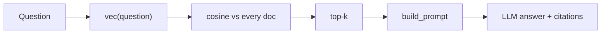

The fastest way to understand a pipeline is to build the smallest version that runs. This topic builds a complete retriever with nothing but the Python standard library, so every number it prints can be checked by hand. It is deliberately crude; each crudeness it exposes is the subject of a later lesson.

## Text as count vectors

Before learned embeddings, the simplest way to turn text into a vector is to count words. Lower-case the text, split it into words, and let each distinct word be one coordinate. "Return an item" becomes a vector with a 1 in the *return*, *an* and *item* coordinates and 0 everywhere else. This is a **bag of words**: order is thrown away, only counts remain.

To compare a query vector $\mathbf{q}$ with a document vector $\mathbf{d}$, use **cosine similarity**, the cosine of the angle between them:

$$
\cos(\mathbf{q}, \mathbf{d}) = \frac{\mathbf{q} \cdot \mathbf{d}}{\lVert \mathbf{q} \rVert \, \lVert \mathbf{d} \rVert} = \frac{\sum_t q_t d_t}{\sqrt{\sum_t q_t^2}\,\sqrt{\sum_t d_t^2}}
$$

where $q_t$ and $d_t$ are the counts of word $t$. It is 1 when the two texts have proportional word counts, 0 when they share no words, and it does not care how long either text is, only about the mix of words.

## The code

```python
import math, re
from collections import Counter

DOCS = {
    "refunds": "Refunds are issued within 14 days of a return being received.",
    "shipping": "Standard shipping takes 3 to 5 business days within the country.",
    "returns": "You can return any item within 30 days if it is unused.",
    "warranty": "Electronics carry a one year warranty against manufacturing defects.",
}

def vec(text):
    return Counter(re.findall(r"[a-z0-9]+", text.lower()))

def cosine(a, b):
    dot = sum(a[t] * b[t] for t in a)
    na = math.sqrt(sum(v * v for v in a.values()))
    nb = math.sqrt(sum(v * v for v in b.values()))
    return dot / (na * nb) if na and nb else 0.0

INDEX = {name: vec(text) for name, text in DOCS.items()}   # offline

def retrieve(question, k=2):                                 # online
    q = vec(question)
    scored = sorted(((cosine(q, v), n) for n, v in INDEX.items()), reverse=True)
    return scored[:k]

for score, name in retrieve("How many days do I have to return an item?"):
    print(f"{score:.3f}  {name}")
```

It prints:

```
0.274  returns
0.191  shipping
```

## Check it by hand

```steps
Scoring the "returns" document
The query has 10 distinct words, each once: *how, many, days, do, i, have, to, return, an, item*. So $\lVert \mathbf{q} \rVert = \sqrt{10} \approx 3.162$.
---
The returns document has 12 distinct words, each once, so $\lVert \mathbf{d} \rVert = \sqrt{12} \approx 3.464$.
---
Shared words: *days, return, item*. Each contributes $1 \times 1$, so $\mathbf{q} \cdot \mathbf{d} = 3$.
---
$\cos = 3 / (3.162 \times 3.464) = 3 / 10.954 = 0.274$. It matches the output.
---
The shipping document (11 words) shares only *to* and *days*: $2 / (\sqrt{10}\sqrt{11}) = 2 / 10.488 = 0.191$. The refunds document shares *days* and *return* and gets exactly the same 0.191; shipping wins the tie only because of alphabetical sorting.
```

That tie is the lesson. To a word counter, sharing the throwaway word *to* is worth as much as sharing *return*. The refunds passage is the more useful second result, and the system could not tell. Real retrievers fix this in two ways, both covered next:

1. **Weight rare words more** than common ones (TF-IDF and BM25), so *return* outweighs *to*.
2. **Compare meanings, not spellings** (dense embeddings), so "send it back" can match "return".

## Finishing the pipeline

Add the prompt builder from the assembling-the-prompt topic and one model call, and you have a full RAG loop: `retrieve` → `build_prompt` → LLM. Everything a production system adds is a better version of one of these three functions: better vectors, a faster and smarter search, and a more careful prompt.



## In practice

This retriever compares the query with **every** document, which is fine for four documents and hopeless for ten million. [Vector Indexes](/learn/retrieval-and-rag/vector-indexes) shows how approximate nearest-neighbour search avoids that full scan. Keep a toy like this around anyway: a 30-line baseline is the right first thing to compare a sophisticated system against, and it is surprising how often keyword overlap is already competitive on product names and error codes.

Now explore the sandbox, where the same loop runs with real components and you can watch which chunks land in the prompt.

```quiz
{"q": "With count vectors, a query has 4 distinct words (each once) and a document has 9 distinct words (each once). They share 2 words. What is the cosine similarity?", "options": ["2/13 ≈ 0.154", "2/6 ≈ 0.333", "2/36 ≈ 0.056", "2/4 = 0.5"], "answer": 1, "explain": "$\\cos = 2 / (\\sqrt{4}\\sqrt{9}) = 2 / (2 \\times 3) = 0.333$. Dividing by $4 + 9$ or $4 \\times 9$ forgets the square roots in the norms."}
```

```quiz
{"q": "In the example, why did the shipping passage tie with the refunds passage?", "options": ["Both have 11 words and share 2 words with the query, and raw counts weight 'to' the same as 'return'", "Cosine similarity favours shorter documents", "The embedding model was not trained on refunds", "Shipping contains the number 5"], "answer": 0, "explain": "Each shares two words with the query and has 11 words, so both score $2 / (\\sqrt{10}\\sqrt{11})$. Bag-of-words gives every shared word equal weight; IDF weighting is the fix."}
```

```sandbox
rag-basic
```
