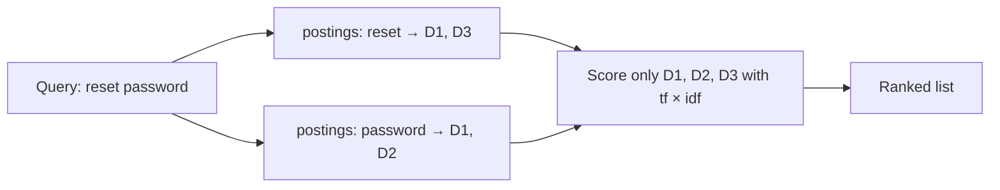

```callout-before
Before you start
You should remember the bag-of-words retriever from the previous lesson and the problem it exposed: the word "to" counted as much as the word "return". Natural logarithms ($\ln$) appear below; a calculator is enough.
```

The index at the back of a textbook does not list pages and the words on them. It lists words and, for each word, the pages it appears on. To find everything about "photosynthesis" you look up one entry instead of reading the book. Search engines are built on exactly this structure, the **inverted index**: a map from each term to the list of documents (a **postings list**) that contain it, usually with how many times.

## Building one

Take a tiny help-centre collection. The text has been lower-cased and common words ("how", "to", "your") removed, which is called **stopword removal**:

| Doc | Tokens | Length |
|---|---|---|
| D1 | reset password account page | 4 |
| D2 | password rules password length password expiry | 6 |
| D3 | reset router wifi | 3 |

The inverted index, with term frequencies in brackets:

| Term | Postings |
|---|---|
| reset | D1 (1), D3 (1) |
| password | D1 (1), D2 (3) |
| account | D1 (1) |
| rules, length, expiry | D2 (1 each) |
| router, wifi | D3 (1 each) |

To answer the query "reset password", the engine reads just two postings lists and only ever touches documents that share at least one term. With ten million documents and a rare query term, that might be a few hundred documents instead of ten million. This is why keyword search is fast, and why the vectors it works with are called **sparse**: each document is a vector over the whole vocabulary, almost all zeros.

## Weighting words: TF and IDF

Two intuitions give a better score than raw overlap:

- **Term frequency (TF)**: a document that mentions a query term more often is probably more about it. Let $\text{tf}(t, D)$ be the count of term $t$ in document $D$.
- **Inverse document frequency (IDF)**: a term that appears in few documents is more informative than one that appears in most. With $N$ documents and $\text{df}(t)$ the number containing $t$:

$$
\text{idf}(t) = \ln \frac{N}{\text{df}(t)}, \qquad
\text{score}(D, Q) = \sum_{t \in Q} \text{tf}(t, D) \cdot \text{idf}(t)
$$

A term in every document gets $\ln 1 = 0$: it cannot tell documents apart, so it contributes nothing. That is the fix for the "to" problem, done automatically instead of with a hand-made stopword list.

```steps
TF-IDF for the query "reset password"
$N = 3$. "reset" is in D1 and D3, so $\text{df} = 2$ and $\text{idf} = \ln(3/2) = 0.405$. "password" is in D1 and D2, so its idf is also $0.405$.
---
D1 has reset ×1 and password ×1: $1 \times 0.405 + 1 \times 0.405 = 0.811$.
---
D2 has password ×3 and no reset: $3 \times 0.405 = 1.216$.
---
D3 has reset ×1: $0.405$.
---
Ranking: **D2 (1.216) > D1 (0.811) > D3 (0.405)**.
```

Look at that ranking critically. The user wants to reset their password, and D1 is the page that does that. D2 is about password *rules*; it wins only because it repeats "password" three times. Raw TF grows without limit, so repetition beats coverage of the query. Long documents also accumulate more counts simply by being long. The next topic, BM25, fixes both problems with two small changes to this formula.



## In practice

Every serious keyword engine (Lucene and the systems built on it, such as Elasticsearch and OpenSearch, and the full-text features of Postgres) is an inverted index underneath, with tokenisation rules (stemming "resetting" to "reset", handling accents and case) that matter as much as the scoring formula. If users search for error codes like `ERR_4012`, check that your tokeniser keeps them as one term; splitting on the underscore quietly destroys the exact-match strength that is the main reason to use keyword search at all.

```quiz
{"q": "A collection has N = 1,000 documents. A term appears in 10 of them. What is its idf, using idf = ln(N/df)?", "options": ["ln(100) ≈ 4.61", "ln(10) ≈ 2.30", "100", "ln(0.01) ≈ −4.61"], "answer": 0, "explain": "$\\ln(1000/10) = \\ln 100 \\approx 4.61$. Inverting the fraction gives a negative weight, which would penalise documents for containing a rare term."}
```

```quiz
{"q": "In the worked example, why does D2 outrank D1 under TF-IDF even though D1 is the better answer?", "options": ["'password' has a higher idf than 'reset'", "Raw term frequency grows without limit, so three mentions of one query term beat one mention of each", "D2 is shorter", "D1 contains stopwords"], "answer": 1, "explain": "Both terms have the same idf (0.405). D2 scores $3 \\times 0.405$ against D1's $0.405 + 0.405$. Nothing in plain TF-IDF says the third 'password' should be worth less than the first, or that matching both query terms matters."}
```
