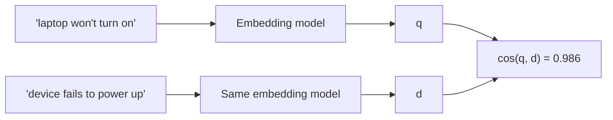

A good librarian does not need you to use the exact words on the book's spine. Ask for "something about why the Roman empire fell" and they hand you a book titled *Decline and Collapse in Late Antiquity*, although it shares none of your words. They matched what you **meant**. **Dense retrieval** gives search that ability by representing every text as a point in a learned space where nearby points have similar meanings.

## From words to a vector of meaning

An **embedding model** (usually a transformer encoder) reads a passage and outputs one vector $\mathbf{e} \in \mathbb{R}^{d}$, often with $d$ = 384, 768, 1024 or more. Unlike the sparse vectors of BM25, which have one coordinate per vocabulary word and are mostly zeros, these vectors are **dense**: every coordinate is a non-zero real number, and no single coordinate means a specific word. Meaning is spread across all of them.

The model is trained so that a question and a passage that answers it end up pointing in similar directions. Retrieval then becomes geometry: embed the query, and return the passages whose vectors are closest to it.

## Cosine similarity, and why direction matters

$$
\cos(\mathbf{q}, \mathbf{d}) = \frac{\mathbf{q} \cdot \mathbf{d}}{\lVert \mathbf{q} \rVert\,\lVert \mathbf{d} \rVert}
$$

Here $\mathbf{q}$ is the query embedding, $\mathbf{d}$ a passage embedding, $\mathbf{q} \cdot \mathbf{d} = \sum_i q_i d_i$ their dot product and $\lVert \cdot \rVert$ the Euclidean length. Cosine ignores vector length and compares only direction, so a long passage and a short one about the same thing score alike.

Most systems **normalise** every vector to length 1 at indexing time. Then $\cos(\mathbf{q}, \mathbf{d}) = \mathbf{q} \cdot \mathbf{d}$ and squared Euclidean distance carries exactly the same ranking:

$$
\lVert \mathbf{q} - \mathbf{d} \rVert^2 = \lVert \mathbf{q} \rVert^2 + \lVert \mathbf{d} \rVert^2 - 2\,\mathbf{q} \cdot \mathbf{d} = 2 - 2\cos(\mathbf{q}, \mathbf{d})
$$

So "maximum inner product", "maximum cosine" and "minimum Euclidean distance" are the same search on unit vectors, which is why vector databases let you choose any of them.

## Worked example: a paraphrase BM25 misses

Query: *"laptop won't turn on"*. Two passages: D1 *"device fails to power up after update"* and D2 *"adjust laptop screen brightness"*. BM25 prefers D2, the only one sharing a word ("laptop"). Now use toy 3-dimensional embeddings (real ones have hundreds of dimensions, but the arithmetic is identical):

```steps
Cosine similarity by hand
$\mathbf{q} = (0.2, 0.9, 0.4)$, $\mathbf{d}_1 = (0.1, 0.8, 0.5)$, $\mathbf{d}_2 = (0.9, 0.1, 0.3)$.
---
Dot products: $\mathbf{q} \cdot \mathbf{d}_1 = 0.02 + 0.72 + 0.20 = 0.94$; $\mathbf{q} \cdot \mathbf{d}_2 = 0.18 + 0.09 + 0.12 = 0.39$.
---
Lengths: $\lVert \mathbf{q} \rVert = \sqrt{0.04 + 0.81 + 0.16} = 1.005$; $\lVert \mathbf{d}_1 \rVert = \sqrt{0.01 + 0.64 + 0.25} = 0.949$; $\lVert \mathbf{d}_2 \rVert = \sqrt{0.81 + 0.01 + 0.09} = 0.954$.
---
$\cos(\mathbf{q}, \mathbf{d}_1) = 0.94 / (1.005 \times 0.949) = 0.986$ and $\cos(\mathbf{q}, \mathbf{d}_2) = 0.39 / (1.005 \times 0.954) = 0.407$.
---
Dense retrieval ranks the power-failure passage first, with no words in common with the query. BM25 would have ranked the brightness passage first because of "laptop".
```



## Where dense retrieval fails

Dense retrieval is not a strict upgrade. Its typical failures are the mirror image of BM25's strengths:

- **Exact identifiers.** "Error E-4012" and "Error E-4021" embed almost identically; the vector does not preserve which digits appeared. BM25 matches the exact token.
- **Rare names and new jargon** the embedding model never saw in training: it maps them to a vague region near similar-looking words.
- **Negation and fine constraints**: "flights *not* via Frankfurt" sits close to "flights via Frankfurt".
- **Domain shift**: a model trained on web questions may embed legal or medical text poorly. Always evaluate on your own data.

## In practice

Embed queries and documents with the **same model and the same preprocessing**, and follow the model's instructions about prefixes: some models expect "query:" and "passage:" markers and lose several points of recall without them. Normalise vectors once at indexing time. Choose $d$ with memory in mind: 10 million 1024-dimensional float32 vectors take $10^7 \times 1024 \times 4 \approx 41$ GB before any index overhead, a number that drives the next lesson.

```quiz
{"q": "Two unit-length embeddings have cosine similarity 0.8. What is their squared Euclidean distance?", "options": ["0.2", "0.4", "1.6", "0.64"], "answer": 1, "explain": "For unit vectors $\\lVert q - d \\rVert^2 = 2 - 2\\cos = 2 - 1.6 = 0.4$. Answering 0.2 uses $1 - \\cos$; 1.6 is $2\\cos$."}
```

```quiz
{"q": "Users search an IT knowledge base for exact error codes like 'KB-30871'. Dense retrieval often returns articles for neighbouring codes. Why?", "options": ["The vectors are not normalised", "Embeddings capture overall meaning and barely distinguish strings that differ in a few characters, so nearby codes look almost identical", "Cosine similarity cannot handle numbers", "The index is too small"], "answer": 1, "explain": "An embedding compresses a passage into a meaning vector; 'KB-30871' and 'KB-30817' mean nearly the same thing to it. Exact-token matching (BM25) is the right tool, which is why hybrid search exists."}
```
