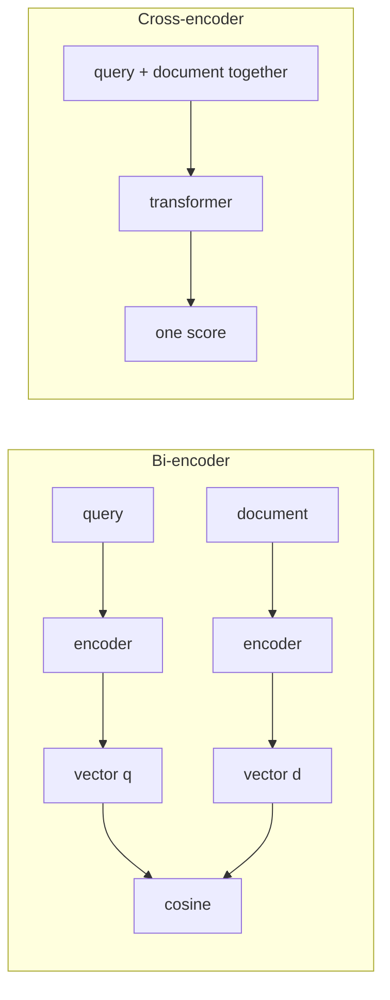

There are two ways to judge whether a CV fits a job advert. You can summarise every CV into a one-line profile once, file the profiles, and later compare any advert's profile against the file in a second. Or you can sit down and read the advert and one CV side by side, which is far more accurate and takes minutes per CV. The first is a **bi-encoder**; the second is a **cross-encoder**. Search systems need both, in different places.

## The two architectures

A **bi-encoder** (also called a dual encoder) runs the query and each document through the encoder *separately* and compares the two resulting vectors:

$$
s_{\text{bi}}(q, d) = \cos\big(f(q),\, g(d)\big)
$$

where $f$ and $g$ are the query and document encoders (often the same network). Because $g(d)$ does not depend on the query, every document vector is computed **once, offline**, and stored in an index.

A **cross-encoder** concatenates query and document into one input, `[CLS] query [SEP] document`, lets every query token attend to every document token inside the transformer, and outputs a single relevance score:

$$
s_{\text{cross}}(q, d) = h\big(\text{Transformer}([q; d])\big)
$$

Nothing can be precomputed, because the score depends on the pair. The upside is accuracy: the model sees exactly which query words the document does and does not satisfy, including negation and fine details that a single pooled vector blurs away.



## The cost arithmetic

Let the collection have $N$ documents. Suppose embedding one query takes $t_q = 20$ ms, one cross-encoder pass takes $t_x = 2$ ms of GPU time per (query, document) pair when batched, and ANN search over precomputed vectors takes $t_s = 10$ ms.

| Strategy | Work per query | Time |
|---|---|---|
| Cross-encoder on all $N = 10^6$ documents | $N$ transformer passes | $10^6 \times 2\text{ ms} = 2{,}000$ s, about 33 minutes |
| Bi-encoder (vectors precomputed) | 1 query embedding + ANN search | $20 + 10 = 30$ ms |
| Bi-encoder to top 50, then cross-encoder on those 50 | 30 ms + 50 passes | $30 + 50 \times 2 = 130$ ms |

Scoring everything with the cross-encoder is $2000 / 0.03 \approx 67{,}000$ times slower than the bi-encoder, so it is impossible as a first stage. But reranking just 50 candidates costs 100 ms extra, which is affordable. This is the standard architecture: **retrieve with a bi-encoder (and BM25) for recall, then rerank with a cross-encoder for precision.** The mechanics of choosing $N$ and $k$ are in [Hybrid Search and Reranking](/learn/retrieval-and-rag/hybrid-and-reranking).

## Why the cross-encoder is more accurate

A bi-encoder must squeeze a whole passage into one vector before it knows what question will be asked. A passage saying "Refunds are not available for monthly plans" and one saying "Refunds are available for annual plans" differ in a few words, and their vectors are nearly identical. A cross-encoder reading the query "can I get a refund on my monthly plan?" together with each passage can attend from "monthly" in the query to "monthly" in the passage and see the "not". That pairwise interaction is what a single vector cannot store.

```callout-note
Late interaction sits in between
Models in the ColBERT family keep one vector *per token* instead of one per document and score with a cheap token-by-token match (MaxSim). They precompute document vectors like a bi-encoder, get some of the cross-encoder's fine-grained matching, and pay for it with a much larger index (hundreds of vectors per document instead of one).
```

## In practice

Bi-encoder models are small (tens to hundreds of millions of parameters) and cheap to run for queries; cross-encoder rerankers are similar in size but run once per candidate, so their cost scales with the number of candidates. Hosted rerank APIs charge per document scored. A cross-encoder's score is not a calibrated probability and is not comparable across queries, so use it to *order* candidates, and use a threshold only after checking its distribution on your own labelled data.

```quiz
{"q": "A cross-encoder takes 2 ms per (query, document) pair. You rerank the top 40 candidates from a bi-encoder search that took 30 ms. What is the approximate total retrieval time?", "options": ["32 ms", "110 ms", "80 ms", "2,030 ms"], "answer": 1, "explain": "$30 + 40 \\times 2 = 110$ ms. 80 ms forgets the first-stage search; 2,030 ms would be scoring a million documents, not forty."}
```

```quiz
{"q": "Why can a bi-encoder precompute document representations but a cross-encoder cannot?", "options": ["Cross-encoders are larger models", "A cross-encoder's score depends on the query and document jointly, so no query-independent document representation exists", "Cross-encoders do not use transformers", "Bi-encoders ignore the query"], "answer": 1, "explain": "In a bi-encoder $g(d)$ depends only on $d$. A cross-encoder processes $[q; d]$ as one input, so its internal states mix both. Model size is not the reason."}
```
