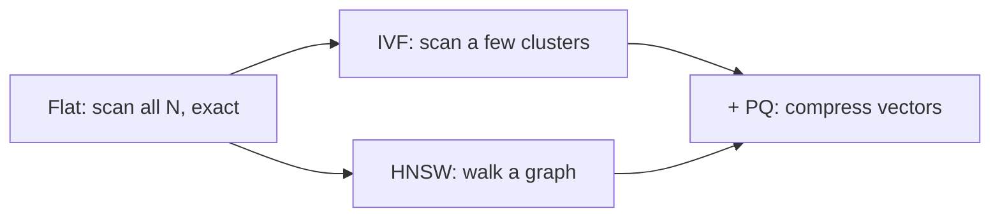

```callout-before
Before you start
You should know that an embedding is a vector of $d$ numbers and that retrieval returns the stored vectors most similar to a query vector. Bytes and big-O estimates are used.
```

The honest way to find the nearest neighbours of a query is to measure the distance to every stored vector and keep the best $k$. This is **exact** or **brute-force** search, called a **flat index** in most libraries. It is simple, has no tuning knobs, and always returns the true nearest neighbours, so it is also the **ground truth** against which every approximate method is graded. The question is only whether you can afford it.

## The cost model

With $N$ stored vectors of dimension $d$, one query needs a dot product against each one. Each dot product is $d$ multiplications and about $d$ additions:

$$
\text{work per query} \approx 2\,N\,d \ \text{FLOPs}, \qquad \text{memory} = N \cdot d \cdot b \ \text{bytes}
$$

where $b$ is bytes per number (4 for float32, 2 for float16, 1 for int8). Selecting the top $k$ from $N$ scores adds a small $O(N \log k)$ term.

```steps
Worked example: 10 million vectors
$N = 10^7$ vectors, $d = 768$, float32 ($b = 4$).
---
Memory: $10^7 \times 768 \times 4 = 3.07 \times 10^{10}$ bytes $= 30.7$ GB. It must all be read for every query.
---
Arithmetic: $2 \times 10^7 \times 768 = 1.54 \times 10^{10}$ FLOPs per query. A single CPU core doing roughly $5 \times 10^{10}$ FLOP/s needs about 0.3 s.
---
Memory traffic: reading 30.7 GB at an illustrative 20 GB/s of memory bandwidth takes about 1.5 s. Search is memory-bound, so 1.5 s per query per core is the realistic figure.
---
At 100 queries per second that is 150 cores busy doing nothing but scanning. Adding batching and a GPU improves this by an order of magnitude, but the cost is still linear in $N$.
```

The cost grows linearly in both $N$ and $d$. Doubling the collection or the embedding width doubles the work. At $N = 10^4$ (10,000 chunks, $d$ = 768) a query is $2 \times 10^4 \times 768 \approx 1.5 \times 10^7$ FLOPs, under a millisecond: flat search is the right answer for small collections.

| Vectors $N$ | Memory (float32, $d=768$) | Time per query (memory-bound, 20 GB/s) | Verdict |
|---|---|---|---|
| $10^4$ | 31 MB | 1.5 ms | Flat is fine |
| $10^5$ | 307 MB | 15 ms | Flat is fine |
| $10^6$ | 3.07 GB | 154 ms | Borderline |
| $10^7$ | 30.7 GB | 1.5 s | Needs an ANN index |
| $10^8$ | 307 GB | 15 s | ANN plus compression |

## Approximate nearest neighbours

The way out is to give up the guarantee. An **approximate nearest-neighbour (ANN)** index returns neighbours that are *probably* the true ones while examining only a tiny fraction of the data. Quality is measured as **recall@k against exact search**:

$$
\text{recall@}k = \frac{\lvert \text{ANN top-}k \,\cap\, \text{exact top-}k \rvert}{k}
$$

If exact search returns 10 neighbours and the ANN index returns 9 of the same 10 (plus one different), recall@10 is 0.9. This is *index* recall, a different thing from the *retrieval* recall of the previous lessons, which asks whether a relevant document is found. A 0.95-recall index of a retriever with 0.80 hit rate loses at most about 5% of its neighbours, not 5% of answers: many missed neighbours are the borderline ones.



The next topics build these three tools: IVF partitions, HNSW graphs and product quantisation.

## In practice

Do not skip the flat baseline. Build one on a sample of your data and use it as ground truth to measure the recall of every approximate index you try, otherwise "recall" is a number you cannot compute. Many production RAG systems have under a million chunks and run a flat index (or an HNSW with high settings) comfortably in memory. Move to compression and sharding only when the memory arithmetic above forces you.

```quiz
{"q": "How much memory do 50 million float32 vectors of dimension 1,024 need?", "options": ["About 51 GB", "About 205 GB", "About 51 MB", "About 410 GB"], "answer": 1, "explain": "$5 \\times 10^7 \\times 1024 \\times 4 = 2.05 \\times 10^{11}$ bytes, about 205 GB. 51 GB would be 1 byte per number; 410 GB uses 8 bytes."}
```

```quiz
{"q": "Exact search over a collection takes 40 ms. The collection grows 5x and you move to d twice as wide. Roughly what is the new exact-search time?", "options": ["80 ms", "200 ms", "400 ms", "40 ms"], "answer": 2, "explain": "Cost is proportional to $N \\cdot d$: $40 \\times 5 \\times 2 = 400$ ms. Forgetting the dimension gives 200 ms."}
```
