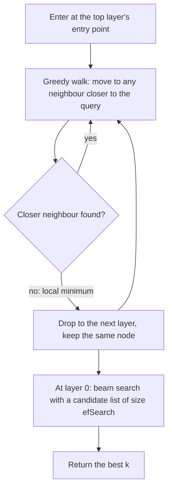

To get across an unfamiliar country you do not walk every road. You take a plane to roughly the right region, a train to the right city, then walk the last few streets. **HNSW** (Hierarchical Navigable Small World) builds exactly that for vectors: a stack of graphs where the top layers have few nodes and long jumps, and the bottom layer holds every vector with short, precise links.

## Structure

Every vector is a node. Each node is linked to its approximate nearest neighbours by edges. The graph has layers $0, 1, 2, \dots$:

- **Layer 0** contains all $N$ nodes, each with up to $2M$ links.
- Each higher layer contains a random sample of the layer below. A node is promoted to layer $\ell$ and above with probability $M^{-\ell}$ (the standard choice makes the expected number of links per node comparable at every layer).
- Upper layers have up to $M$ links per node.

$M$ is the main structural parameter: the number of links per node on upper layers (typically 8 to 64).

```steps
Worked example: how many nodes per layer
$N = 10^6$ and $M = 16$. A node reaches layer $\ell$ or above with probability $16^{-\ell}$.
---
Layer 1 holds about $10^6 / 16 = 62{,}500$ nodes; layer 2 about $3{,}906$; layer 3 about $244$; layer 4 about $15$; layer 5 about $1$.
---
So the top layer is around $\log_{16} 10^6 = \ln 10^6 / \ln 16 \approx 13.8 / 2.77 \approx 5$. The number of layers grows like $\log_M N$.
```

## Search



On layers above 0 the search is a simple greedy walk: hop to whichever neighbour is closest to the query until no neighbour improves, then descend. At layer 0 the algorithm keeps a candidate list of size **efSearch** ($ef$): it repeatedly expands the best unexplored candidate, adds its neighbours, and stops when the closest unexplored candidate is worse than the worst of the $ef$ best found. Larger $ef$ explores more, and finds more of the true neighbours.

## Why it is roughly logarithmic

Each upper layer reduces the remaining distance by a roughly constant factor, so reaching the right neighbourhood takes $O(\log N)$ hops, each looking at at most $M$ neighbours. The final beam search at layer 0 touches on the order of $ef \cdot M$ nodes. Distance computations per query are therefore roughly

$$
\text{distances} \approx M \cdot (c \cdot ef + \ln N)
$$

with a small constant $c$ (the sim uses $c = 1.5$). Look at what is absent: $N$ appears only inside a logarithm.

For $M = 16$, $ef = 64$, $N = 10^6$: $16 \times (1.5 \times 64 + 13.8) = 16 \times 109.8 \approx 1{,}757$ distances, against $10^6$ for exact search: about $570\times$ fewer. Multiplying $N$ by 100 to $10^8$ changes $\ln N$ from 13.8 to 18.4, so the count moves from 1,757 to $16 \times (96 + 18.4) = 1{,}831$: barely 4% more work for a 100x larger collection. (In real hardware, caches and memory latency add to this, so latency does rise with $N$, but gently.)

## The parameters

| Parameter | Set when | Effect of raising it | Cost |
|---|---|---|---|
| $M$ | build | Better graph connectivity, higher recall ceiling | Memory and build time grow with $M$ |
| efConstruction | build | Higher-quality graph | Slower build |
| efSearch ($ef$) | query | More candidates explored, higher recall | Latency grows about linearly in $ef$ |

Memory: each vector needs its $d \cdot b$ bytes plus links. Layer 0 stores about $2M$ neighbour IDs of 4 bytes each. For $M = 16$ that is $2 \times 16 \times 4 = 128$ bytes per vector on top of $768 \times 4 = 3{,}072$ bytes for the vector, about 4% overhead. For $M = 64$ it is 512 bytes, about 17%. Upper layers add a small extra amount.

## See it

```sim
hnsw-recall
{"index": "hnsw", "vectors": 1000000, "dim": 768, "M": 16, "efSearch": 64}
```

Start with $ef = 10$ and double it repeatedly (10, 20, 40, 80, 160): recall@10 rises steeply and then flattens while latency keeps growing. Find the knee, the $ef$ where another doubling buys less than one point of recall. Then lower $M$ to 8 and see how the recall curve shifts down and memory shrinks. Finally switch to Flat and compare latency.

## In practice

HNSW is the default ANN index in most vector databases because it combines high recall (often above 0.95) with low latency and no clustering step. Its costs are memory (the whole graph and vectors normally live in RAM), slow bulk builds, and awkward deletes: removing a node leaves holes in the graph, so many systems mark nodes deleted and rebuild periodically. Typical starting points are $M = 16$, efConstruction between 100 and 200, and efSearch between 50 and 200, tuned against a recall target on your data.

```quiz
{"q": "With a standard HNSW promotion probability of M^(-l) and M = 8, roughly how many nodes sit on layer 2 or above in a collection of 640,000?", "options": ["10,000", "80,000", "5,000", "640"], "answer": 0, "explain": "Probability $8^{-2} = 1/64$, so $640{,}000/64 = 10{,}000$. 80,000 is the layer-1 count ($640{,}000/8$)."}
```

```quiz
{"q": "Your HNSW recall@10 is 0.88 and you need 0.95 without rebuilding. Which change fits?", "options": ["Raise M", "Raise efSearch, accepting higher latency", "Lower the embedding dimension", "Raise efConstruction"], "answer": 1, "explain": "efSearch is a query-time parameter: a larger candidate list explores more of the graph. M and efConstruction shape the graph at build time and would need a rebuild."}
```

```lab
tune-the-index
```
