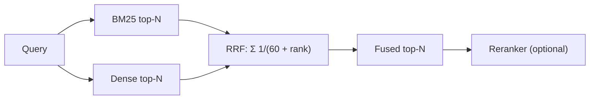

Two doctors examine a patient. One is excellent at spotting rare, specific conditions from exact symptoms; the other is excellent at recognising the general pattern behind vague complaints. When they agree, you trust the diagnosis. When they disagree, you want a sensible way to combine their opinions. **Hybrid search** does this for retrieval: run a keyword retriever (BM25) and a dense retriever side by side, and merge their results.

Each family covers the other's weakness. BM25 nails exact codes, names and rare terms but misses paraphrases; dense retrieval handles paraphrase but blurs identifiers. A query log from any real product contains both kinds, so a fusion is usually better than either alone on the average query.

## The scale problem

The obvious merge, adding the two scores, does not work. BM25 scores are unbounded and depend on query length and corpus statistics (a good match might score 14.2); cosine similarities live between $-1$ and $1$ and cluster in a narrow band (a good match might score 0.83). Adding them lets BM25 dominate. You must **normalise** first, for example with min-max scaling over each list's returned scores.

```steps
Worked example: weighted score fusion
Three documents. BM25 scores: D1 = 12.0, D2 = 6.0, D3 = 3.0. Cosine scores: D1 = 0.62, D2 = 0.80, D3 = 0.55.
---
Min-max normalise each list: $x' = (x - \min)/(\max - \min)$. BM25: D1 $= (12-3)/9 = 1.00$, D2 $= (6-3)/9 = 0.33$, D3 $= 0$. Cosine: D1 $= (0.62-0.55)/0.25 = 0.28$, D2 $= 1.00$, D3 $= 0$.
---
Fuse with weight $\alpha = 0.5$: $s = \alpha\, s'_{\text{bm25}} + (1-\alpha)\, s'_{\text{dense}}$. D1 $= 0.5 + 0.14 = 0.64$; D2 $= 0.167 + 0.5 = 0.667$; D3 $= 0$.
---
D2 narrowly beats D1. Change $\alpha$ to 0.6 and D1 ($0.6 + 0.112 = 0.712$) beats D2 ($0.2 + 0.4 = 0.6$). The ranking flips on a tuning parameter, and min-max also depends on which documents happened to be returned.
```

Weighted fusion works when tuned on labelled data, but it is fragile: the normalisation changes with the query and the candidate set.

## Reciprocal Rank Fusion

**Reciprocal Rank Fusion (RRF)** sidesteps scores completely and uses only **ranks**. Each retriever contributes $1/(k + \text{rank})$ for every document it returns, and contributions are summed:

$$
\text{RRF}(d) = \sum_{r \in R} \frac{1}{k + \text{rank}_r(d)}
$$

Here $R$ is the set of ranked lists, $\text{rank}_r(d)$ is the 1-based position of document $d$ in list $r$ (the document contributes nothing if absent), and $k$ is a constant, conventionally **60**. A high rank gives a large contribution; appearing in several lists adds up. The constant $k$ keeps the first place from swamping the rest: with $k = 60$ rank 1 is worth $1/61 = 0.01639$ and rank 4 is worth $1/64 = 0.01563$, only 4.7% less.

```steps
Worked example: RRF with k = 60
BM25 returns: D3, D1, D5, D2 (ranks 1 to 4). Dense returns: D1, D4, D3, D2 (ranks 1 to 4).
---
D1: rank 2 in BM25 and rank 1 in dense: $\frac{1}{62} + \frac{1}{61} = 0.01613 + 0.01639 = 0.03252$.
---
D3: rank 1 and rank 3: $\frac{1}{61} + \frac{1}{63} = 0.01639 + 0.01587 = 0.03227$. D2: rank 4 in both: $\frac{1}{64} + \frac{1}{64} = 0.03125$.
---
D4: only in dense at rank 2: $1/62 = 0.01613$. D5: only in BM25 at rank 3: $1/63 = 0.01587$.
---
Fused order: **D1 (0.0325), D3 (0.0323), D2 (0.0313), D4 (0.0161), D5 (0.0159)**. The three documents both retrievers found fill the top; those found by one retriever follow.
```



Why RRF is the default: it needs no score normalisation, no tuning data, handles any number of retrievers, and is very hard to break. Its weaknesses are that it ignores how *confident* each retriever was (a runaway first place counts as little as a close one) and that small $k$ makes it sensitive to the top ranks.

## See it

```sim
retrieval-compare
{"preset": "e42", "method": "hybrid", "k": 3}
```

The default query is an exact error code, where BM25 shines and the toy embedding fails. Compare the three methods' mean recall over all six labelled queries (shown by the sim): each single method fails on different queries, and the hybrid recovers most of both. Then pick the paraphrase presets ("how do I get my money back", "does it work without wifi") and watch the roles reverse.

## In practice

Retrieve about 50 to 100 candidates from each retriever, fuse with RRF, and hand the top 50 to a reranker. Many vector databases and search engines now offer hybrid queries with RRF built in. Weighted fusion is worth the effort only if you have a labelled set to tune $\alpha$ and a stable score distribution. A frequent mistake is to fuse before the lists share a document identity: two retrievers must return the same ID for the same chunk, otherwise duplicates split their votes.

```quiz
{"q": "With k = 60, a document is ranked 1st by retriever A and not returned by retriever B. Another document is ranked 5th by both. Which has the higher RRF score?", "options": ["The first: 1/61 = 0.01639", "The second: 2/65 = 0.03077", "They tie", "Cannot be determined without the raw scores"], "answer": 1, "explain": "The second document scores $2 \\times 1/65 = 0.0308$, almost twice the first. RRF rewards agreement across retrievers; no raw scores are needed."}
```

```quiz
{"q": "Why can't you add a raw BM25 score and a raw cosine similarity?", "options": ["Cosine similarity is always negative", "They live on different scales, so the BM25 score would dominate unless both are normalised", "BM25 is not a similarity", "Dense scores are integers"], "answer": 1, "explain": "A BM25 score of 14 and a cosine of 0.83 differ by an order of magnitude in range, and BM25's range depends on the query. RRF avoids the problem by using ranks only."}
```
