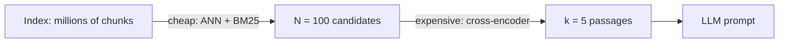

A hiring team screens 2,000 CVs with a quick keyword filter and cuts them to 50. Then a senior person reads those 50 carefully and picks the best five to interview. The quick filter is cheap and generous (it must not lose good candidates); the careful read is expensive and sharp (it decides the order). **Reranking** is that second stage: a slow, accurate model rescoring the short list that fast retrieval produced.

## The funnel

First-stage retrieval (BM25, dense, or a hybrid) returns the top $N$, often 50 to 200, tuned for **recall**. A **cross-encoder** reranker scores each (query, candidate) pair jointly, as described in [Bi-encoders and cross-encoders](/learn/retrieval-and-rag/sparse-and-dense), and you keep the top $k$ (typically 3 to 8) for the prompt, tuned for **precision**.



## Why it improves accuracy

The gain can be written as a product, in the style of the earlier accuracy equation. The relevant passage must (1) be among the $N$ candidates and (2) be placed in the top $k$ by the reranker:

$$
\text{recall@}k_{\text{reranked}} \approx \text{recall@}N_{\text{first stage}} \times P(\text{top-}k \mid \text{in candidates})
$$

```steps
Worked example: what reranking buys
The first stage alone puts the answer in its top 5 for 70% of queries: $\text{recall@5} = 0.70$.
---
Its top 50 contains the answer for 92% of queries: $\text{recall@50} = 0.92$. This is the ceiling reranking cannot exceed.
---
The reranker puts the answer in its top 5 on 92% of the queries where it was a candidate: $P = 0.92$.
---
Reranked $\text{recall@5} \approx 0.92 \times 0.92 = 0.846$, up from 0.70: a 14.6-point gain. Raising $N$ to 100 might lift the ceiling to 0.95, but the reranker's own accuracy limits the result to $0.95 \times 0.92 = 0.874$.
```

So two quantities matter and they trade differently: a bigger $N$ raises the ceiling at linear cost; a better reranker raises the conditional term.

## Latency and cost

A transformer forward pass costs about $2P$ FLOPs per token for a model with $P$ parameters. To score one pair of length $T$ tokens costs $2PT$ FLOPs, and reranking $N$ candidates costs $N$ times that. With hardware delivering $F$ effective FLOP/s:

$$
t_{\text{rerank}} \approx \frac{2\,P\,T\,N}{F}
$$

```steps
Worked example: latency for N = 100
A reranker with $P = 1.1 \times 10^8$ parameters, pairs of $T = 350$ tokens (300-token passage plus the query), $N = 100$, and a GPU delivering an effective $F = 5 \times 10^{13}$ FLOP/s.
---
One pair: $2 \times 1.1\times10^8 \times 350 = 7.7 \times 10^{10}$ FLOPs. For 100 pairs: $7.7 \times 10^{12}$ FLOPs.
---
$t \approx 7.7 \times 10^{12} / 5 \times 10^{13} = 0.154$ s, **about 154 ms**. At $N = 50$ it is about 77 ms; at $N = 200$ about 308 ms.
---
Compare the first stage at about 30 ms: at $N = 100$ the reranker is five times the cost of retrieval. Latency is linear in $N$ and in passage length $T$.
```

Doubling $N$ doubles rerank latency (and API cost, where hosted rerankers bill per document), while recall@$N$ grows with sharply diminishing returns. That is the whole trade-off: find the $N$ where the next doubling buys under a point of recall.

## See it

```sim
rerank-depth
{"candidates": 50, "k": 5, "firstStage": "dense", "rerankerAuc": 0.97, "msPerDoc": 2}
```

Raise the number of candidates from 5 up to 200 and watch the reranked recall curve rise, flatten and level off while latency keeps climbing in a straight line. Find the knee. Then lower the reranker quality (AUC) to 0.85 and see how the curve changes: a weaker reranker both lowers recall and makes a large $N$ less valuable, because it cannot find the needle in a bigger haystack. Finally switch the first stage from dense to hybrid and compare the ceiling.

## In practice

Hosted reranking APIs and open cross-encoders (families such as bge-reranker or ms-marco MiniLM models) are the usual choices; an LLM can also act as a listwise reranker, at far higher cost and latency. Truncate candidates to what the reranker accepts (often 512 tokens). Always keep a recall@$N$ measurement: if the answer is missing from the first-stage top $N$, no reranker can recover it, and the fix is in retrieval or chunking. A typical production funnel is $N = 50$ to $100$, $k = 3$ to $8$, with the reranker adding 50 to 200 ms.

```quiz
{"q": "recall@50 of the first stage is 0.90 and the reranker places the answer in its top 5 for 85% of the cases where it is a candidate. Estimate reranked recall@5.", "options": ["0.90", "0.85", "0.765", "0.95"], "answer": 2, "explain": "$0.90 \\times 0.85 = 0.765$. The ceiling (0.90) cannot be exceeded and the reranker's conditional accuracy multiplies it down."}
```

```quiz
{"q": "Rerank latency is 80 ms at N = 40. You raise N to 120 and double the passage length. Roughly what is the new latency (linear in N and T)?", "options": ["240 ms", "480 ms", "160 ms", "960 ms"], "answer": 1, "explain": "Latency scales with $N \\times T$: $80 \\times 3 \\times 2 = 480$ ms. 240 ms forgets the longer passages."}
```
