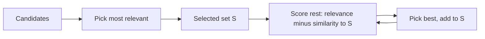

Ask five friends for restaurant recommendations and, if they all just repeat the same famous place, you have learned one fact five times. A retriever has the same problem. The five most similar passages to a query are often near-duplicates of each other: the same paragraph in three versions of a document, or consecutive overlapping chunks. They fill the prompt with one fact and crowd out a second fact the answer also needs.

## Maximal marginal relevance

**Maximal marginal relevance (MMR)** selects passages one at a time, balancing relevance to the query against similarity to what has already been selected:

$$
\text{MMR} = \arg\max_{d \in C \setminus S} \Big[\, \lambda \,\text{sim}(d, q) \;-\; (1-\lambda)\, \max_{d' \in S} \text{sim}(d, d') \,\Big]
$$

Here $C$ is the candidate set, $S$ the passages already selected, $q$ the query, $\text{sim}$ a similarity such as cosine, and $\lambda \in [0,1]$ the trade-off. $\lambda = 1$ is plain top-$k$ by relevance; smaller $\lambda$ penalises redundancy more strongly. The first pick is always the most relevant passage, since $S$ is empty.

```steps
Worked example: a near-duplicate loses
Three candidates. Similarity to the query: $d_1 = 0.90$, $d_2 = 0.88$, $d_3 = 0.70$. Pairwise: $\text{sim}(d_1, d_2) = 0.95$ (a near-duplicate), $\text{sim}(d_1, d_3) = 0.20$. Use $\lambda = 0.7$.
---
Pick 1: the most relevant, $d_1$ (score $0.7 \times 0.90 = 0.63$, with nothing to penalise).
---
Pick 2, candidate $d_2$: $0.7 \times 0.88 - 0.3 \times 0.95 = 0.616 - 0.285 = 0.331$.
---
Pick 2, candidate $d_3$: $0.7 \times 0.70 - 0.3 \times 0.20 = 0.490 - 0.060 = 0.430$.
---
$d_3$ wins. Plain top-2 would have returned $d_1, d_2$ (the same fact twice). MMR returns $d_1, d_3$: two different facts. With $\lambda = 1$ the penalty vanishes and $d_2$ (0.88) beats $d_3$ (0.70) again.
```



## Other ways to remove redundancy

- **Deduplicate at indexing time**: hash normalised text and drop exact duplicates; use MinHash or embedding similarity above a threshold (say 0.95) to catch near-duplicates such as versioned documents.
- **Merge adjacent chunks**: if chunks 12 and 13 of the same document are both retrieved, send them as one passage in order, saving the repeated overlap tokens.
- **Limit per source**: allow at most $m$ passages from any one document so one long file cannot fill the context.
- **Prefer the newest version**: for versioned documents, keep a version field and filter or boost on it.

## In practice

MMR costs $O(k \cdot |C|)$ similarity computations on already-retrieved vectors, which is negligible next to retrieval itself. Use it when queries need several different facts (summaries, comparisons, multi-part questions) and when the corpus has lots of near-duplicates. Do not use it blindly on single-fact lookups: it may swap the best passage's close sibling, which contained a needed detail, for a less relevant but different one. A common setting is $\lambda$ between 0.5 and 0.8; tune it on your labelled questions, measuring both recall@$k$ and answer correctness. Also remember that overlapping chunks (next lesson) create redundancy by design, so MMR and chunk merging are the usual companions of an overlap setting.

```quiz
{"q": "With lambda = 1 in MMR, what does it select?", "options": ["The most diverse passages", "The top-k by similarity to the query alone, exactly like plain retrieval", "Random passages", "Only the single most relevant passage"], "answer": 1, "explain": "At $\\lambda = 1$ the redundancy term is multiplied by $(1-\\lambda) = 0$, leaving only $\\text{sim}(d,q)$. Lower $\\lambda$ values weight diversity more."}
```

```quiz
{"q": "Candidates: relevance to query d1 = 0.9, d2 = 0.8. sim(d1,d2) = 0.9. After picking d1 and with lambda = 0.5, what is d2's MMR score?", "options": ["0.40 - 0.45 = -0.05", "0.45", "0.85", "0.72"], "answer": 0, "explain": "$0.5 \\times 0.8 - 0.5 \\times 0.9 = 0.40 - 0.45 = -0.05$. It is negative: a near-duplicate of something already chosen is worse than nothing at this $\\lambda$."}
```
