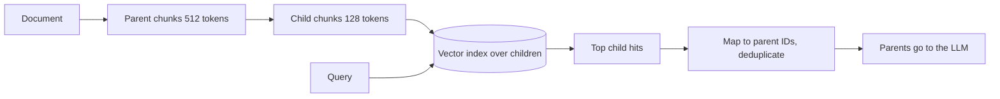

The best size for *finding* a passage and the best size for *reading* it are different. A small chunk has a sharp vector that matches a specific question well. A large chunk gives the model the surrounding explanation it needs to answer correctly. Rather than compromise, two techniques decouple the two sizes: **parent-child retrieval** and **contextual chunks**.

## Parent-child (small-to-big) retrieval

Index small **child** chunks (say 128 tokens) for search, but give the model the larger **parent** each child belongs to (a 512-token section, or the whole page). Every child stores the ID of its parent; at query time you search children, map hits to parents, remove duplicates and put the parents in the prompt.



```steps
Worked example: tokens in the prompt
The top 5 child hits belong to parents $[P_1, P_1, P_2, P_1, P_3]$. Parent size $512$, child size $128$.
---
Child-only context: $5 \times 128 = 640$ tokens: cheap, but each piece may lack surrounding context.
---
Naive parents (one per hit): $5 \times 512 = 2{,}560$ tokens, with $P_1$ repeated three times.
---
Deduplicated parents: unique $\{P_1, P_2, P_3\}$, so $3 \times 512 = 1{,}536$ tokens. Three child hits agreeing on $P_1$ is also useful evidence: you can rank parents by the sum or maximum of their children's scores.
```

The trade-off is explicit: parent-child costs $\text{(unique parents)} \times s_{\text{parent}}$ tokens instead of $k \times s_{\text{child}}$, here $2.4\times$ as many. In exchange the retriever works with precise vectors and the generator reads complete passages. A variant, **sentence-window retrieval**, indexes single sentences and returns each hit with the $w$ sentences on either side.

## Contextual chunks

A chunk often becomes ambiguous when cut from its document: "The company's revenue grew 3% over the previous quarter." Which company, which quarter? **Contextual chunking** asks an LLM, once per chunk at indexing time, to write a one- or two-sentence description of where the chunk fits in the whole document, and prepends it to the chunk before embedding and BM25 indexing:

```
Context: This passage is from ACME Corp's Q2 2024 earnings report.
The company's revenue grew 3% over the previous quarter.
```

The generated context restores the missing "who and when", so both the vector and the keywords match queries like "ACME Q2 2024 revenue growth".

The price is one LLM call per chunk. With the document in the prompt each time, naive cost is high, but **prompt caching** makes the repeated document prefix cheap.

```steps
Worked example: cost of contextualising 350,000 chunks
Per call: document prefix $3{,}000$ tokens, the chunk $512$ tokens, generated context $80$ tokens. Illustrative prices: \$3 per million input tokens, \$15 per million output, cached reads at 10% of the input price.
---
Without caching: $3000 \times 3/10^6 = \$0.00900$, plus chunk $512 \times 3/10^6 = \$0.00154$, plus output $80 \times 15/10^6 = \$0.00120$. Total \$0.01174 per chunk, so $350{,}000 \times 0.01174 = \$4{,}108$.
---
With the 3,000-token document served from cache: $3000 \times 0.3/10^6 = \$0.00090$ in place of \$0.00900. Total \$0.00364 per chunk, so $350{,}000 \times 0.00364 = \$1{,}273$: about 3.2 times cheaper.
---
This is a one-off indexing cost (repeated only for changed documents). Decide whether the retrieval gain justifies it by measuring recall@k with and without context on your labelled questions.
```

## Other enrichment worth knowing

- **Document summaries or titles** prepended to each chunk: cheaper than a per-chunk LLM call and often most of the benefit.
- **Hypothetical questions**: generate 2 to 3 questions each chunk answers and index those too, so user questions match question-shaped text. Costs more embeddings, helps paraphrase-heavy queries.
- **Metadata fields** (product, version, date, audience): used for filters, not embedded.

## In practice

Start simple: structure-aware chunks plus heading paths. Add parent-child retrieval when your answers need surrounding explanation (policies with exceptions, procedures with preconditions). Add contextual chunks when failures show ambiguous chunks, which you find in error analysis, not by guessing. Each technique adds an indexing step to version and a failure mode to monitor: parents out of sync with children after a partial update is a classic one.

```quiz
{"q": "Top 6 child hits map to parents [A, B, A, A, C, B]. Parents are 600 tokens each. How many parent tokens go into the prompt after deduplication?", "options": ["1,800", "3,600", "600", "1,200"], "answer": 0, "explain": "Unique parents are A, B, C: $3 \\times 600 = 1{,}800$. Without deduplication it would be $6 \\times 600 = 3{,}600$."}
```

```quiz
{"q": "Why does prompt caching matter for contextual chunking at indexing time?", "options": ["The same long document prefix is sent for every chunk of that document, and cached reads cost a fraction of normal input tokens", "It makes the generated context shorter", "It removes the need for embeddings", "It improves recall directly"], "answer": 0, "explain": "Each call repeats the document (3,000 tokens) and varies only the chunk. Serving that repeated prefix from cache turned \\$4,108 into about \\$1,273 in the worked example. Caching affects cost, not the quality of the context."}
```
