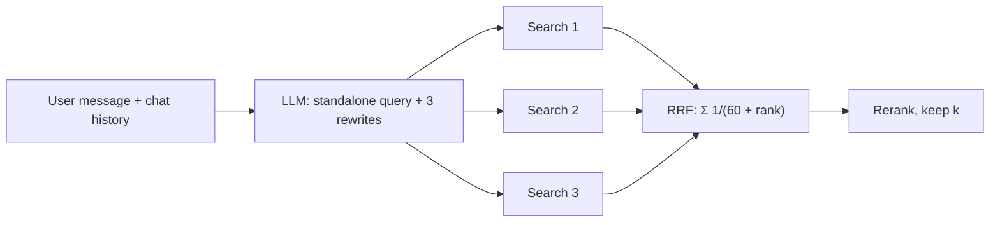

```callout-before
Before you start
You should know that retrieval embeds the query text as-is and returns the nearest chunks, and how Reciprocal Rank Fusion merges ranked lists (previous lesson).
```

Users do not write search queries. They write fragments, follow-ups and complaints: "and what about for annual plans?", "it still doesn't work", "price?". Embedding that text verbatim gives the retriever almost nothing to match. **Query rewriting** uses a language model to turn what the user typed into what the index needs.

## What a rewrite fixes

| Problem | User says | Rewritten query |
|---|---|---|
| Missing context in a follow-up | "and for annual plans?" (after asking about refunds) | "refund policy for annual plans" |
| Vague wording | "it still doesn't work" | "troubleshoot sync failure after app update" |
| Question packed with several asks | "price and storage limit of Pro, and can I share?" | three separate queries |
| Vocabulary mismatch | "can't get into my account" | "account locked sign-in failed login reset" |

The standard prompt gives the model the conversation so far and asks for a standalone search query. This is **conversational query condensation**; it fixes the most common failure in chat-style RAG, where the retriever sees only the last message.

## Multi-query retrieval and fusion

One query is one guess at how the answer is phrased. Generating $m$ different rewrites (say 3 to 5) and retrieving for each raises the chance that at least one phrasing lands near the right chunk. Merge the lists with RRF: a chunk found by several rewrites accumulates score.

If each rewrite independently found the answer with probability $p$, then at least one would succeed with probability

$$
P(\text{hit}) = 1 - (1-p)^m
$$

```steps
Worked example: the ideal gain, and why reality is smaller
A single query has $p = 0.70$ chance of putting the answer in the top 5.
---
With $m = 3$ independent rewrites: $1 - 0.3^3 = 1 - 0.027 = 0.973$. With $m = 2$: $1 - 0.09 = 0.91$.
---
Rewrites of the same question are strongly correlated (they share the same failure, say a missing document, or an unusual term), so real gains are much smaller than 0.973. Measure on your labelled set: a rise from 0.70 to 0.80 is a good outcome.
---
Cost: each rewrite is one more embedding and one more search (cheap), plus one LLM call to generate them. Generating three rewrites with a small model takes about 300 to 600 ms, which sits in front of retrieval on the critical path.
```



## Step-back and expansion variants

- **Step-back queries** ask for the general concept behind a specific question: "Why was error E42 raised when syncing on iOS 17?" becomes "What causes sync database errors?". Retrieve both and merge.
- **Keyword expansion** adds synonyms and related terms for BM25: "refund" adds "money back, reimbursement". Cheap and effective for keyword retrieval.
- **Query routing** sends the query to the right index (docs, tickets, code) or skips retrieval entirely for small talk. A rewrite step can output a structured decision: `{"search": true, "queries": [...], "filters": {"product": "Pro"}}`.

## See it

```sim
rag-pipeline
{"k": 5, "chunkTokens": 300, "retriever": "bm25", "faithfulness": 0.92}
```

This simulation shows how retrieval strength turns into answer accuracy. Start with the BM25 retriever and note the recall at $k=5$; switch to Hybrid and read the recall again. A good rewrite or multi-query step acts like moving from the first setting toward the second: it raises recall without touching the generator. Notice that accuracy rises roughly in proportion, as the accuracy equation predicts.

## In practice

Always pass the **last few turns** to the condenser, not the whole history, and instruct it to output only the query. Log the rewritten query next to the original: when retrieval fails, the rewrite is often the culprit (it dropped a product name or added an assumption). Keep the original query in the mix, fused with the rewrites, as insurance against a bad rewrite. Skip rewriting for standalone queries on short, clean questions: it adds latency and occasionally harms exact-match queries such as error codes.

```quiz
{"q": "Single-query recall@5 is 0.60. Assuming three fully independent rewrites, what is the idealised probability that at least one finds the answer?", "options": ["0.784", "0.936", "0.80", "0.216"], "answer": 1, "explain": "$1 - 0.4^3 = 1 - 0.064 = 0.936$. 0.216 is $0.6^3$, the chance that all three succeed. In practice rewrites are correlated, so the real gain is smaller."}
```

```quiz
{"q": "A chat user asks 'and for the Pro plan?' right after a question about storage limits. What does the retriever need?", "options": ["The raw last message", "A standalone query that includes the earlier topic, such as 'storage limit of the Pro plan'", "A larger k", "A different embedding model"], "answer": 1, "explain": "'and for the Pro plan?' has no content words to match. Condensing it with the conversation yields a self-contained query; raising k only fetches more irrelevant chunks."}
```
