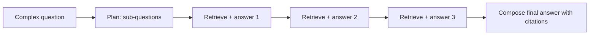

"Who founded the company that acquired the startup that makes Aurora?" No single passage contains the answer. One document says which startup makes Aurora, another says who acquired it, a third says who founded the acquirer. A retriever that embeds the whole question finds, at best, one of the three, because the question's words match only the first hop. Questions that need chaining several facts are **multi-hop**, and they are the standard way a basic RAG system fails on questions that look easy.

## Why one search is not enough

The needed documents are **not all similar to the question**: the second and third hops are only reachable once you know the answer to the previous one. Searching with the original question cannot retrieve a document about "Helix Corp" if the name Helix Corp appears nowhere in the question.

## Decomposition

Break the question into a chain of sub-questions, answering each from retrieval and passing the answer forward.

```steps
Worked example: three hops
Question: "Who founded the company that acquired the startup that makes Aurora?"
---
Hop 1. Query: "Which startup makes Aurora?" Retrieve, read: "Aurora is built by Lumen Labs."
---
Hop 2. Query: "Who acquired Lumen Labs?" (the answer from hop 1 is now in the query). Retrieve, read: "Helix Corp acquired Lumen Labs in 2023."
---
Hop 3. Query: "Who founded Helix Corp?" Retrieve, read: "Helix Corp was founded by Dana Ortiz." Answer: Dana Ortiz.
```



## The compounding problem

Each hop is a chance to fail, and the failures multiply. If a hop's retrieval and reading succeeds with probability $p$ and a question needs $h$ hops, assuming independence:

$$
P(\text{all hops succeed}) = p^{h}
$$

| Per-hop success $p$ | 1 hop | 2 hops | 3 hops | 4 hops |
|---|---|---|---|---|
| 0.95 | 0.950 | 0.903 | 0.857 | 0.815 |
| 0.90 | 0.900 | 0.810 | 0.729 | 0.656 |
| 0.80 | 0.800 | 0.640 | 0.512 | 0.410 |

At $p = 0.9$ (a good system) a three-hop question succeeds only $0.9^3 = 0.729$ of the time. If the final composition step also fails 10% of the time, the end-to-end accuracy is $0.729 \times 0.9 = 0.656$. This is the same series-reliability arithmetic that governs agents ([Workflows or Agents](/learn/agents/workflows-vs-agents)), and the same remedies apply: raise per-hop reliability (rerank, verify) and keep chains short.

## Latency adds up too

Each hop costs a retrieval (about 100 ms) plus an LLM call (about 1 s for a short answer). Three sequential hops cost roughly $3 \times 1.1 = 3.3$ s before the final answer is even generated. Sub-questions that do not depend on each other (comparing two products, "revenue of A and revenue of B") can run in **parallel**; only dependent chains must be sequential.

## Approaches

- **Plan, then execute**: an LLM writes the sub-question list up front. Simple to log and test, but cannot adapt when hop 1 returns something unexpected.
- **Iterative (ReAct or IRCoT style)**: the model alternates between reasoning and retrieving, deciding the next query from what it has learned. More flexible, less predictable, bounded by a maximum number of steps.
- **Parallel fan-out**: for comparison and aggregation questions, issue all sub-queries at once and merge.

## In practice

Detect first, then decompose: most queries are single-hop, and decomposing them wastes time and sometimes hurts. A cheap classifier or a rewrite step that outputs `{"hops": 1}` or a list of sub-questions handles this. Set a hard cap on hops (3 or 4) and make the system say "I could not complete this" when a hop returns nothing relevant, instead of improvising from the unrelated passages it received. Log every hop's query and retrieved chunk IDs; multi-hop failures are impossible to debug from the final answer alone.

```quiz
{"q": "Each hop succeeds 85% of the time and a question needs 3 hops. What is the chance that all hops succeed (independent)?", "options": ["0.85", "0.614", "0.255", "0.95"], "answer": 1, "explain": "$0.85^3 = 0.614$. Failures compound multiplicatively; 0.255 is $3 \\times 0.085$, the expected number of failing hops, not a probability of success."}
```

```quiz
{"q": "Which question is best answered by running sub-queries in parallel rather than as a chain?", "options": ["Who founded the company that acquired the maker of Aurora?", "What were the 2023 revenues of company A and of company B, and which is larger?", "What city was the CEO of the acquirer born in?", "Who is the manager of the author of this report?"], "answer": 1, "explain": "The two revenue lookups are independent: neither needs the other's answer. The other questions each need the previous hop's result before the next query can even be written."}
```
