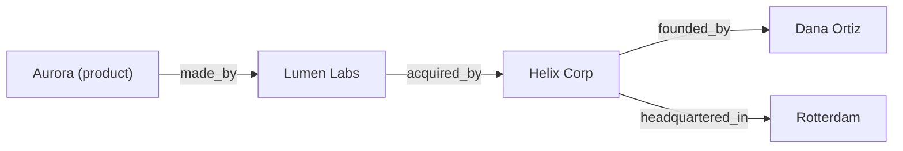

Vector search answers "which passages are most like this question?". It is weak at two other kinds of question. One is **relational**: "which suppliers of component X also supply our competitors?" requires following links between facts, not matching text. The other is **global**: "what are the main themes across all 10,000 support tickets?" has no single best passage; the answer is spread across the whole corpus and top-$k$ retrieval will return a random-looking handful of tickets. **Graph RAG** adds a structure that handles both: a knowledge graph built from the documents.

## Building the graph

At indexing time, an LLM reads each chunk and extracts **entities** (people, products, organisations, errors) and **relations** between them, producing triples like (Lumen Labs, acquired_by, Helix Corp). Merging duplicates, "Helix", "Helix Corp." and "HelixCorp" into one node, gives a graph whose nodes are entities and whose edges carry the chunks that support them.



For **global** questions a second step helps: run a community-detection algorithm to group densely connected nodes into **communities**, and have an LLM write a summary for each community (and for communities of communities). A global question is answered from these summaries rather than from raw chunks.

## Querying

- **Local queries** (about a specific entity): find the entities named in the question, then collect their neighbourhood: connected entities, relations and the source chunks, and give that to the model. This follows links that no vector similarity would.
- **Global queries**: map the question over the community summaries (each summary produces a partial answer), then reduce the partial answers into one.

## How much does a neighbourhood hold?

With an average of $b$ neighbours per node, the number of nodes within $h$ hops is about

$$
1 + b + b^2 + \dots + b^h \approx b^{h}\ \text{(for large } b\text{)}
$$

For $b = 10$: 1 hop reaches $1 + 10 = 11$ nodes, 2 hops reach $1 + 10 + 100 = 111$, and 3 hops reach 1,111. Neighbourhoods explode quickly, so graph queries limit depth to 1 or 2 hops, weight edges by relevance, and rank the collected facts before they reach the prompt. Otherwise the prompt fills with technically connected but irrelevant material.

## The cost

Extraction is an LLM call per chunk, which makes graph indexing far more expensive than embedding:

```steps
Worked example: indexing 350,000 chunks
Per chunk: $512$ input tokens and about $150$ output tokens listing entities and relations. Illustrative prices: \$3 per million input tokens, \$15 per million output.
---
Input: $512 \times 3 / 10^6 = \$0.001536$. Output: $150 \times 15 / 10^6 = \$0.00225$. Total \$0.003786 per chunk.
---
Collection: $350{,}000 \times 0.003786 = \$1{,}325$, versus about \$3 to embed the same chunks (previous lesson). Roughly 400 times more, before community summaries.
---
Extraction also makes mistakes (missed entities, wrong relations, duplicates that fail to merge), so graph quality needs its own evaluation, and updates mean re-extracting changed chunks and re-summarising their communities.
```

## When it is worth it

| Question type | Vector RAG | Graph RAG |
|---|---|---|
| "What is our refund policy for annual plans?" | Excellent | Unnecessary cost |
| "Which projects depend on the payments service?" | Poor (dependencies are scattered) | Strong |
| "What are the main complaints this quarter?" | Poor (no single passage) | Strong (community summaries) |
| "Summarise everything about customer Acme" | Fair | Strong (entity neighbourhood) |
| Mostly fact lookup in prose | Excellent | Little gain |

A pragmatic middle path: **keep vector retrieval as the default** and use the graph for the two question types it is good at, selected by a router. Lightweight variants skip the LLM: extract entities with a standard named-entity tagger, link chunks that mention the same entity, and expand retrieval to linked chunks.

## In practice

Many teams get most of the "graph" benefit from structured metadata they already have: a product catalogue, an org chart, a dependency manifest or a ticket-to-customer table. Joining retrieved chunks to such tables ("get all tickets for this customer") is cheap, exact and debuggable. Build an LLM-extracted graph when the relations are only in the text and the questions truly need them; start with a sample of 1,000 chunks, check extraction precision by hand, and estimate the full cost with the arithmetic above before running it everywhere.

```quiz
{"q": "An entity graph has an average of 8 neighbours per node. About how many nodes are within 2 hops of one entity (counting itself)?", "options": ["17", "73", "64", "512"], "answer": 1, "explain": "$1 + 8 + 8^2 = 1 + 8 + 64 = 73$. 64 counts only the second ring; 512 is 3 hops of expansion without the sum."}
```

```quiz
{"q": "Which question most clearly needs graph RAG or community summaries rather than plain vector top-k?", "options": ["What is the warranty period for the X200?", "How do I reset my password?", "What are the recurring themes across all 8,000 customer interviews?", "Who wrote the onboarding guide?"], "answer": 2, "explain": "A global question has no single best passage; top-k returns a few arbitrary interviews. Summaries of communities of related content cover the whole corpus. The others are single-fact lookups that vector search handles well."}
```
