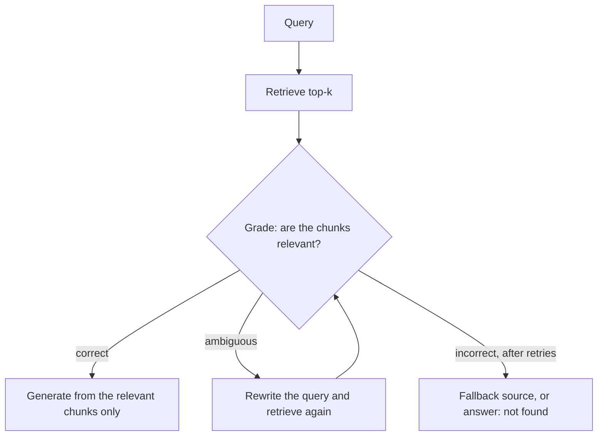

A fixed pipeline retrieves five chunks for every message, including "thanks!" and "hello". It also trusts whatever comes back, even when the chunks are clearly about something else. Two ideas fix both habits. **Adaptive RAG** decides *whether and how* to retrieve. **Corrective RAG** checks *what came back* and acts on the check.

## Adaptive retrieval: decide before searching

A small, fast classifier (a prompt to a small model, or a trained classifier) routes each query:

| Route | Example | Action |
|---|---|---|
| No retrieval | "thanks", "rewrite this sentence" | Answer directly |
| Single retrieval | "what is the refund window?" | Standard pipeline |
| Multi-step | "compare plan A and B limits" | Decompose, retrieve per part |
| Other source | "what is my current balance?" | Call a tool or database, not a document index |

The saving is straightforward to compute. Take the request costs from earlier: a RAG request costs \$0.0108 (2,350 input tokens), and a request with no retrieval (350 input tokens) costs $350 \times 3/10^6 + 250 \times 15/10^6 = \$0.0048$.

```steps
Worked example: what routing saves
Suppose 40% of traffic genuinely needs retrieval and 60% does not. Add a classifier costing \$0.0001 per request.
---
Always retrieve: \$0.0108 per request.
---
Routed: $0.4 \times 0.0108 + 0.6 \times 0.0048 + 0.0001 = 0.00432 + 0.00288 + 0.0001 = \$0.0073$.
---
Saving: $(0.0108 - 0.0073)/0.0108 = 32\%$, and the 60% of requests that skip retrieval also skip its latency. The risk is a classifier error: a wrongly skipped retrieval returns an ungrounded answer. Measure the classifier's recall on "needs retrieval" and favour recall over precision.
```

## Corrective retrieval: grade before using

After retrieval, a **grader** (an LLM or a trained model) judges whether each chunk is relevant to the query. A common scheme labels the whole retrieval as *correct*, *ambiguous* or *incorrect* and acts accordingly:



The grader reduces the main failure of the first topic in this module: the model building a confident answer from irrelevant text. Dropping chunks the grader rejects shrinks the prompt (cheaper), and "not found" becomes a real outcome instead of an accident.

The grader's accuracy sets the benefit. Say 20% of retrievals are irrelevant (the right evidence is missing). If the grader catches 85% of those and wrongly rejects 5% of good retrievals:

$$
\text{caught bad} = 0.20 \times 0.85 = 0.17, \qquad \text{wrongly rejected good} = 0.80 \times 0.05 = 0.04
$$

So 17% of all queries move from "likely hallucinated answer" to "retry or not found", at the cost of 4% of queries retrying unnecessarily. Each retry costs another retrieval (about 100 ms) and possibly a rewrite and grade (about 0.5 to 1 s).

## Self-reflective variants

**Self-RAG** trains the model itself to emit special judgement tokens: whether to retrieve, whether a passage is relevant, whether its own output is supported. Prompt-based versions approximate this by asking the model to verify its draft against the sources ("Which sentence of the sources supports each claim? Reply 'unsupported' if none.") and to revise. Verification adds a second generation, which roughly doubles the output tokens and adds one LLM latency, so use it where wrong answers are costly.

## Agentic RAG

At the far end, retrieval becomes a **tool** the model calls when it decides to, with its own query, possibly several times, mixing indexes, SQL and web search. It handles open-ended research questions well. It is also the least predictable and most expensive pattern: latency and cost vary with the number of steps, and errors compound across steps (see [Agents, Tools and the Loop](/learn/agents/agent-loop)). Use a fixed pipeline for the 90% of questions it handles and reserve the agentic loop for the rest, with a step budget.

## In practice

Add the cheapest control that fixes an observed failure. If irrelevant context is the problem, add a relevance threshold on the reranker score before adding an LLM grader. If follow-ups fail, add query condensation before adding a router. Put hard limits on retries (one or two), and log every routing and grading decision so you can compute their accuracy on a sample you label by hand.

```quiz
{"q": "Routing: 30% of requests need retrieval (cost 0.0108), 70% do not (cost 0.0048); the router costs 0.0001. What is the average cost per request?", "options": ["0.0067", "0.0073", "0.0108", "0.0048"], "answer": 0, "explain": "$0.3 \\times 0.0108 + 0.7 \\times 0.0048 + 0.0001 = 0.00324 + 0.00336 + 0.0001 = 0.0067$. 0.0073 is the average for the 40% split in the worked example."}
```

```quiz
{"q": "A relevance grader wrongly rejects 5% of good retrievals and catches 85% of bad ones. Bad retrievals are 20% of traffic. What fraction of all queries are correctly flagged as bad?", "options": ["0.17", "0.04", "0.85", "0.20"], "answer": 0, "explain": "$0.20 \\times 0.85 = 0.17$. 0.04 is the fraction of all queries wrongly rejected ($0.80 \\times 0.05$)."}
```
