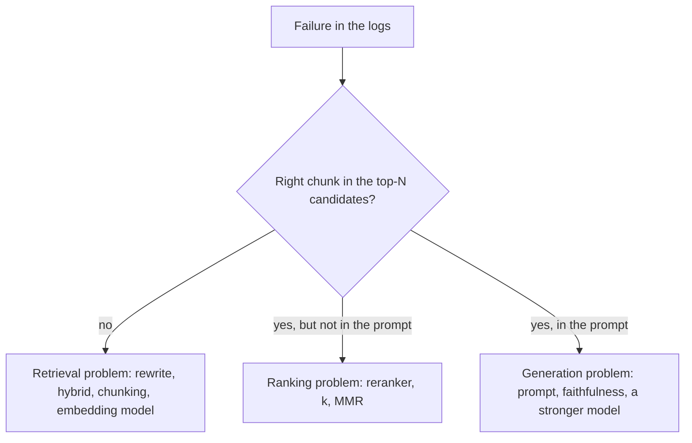

Every technique in this lesson is a patch for one failure. A system with all of them switched on is slow, expensive and hard to debug, and often no better than a system with the right one. The discipline is to start from the *symptom*, find the stage that causes it, and add the cheapest fix for that stage.

## Symptom to cause to fix

| What you observe | Likely cause | Cheapest fix | Heavier fix |
|---|---|---|---|
| Follow-up questions in a chat get irrelevant chunks | Retriever sees only the last message | Query condensation with recent turns | Full conversation rewrite and routing |
| Exact codes, names, IDs missed | Dense-only retrieval | Add BM25 and fuse with RRF | Field-aware keyword indexes |
| Paraphrased questions miss the right page | Vocabulary mismatch | Multi-query rewrite, or a better embedding model | HyDE; fine-tune the embedder |
| Answer needs two or more documents | Single search cannot reach later hops | Decompose into sub-queries (cap hops at 3) | Iterative retrieve-reason loop |
| "Summarise everything about X" returns a random few | Top-$k$ cannot cover a whole corpus | Metadata join by entity | Graph RAG with community summaries |
| Confident answers from irrelevant context | No relevance check, no "not found" path | Reranker score threshold; explicit "say not found" prompt | LLM grader with retry |
| Greetings and arithmetic trigger retrieval | Retrieval on every request | Rule-based routing | Learned router |



## What each addition costs

Latency stacks, because most additions run **before** retrieval or **between** retrieval and generation. Using typical figures:

| Stage added | Typical latency added | Extra LLM calls |
|---|---|---|
| Query condensation (small model) | 300 to 600 ms | 1 |
| Multi-query (3 rewrites, parallel searches) | 300 to 600 ms + search | 1 |
| HyDE | 500 to 2,000 ms | 1 |
| Reranker | 50 to 200 ms | 0 (model, not LLM) |
| LLM relevance grader | 400 to 1,000 ms | 1 (or 1 per chunk, in parallel) |
| Each decomposition hop | about 1,100 ms | 1 |

```steps
Worked example: stacking too much
Baseline: embed 20 ms, search 30 ms, LLM first token 450 ms: about 500 ms.
---
Add condensation (450 ms), multi-query (450 ms with parallel search), a reranker (120 ms) and an LLM grader (700 ms).
---
New time to first token: $500 + 450 + 450 + 120 + 700 = 2{,}220$ ms: 4.4 times slower. If only the condensation fixed your logged failure, the other three added 1.27 seconds for nothing.
---
Measure each addition on your labelled set: keep it only if it buys more than its cost, in recall or accuracy points per 100 ms of latency and per dollar.
```

## See it

```sim
rag-pipeline
{"k": 5, "chunkTokens": 300, "retriever": "hybrid", "faithfulness": 0.92}
```

Use the sim as a budgeting tool. Start with hybrid retrieval and note accuracy, cost and latency. Switch to BM25 to see what a weaker first stage costs in accuracy. Then restore hybrid and lower faithfulness to 0.80, mimicking a model that ignores context: notice that no retrieval improvement recovers the loss, which tells you when a retrieval technique is the wrong patch.

## In practice

Keep a **failure log**: for each wrong answer, record where the chain broke using the flow above (candidate recall, ranking, generation). After 50 failures the distribution tells you what to build, and it is almost never "all of it". Re-measure after each change on a fixed labelled set, and keep the simple pipeline as a baseline to compare against; sophisticated pipelines that cannot beat a tuned hybrid retriever with a reranker are common.

```quiz
{"q": "Logs show that for failed questions the right chunk was in the top-50 candidates but not in the 5 sent to the model. Which fix targets this?", "options": ["Multi-query rewriting", "A reranker or better ranking of the candidates", "A larger embedding model", "Graph RAG"], "answer": 1, "explain": "The evidence was retrieved but ranked too low: a ranking problem. Rewriting and embedding changes target candidate recall, which is already fine; graph RAG targets relational and global questions."}
```

```quiz
{"q": "Baseline time to first token is 500 ms. You add condensation (400 ms), a reranker (100 ms) and a grader (600 ms). What is the new total, and by what factor is it slower?", "options": ["1,600 ms, 3.2x", "1,100 ms, 2.2x", "1,500 ms, 3.0x", "600 ms, 1.2x"], "answer": 0, "explain": "$500 + 400 + 100 + 600 = 1{,}600$ ms, and $1600/500 = 3.2$. Serial stages add; 1,100 omits the grader."}
```
