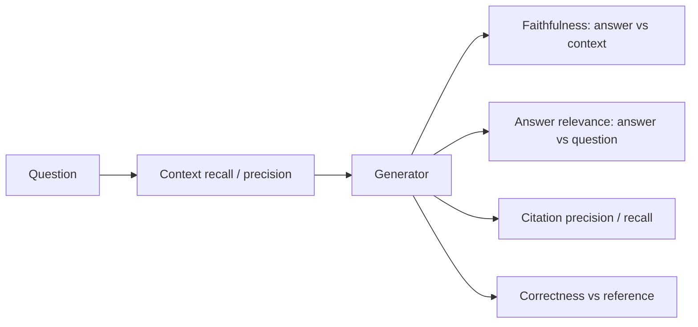

The retriever did its job and the right passage is in the prompt. The answer can still be wrong in three different ways: it can say things the passage does not support (**unfaithful**), it can be true but not what the user asked (**irrelevant**), or it can point at the wrong source (**bad citation**). Each has its own metric, and each is measured by breaking the answer into small checkable pieces.

## Faithfulness (groundedness)

**Faithfulness** asks: is every claim in the answer supported by the retrieved context? The procedure: split the answer into atomic claims, then for each claim judge whether the context entails it (a human, an LLM judge or an entailment model).

$$
\text{faithfulness} = \frac{\text{claims supported by the context}}{\text{claims in the answer}}
$$

A claim that is true in the world but absent from the context counts as **unsupported**, because the point is whether the system used its evidence. A system that answers from memory can be right and unfaithful at once, and that matters whenever the context is the authority (policies, contracts, medical guidance).

```steps
Worked example: claim-level faithfulness
Answer: "Annual plans can be refunded within 30 days. Refunds return to the original card in 5 to 10 business days. Monthly plans are refunded pro rata. Support can approve exceptions. Refunds are processed by the billing team."
---
Split into five claims and check each against the retrieved passage. Claims 1 and 2 appear in the passage: supported.
---
Claim 3 ("pro rata") contradicts the passage, which says monthly plans are not refunded: unsupported, and wrong. Claim 4 is not in the passage: unsupported. Claim 5 is supported by a second chunk.
---
Faithfulness $= 3/5 = 0.60$. Also report the contradiction (claim 3) separately: contradicted claims are more serious than merely unsupported ones.
```

## Answer relevance

An answer can be perfectly faithful to the context and still ignore the question. **Answer relevance** measures how well the answer addresses the question asked. One reference-free recipe: ask an LLM to generate several questions that the answer would be a good response to, embed them, and average their cosine similarity with the original question:

$$
\text{answer relevance} = \frac{1}{m}\sum_{j=1}^{m} \cos\big(\mathbf{e}(q),\, \mathbf{e}(\hat{q}_j)\big)
$$

where $q$ is the user's question, $\hat{q}_j$ the generated questions and $\mathbf{e}(\cdot)$ the embedding function. If three generated questions have cosine 0.92, 0.88 and 0.40 with the original, the score is $(0.92 + 0.88 + 0.40)/3 = 0.733$. The low outlier suggests part of the answer wandered off-topic.

## Citation accuracy

If the system cites sources, citations are claims too, and they can be wrong in two ways: citing a passage that does not support the claim, or leaving a claim uncited. Two metrics:

$$
\text{citation precision} = \frac{\text{citations that support their claim}}{\text{citations made}}, \qquad
\text{citation recall} = \frac{\text{claims backed by a correct citation}}{\text{claims}}
$$

Take the five claims above. Suppose the model attached citations to four of them, and a check shows three of those four citations really support their claims. Citation precision $= 3/4 = 0.75$. Claims backed by a correct citation: three of five, so citation recall $= 3/5 = 0.60$.

| Metric | Computed over | Catches |
|---|---|---|
| Faithfulness | claims vs context | invention, contradiction |
| Answer relevance | answer vs question | evasion, rambling, answering a different question |
| Citation precision | citations vs claims | links that do not support what they decorate |
| Citation recall | claims vs citations | confident claims with no source |
| Correctness | answer vs reference answer | wrong final answer (needs a reference) |

Notice the independence: a system can score 1.0 on faithfulness and 0.3 on correctness if retrieval returned a faithful-but-outdated passage. Correctness against a reference, faithfulness against the context and context recall against the facts are three separate lenses, and the combination tells you where the fault is.



## Judging at scale

Hand-checking every claim is slow, so teams use an **LLM judge**: one prompt extracts claims, another checks each against the context and returns supported, unsupported or contradicted. Judges have known biases (they favour longer, more fluent answers and can be lenient with plausible-sounding claims; see [Using a Model as a Judge](/learn/evaluation/llm-as-judge)), so validate yours on 50 to 100 human-labelled examples before trusting it, and re-check when you change the judge model.

## In practice

Use faithfulness as a release gate in regulated settings (a threshold such as at least 0.95 on a held-out set, with zero contradicted claims on critical questions) and answer relevance as a quality signal. Prompt for citations in a parseable format (`[2]`) and verify them automatically by checking that cited IDs exist and, for a sample, that the cited text entails the claim. Beware a citation that merely points at the right *document* when the supporting sentence is in another chunk of it: decide whether you score at chunk, page or document level, and be consistent.

```quiz
{"q": "An answer makes 8 claims. 6 are supported by the context, 1 is unsupported, 1 contradicts the context. What is faithfulness, and which part should you review first?", "options": ["0.75; the contradicted claim", "0.875; the unsupported claim", "0.75; the unsupported claim", "1.0; neither"], "answer": 0, "explain": "$6/8 = 0.75$ counts supported claims only. The contradicted claim is the most serious defect because the answer says the opposite of its evidence, not just something extra."}
```

```quiz
{"q": "A model answers correctly from its own memory, ignoring the retrieved context, which says something slightly different. Which metric flags a problem?", "options": ["Correctness", "Faithfulness", "Answer relevance", "Context recall"], "answer": 1, "explain": "Faithfulness checks claims against the context, so memory-based claims count as unsupported even if they are true. Correctness may be fine, which is why it alone cannot tell whether the system is grounded."}
```
