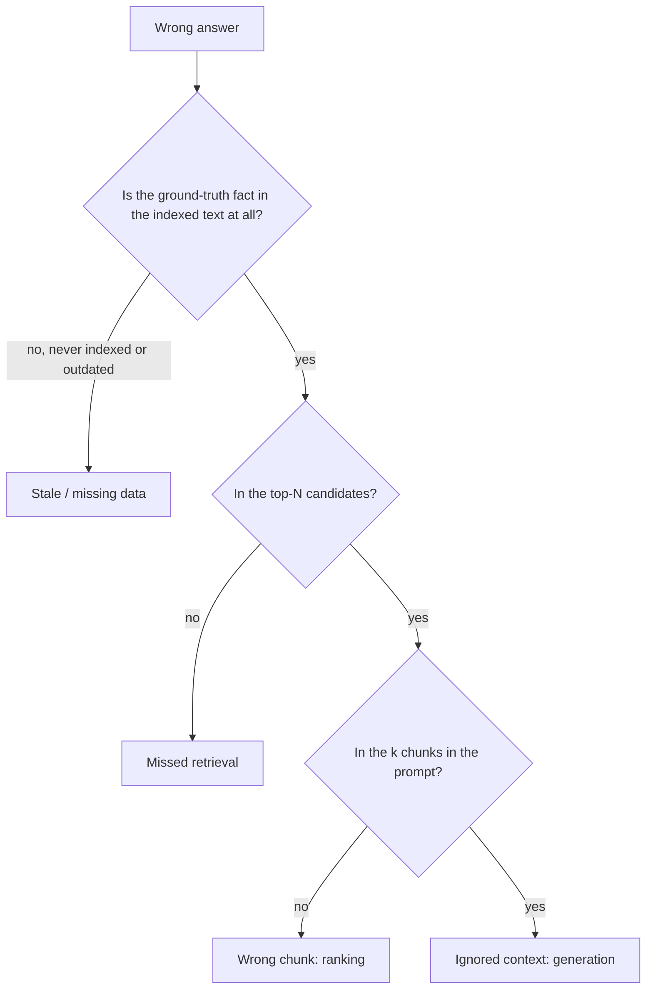

A doctor does not treat "feeling unwell"; they find which system is failing. The same applies to a RAG bot that gives wrong answers. "Accuracy is 80%" tells you nothing about what to change. A **failure taxonomy** sorts each wrong answer into the stage that caused it, so fixes can target the biggest category rather than the loudest complaint.

## The four main failure modes

1. **Missed retrieval.** The evidence was never in the candidate list. Causes: the answer is split across chunks or hidden by a bad chunk boundary, a vocabulary mismatch the retriever cannot bridge, an overly narrow metadata filter, truncated embeddings, or the document was never indexed.
2. **Wrong chunk (ranking failure).** The evidence was among the candidates but a more similar-looking, less useful chunk ranked above it and the right one fell outside the $k$ sent to the model. Causes: no reranker, near-duplicate or older versions outranking the current one, a too small $k$.
3. **Ignored context.** The right chunk was in the prompt and the model still answered wrongly: it preferred its own memory, was distracted by a conflicting chunk, lost the fact in the middle of a long context, or misread a table. A prompt or model problem, not a retrieval problem.
4. **Stale data.** The index holds an outdated version of the truth. Retrieval and generation both worked; the source was old. Causes: slow re-indexing, deleted documents still searchable, old versions retained alongside new ones.

Two more categories appear in real logs: **bad question or label** (ambiguous question, wrong ground truth) and **out of scope** (the answer is not in the corpus and the system should have said so, but fabricated one).

## A diagnostic flow



This flow needs only three logged facts per request: the retrieved candidate IDs and scores, the IDs sent in the prompt, and the ground-truth chunk. That is why logging the assembled prompt matters from the first day.

## Worked tally: where to spend the next week

A bot is evaluated on 500 questions and answers 400 correctly (accuracy 0.80). The 100 failures are classified by hand:

| Category | Count | Share of failures | Share of all questions |
|---|---|---|---|
| Missed retrieval | 38 | 38% | 7.6% |
| Wrong chunk (ranking) | 17 | 17% | 3.4% |
| Ignored context | 21 | 21% | 4.2% |
| Stale data | 12 | 12% | 2.4% |
| Bad question / label | 12 | 12% | 2.4% |
| Total | 100 | 100% | 20% |

```steps
Turning the tally into a plan
The largest bucket is missed retrieval: 38 of 500 questions, or 7.6 points of accuracy. A fix that halves it (hybrid search, better chunking) recovers about $19/500 = 3.8$ points.
---
Ranking failures (17) have a cheap fix: a reranker. Even if it fixes only 60% of them, that is $10/500 = 2$ points for roughly a day of work.
---
Stale data (12) is an operations problem: shorten the re-index interval. Ignored context (21) needs prompt and model changes; test a stricter "answer only from sources" instruction and a stronger model on exactly those 21 questions.
---
Bad questions (12): fix the labels. If half of them were mislabelled, true accuracy was higher than measured. Plan: rerank first (cheap, certain), then hybrid and chunking, then freshness, and re-run the whole set after each.
```

## Estimating staleness

If a fraction $u$ of documents change per day and you re-index every $T$ days, then on average the index is out of date for roughly $uT/2$ of documents (valid when $uT$ is small). For $u = 2\%$ and a weekly rebuild, $0.02 \times 7/2 = 7\%$ of documents are stale on a typical day; a daily rebuild cuts that to $1\%$. Weight by query popularity: if the volatile documents (prices, policies) are also the most asked about, the effective error is higher. Handle deletions explicitly, because a deleted document that stays searchable is worse than an outdated one.

## In practice

Run the classification on at least 50 failures; do it by hand at first, then train an LLM classifier against your labels. Store the category with the evaluation record so the distribution can be tracked release over release: a shift in the mix is an early warning (a rising "missed retrieval" share after a re-chunking points at the chunker). Resist fixing one dramatic failure; fix the category with the most volume. Each category has a different owner: retrieval engineers, prompt engineers, data operations, and the people who write the questions.

```quiz
{"q": "The ground-truth passage is indexed and ranked 7th out of 50 candidates, and you send the top 5 to the model. The answer is wrong. Which category is this?", "options": ["Missed retrieval", "Wrong chunk (ranking)", "Ignored context", "Stale data"], "answer": 1, "explain": "The evidence was in the candidates but did not make the top 5 that reach the prompt. Missed retrieval would mean it was not in the candidates; ignored context would mean it was in the prompt."}
```

```quiz
{"q": "2% of all documents change each day and you re-index weekly (T = 7). About what fraction of documents is stale on an average day?", "options": ["About 7%", "About 14%", "About 2%", "About 0.3%"], "answer": 0, "explain": "$uT/2 = 0.02 \\times 7/2 = 0.07$. The 14% figure forgets the factor of one half: a changed document is stale only from the change until the next rebuild, so on average half an interval."}
```
