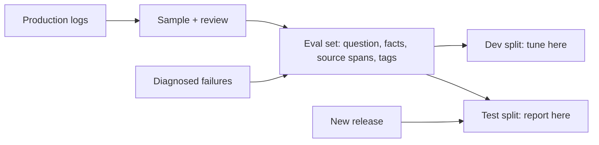

Every metric in this lesson is only as good as the questions it is computed on. A set of 20 questions the author wrote after reading the documents will say the system is excellent and will be wrong. A trustworthy set has the right questions, the right labels and enough of them.

## What goes in the set

Each item stores: the **question**, the **needed facts** (or a reference answer), the **source passages** that support them (as spans, not chunk IDs), and tags for question type and difficulty. Composition matters more than size:

- **Real user questions**, sampled from logs or support tickets, with their typos and vagueness. This is the most valuable source.
- **Hard cases on purpose**: multi-hop questions, exact identifiers, paraphrases, questions with negation, questions with two plausible answers from different document versions.
- **Unanswerable questions** (the answer is not in the corpus), typically 10 to 20% of the set. The correct behaviour is "not found". Without them you cannot measure the failure of the first topic of this module.
- **Synthetic questions** generated from chunks by an LLM: cheap and numerous, useful for regression, but they echo the chunk's wording and flatter keyword retrieval. Keep them labelled as synthetic and report them separately.

Hold out a **test split** that you never tune on, and keep a smaller **dev split** for experiments. Tuning chunk sizes, $k$ and prompts against the same questions you report on overfits to them.

## How many questions?

Accuracy measured on $n$ questions is a proportion with standard error $\sqrt{p(1-p)/n}$. To get a 95% interval half-width of $w$ around a true accuracy $p$, you need

$$
n \approx \frac{1.96^{2}\; p\,(1-p)}{w^{2}}
$$

```steps
Worked example: sizing for a target precision
You expect accuracy around $p = 0.80$ and want $\pm 3$ points ($w = 0.03$).
---
$n = 3.84 \times 0.8 \times 0.2 / 0.03^2 = 0.6147 / 0.0009 \approx 683$ questions.
---
With only $n = 100$: $\text{SE} = \sqrt{0.16/100} = 0.04$, so $\pm 7.8$ points. A change from 0.80 to 0.85 is invisible. With $n = 300$: $\text{SE} = 0.0231$, $\pm 4.5$ points.
---
To compare two systems on the same questions, a paired comparison needs fewer questions than two separate intervals: count the questions where only A is right (say 30) and where only B is right (say 12). The difference, 18 questions of 300, is 6 points; test whether 30 versus 12 is plausible under a 50/50 split (it is not: the standard deviation of the split is $\sqrt{42}/2 \approx 3.2$ and the gap is $18/2 = 9$ from the mean of 21, almost 3 deviations).
```

The paired reasoning is developed in [Comparing Systems You Can Trust](/learn/evaluation/comparing-systems). The practical rule: 150 to 300 questions are enough to catch large regressions in a development loop; plan for 500 to 1,000 before announcing a small improvement.

## Labelling

Label the **evidence**, not only the answer. Two people with different chunkers must be able to score the same item. For each item record where the answer lives (document and character span). Have a second person label 10 to 20% of items and measure agreement: if two careful humans disagree on 20% of the items, no metric can be more reliable than that, and the guidelines (what counts as relevant, how partial answers are scored) need tightening.

When an LLM judge scores answers, calibrate it. Run it and humans on the same 100 items and compute agreement. A judge that matches humans 90% of the time is usable for relative comparisons, with periodic spot checks; a judge at 70% is not.

## Keep it alive

A frozen set rots. The corpus changes, products launch, user questions drift. Add to the set every real failure you diagnose (with its category), retire items whose ground truth has become outdated, and re-label when documents change. A good habit is to add every escalated or thumbs-down conversation, after review, as a new item, so the set follows the product.



## In practice

Version the set like code. Record, with every reported number, the set version, the number of questions, the interval, and the system version. Keep unanswerable and adversarial items as their own tagged slices and report them separately, because a system that is 95% on the easy majority and 40% on "not found" will look fine in the average and fail where it matters most. Report slices, not just one number.

```quiz
{"q": "You expect accuracy near 0.90 and want a 95% interval of about ±2 points. Roughly how many questions do you need?", "options": ["About 865", "About 400", "About 100", "About 2,000"], "answer": 0, "explain": "$n = 3.84 \\times 0.9 \\times 0.1 / 0.02^2 = 0.3457 / 0.0004 \\approx 864$. Accuracy near 0.9 has lower variance than near 0.5, but a tight interval still demands hundreds of questions."}
```

```quiz
{"q": "Why include unanswerable questions in a RAG evaluation set?", "options": ["They make the set larger", "Retrieval always returns something, so only these questions reveal whether the system correctly says it could not find the answer", "They test the tokenizer", "They are easier to label"], "answer": 1, "explain": "On answerable questions a fabricating system and an honest one can look alike. Unanswerable items isolate the 'confident answer from irrelevant context' failure."}
```
