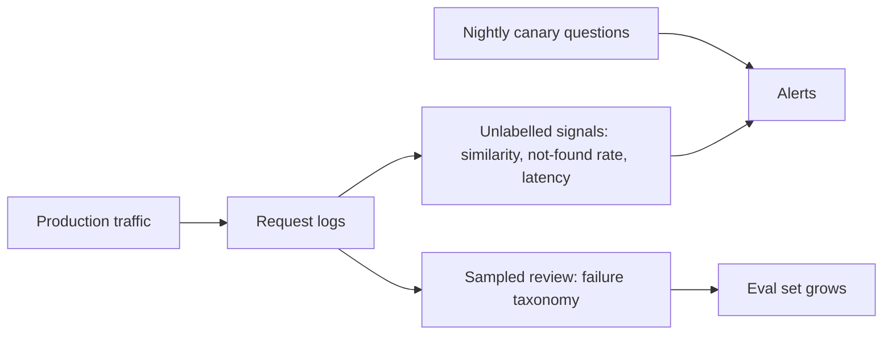

Offline evaluation tells you the system was good on last month's questions. Production is where documents change, users ask new things, an embedding provider updates a model, and someone deletes a folder. A RAG system degrades silently, because it never throws an error: it just retrieves slightly worse chunks and answers slightly worse. Monitoring is how you notice before users do.

## What to log for every request

- the user query and the rewritten query;
- candidate chunk IDs and scores (first stage and rerank), and the chunk IDs actually placed in the prompt;
- source document versions and their last-updated dates;
- the answer, citations, and whether the model returned "not found";
- latency per stage, token counts and cost;
- user feedback: thumbs, edits, follow-up rephrasings, escalation to a human.

With these in a table, every metric in this lesson can be computed on real traffic, and any wrong answer can be traced through the diagnostic flow of the failure-taxonomy topic.

## Signals that need no labels

You cannot label every request, but several quantities are visible without labels and move when something breaks:

| Signal | Healthy looks like | A change suggests |
|---|---|---|
| Top-1 retrieval similarity (mean, distribution) | stable | embedding model changed, corpus drift, new query types |
| "Not found" rate | stable, say 5 to 10% | index missing documents (rate up), or model over-answering (rate down) |
| Share of answers with a valid citation | high, stable | prompt regression, parsing bug |
| Rephrase rate (user asks again immediately) | low | answers not satisfying |
| Thumbs-down / escalation rate | low, stable | quality drop |
| Index freshness (age of newest document, lag after an update) | within SLA | ingestion pipeline stuck |
| p50 / p95 latency per stage | stable | reranker or index slowdown |

```steps
Worked example: detecting a silent embedding change
Baseline top-1 cosine similarity over a week of queries: mean 0.71, standard deviation 0.08 across 5,000 queries.
---
After a provider-side model update, this week: mean 0.62 over 5,000 queries. The standard error of the baseline mean is $0.08/\sqrt{5000} = 0.00113$.
---
The shift is $0.09 / 0.00113 \approx 80$ standard errors: not noise. Query and index vectors are probably no longer in the same space, or the corpus changed.
---
Action: pin the embedding model version, and compare retrieval recall on the canary set. If recall fell, re-embed the index with the new model, or roll back to the pinned version.
```

## Cost and efficiency numbers

Divide cost by successful outcomes, not by requests. A request costs \$0.0108 (the 2,350-token example from the first lesson). If users accept or do not escalate 72% of answers, the cost per successful answer is

$$
\text{cost per success} = \frac{\text{cost per request}}{\text{success rate}} = \frac{0.0108}{0.72} = \$0.0150
$$

Improving the success rate from 0.72 to 0.80 lowers this to $0.0108/0.80 = \$0.0135$, a 10% saving with no change in the price per token. Quality improvements are cost reductions.

## Canary questions and freshness

Keep a small **canary set** of 50 to 100 questions with known answers, run it every night against production (with the real index and the real model), and alert if recall or faithfulness falls below thresholds. This catches regressions from re-indexing, provider changes and prompt edits within a day.

Freshness deserves its own check. For a sample of documents, record when the source changed and when the index reflected the change: the **index lag**. An alert on lag above the agreed limit (say one hour for prices, one day for handbooks) catches stuck ingestion. Test deletions explicitly: delete a canary document and assert that it stops appearing.



## Practice the whole loop

The lab gives you a RAG bot with several defects. Use the tools from this lesson: log the candidates and prompt, classify each failure with the diagnostic flow, and fix the biggest category first. The sandbox lets you run a production-style RAG service and watch these signals move as you change the configuration.

```lab
fix-the-rag-bot
```

```sandbox
rag-production
```

## See it

```sim
rag-pipeline
{"k": 5, "chunkTokens": 300, "retriever": "dense", "faithfulness": 0.92}
```

Treat the sim as a model of your monitoring dashboard. Reduce faithfulness from 0.92 to 0.80 and note the accuracy drop; reduce recall by switching from hybrid to BM25 and note a similar drop. The same visible accuracy loss has two different causes, so your monitoring must separate retrieval signals (similarity, candidate recall on the canary set) from generation signals (faithfulness, citation validity).

## In practice

Alert on **changes**, not absolute levels, and keep alerts few and actionable: three well-chosen alarms (canary recall, not-found rate, index lag) beat thirty ignored ones. Review a random sample of 20 to 30 production conversations every week; no dashboard replaces reading real failures. Record every incident in the failure taxonomy so that the distribution informs the next quarter's work.

```quiz
{"q": "A request costs 1.2 cents and 60% of answers are successful. What is the cost per successful answer?", "options": ["2.0 cents", "0.72 cents", "1.2 cents", "3.0 cents"], "answer": 0, "explain": "$1.2 / 0.60 = 2.0$ cents. Multiplying by the success rate (0.72 cents) goes the wrong way: failed answers still cost money, so each success has to carry their cost."}
```

```quiz
{"q": "The not-found rate suddenly falls from 8% to 1% while citation validity stays high. What is the most likely concern?", "options": ["The system improved", "The model may now be answering from irrelevant context instead of declining, or a prompt change removed the 'say not found' behaviour", "The index is smaller", "Latency increased"], "answer": 1, "explain": "A sharp drop in honest refusals is more often a regression than a gain: retrieval always returns something, so a changed prompt or threshold can turn refusals into fabricated answers. Check unanswerable canary questions."}
```
