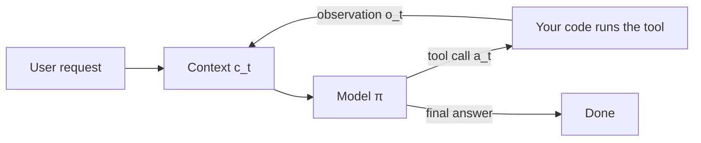

```callout-before
Before you start
You need to know what a prompt and a completion are, and that a model reads tokens and writes tokens. Nothing about agents is assumed.
```

Ask a model "What is the weather in Lisbon right now?" and a plain chat model can only guess: the answer is not in its weights. Now give it one extra ability. Instead of answering, it may write a short structured request such as `get_weather(city="Lisbon")`. Your code sees that request, calls a real weather service, and pastes the result back into the conversation. The model reads the result and writes the answer.

That small change turns a text predictor into something that can **act**. The structured request is a **tool call**, the function your code runs is a **tool**, and the text you paste back is an **observation**. When the model is allowed to make several calls in a row, each one chosen after reading the previous result, you have an **agent**: a model that decides its own next step inside a **loop**.

The precise idea is short. A single model call is a function from context to text. An agent wraps that function in a loop that keeps appending what happened to the context and calling the model again, until the model says it is finished or the loop runs out of budget.

## The loop in symbols

Call the full context at step $t$ (system prompt, user request, every earlier call and result) $c_t$. The model acts as a **policy** $\pi$: given the context, it produces an action $a_t$, which is either a tool call or a final answer. If it is a tool call, the environment (your code plus the outside world) returns an observation $o_t$, and the context grows:

$$
a_t = \pi(c_t), \qquad o_t = \text{env}(a_t), \qquad c_{t+1} = c_t \oplus a_t \oplus o_t
$$

Here $\oplus$ means "append to the end". The loop stops at the first step $T$ where $a_T$ is a final answer. Nothing inside the model changes between steps; its weights are frozen. All of the agent's "memory" of what it has done lives in the growing context $c_t$.

```steps
A three-step run, by hand
The user asks: "Is my order 4417 going to arrive before Friday?" The context $c_0$ is the system prompt, two tool definitions (`get_order`, `get_shipping_eta`) and the question. Say $c_0$ is 900 tokens.
---
Step 0. The model reads $c_0$ and emits $a_0$ = `get_order(order_id=4417)` (about 30 tokens). Your code returns $o_0$ = `{"status": "shipped", "carrier": "DHL", "tracking": "JD0142"}` (about 40 tokens). Now $c_1$ is $900 + 30 + 40 = 970$ tokens.
---
Step 1. The model reads $c_1$ and emits $a_1$ = `get_shipping_eta(tracking="JD0142")` (30 tokens). The observation $o_1$ = `{"eta": "Thursday"}` (15 tokens). Now $c_2 = 970 + 30 + 15 = 1015$ tokens.
---
Step 2. The model reads $c_2$ and emits a final answer: "Yes, it is due Thursday." The loop ends with $T = 2$, after three model calls and two tool calls.
```

Notice that the model was called three times and read 900, 970 and 1015 tokens: 2885 input tokens in total, more than three times the original prompt. That re-reading is the root of the cost behaviour you will meet in a later topic.

## What makes it an agent, and what does not

Three ingredients are needed, and it is worth being strict about them:

| Ingredient | What it is | Without it |
|---|---|---|
| A model | the policy that chooses the next action | nothing decides |
| Tools | functions with side effects or fresh information | the model can only talk |
| A loop the model controls | the model decides whether to call again or stop | it is a fixed pipeline, not an agent |

A system that always calls retrieval once and then generates is a pipeline with a tool in it. It becomes an agent only when the model chooses the number and order of steps. The next lesson treats that line carefully, because it decides how predictable your system is.



## In practice

Every major model API supports this pattern natively: you send tool definitions with the request, the response can contain a structured tool call instead of text, and you send the result back in the next request. The model never runs anything itself. Your code is always the one that executes the tool, which is exactly why you can validate, log, rate-limit or refuse each call. Keeping that control point in mind makes most of this module easier: every safety and reliability technique later on hooks into the moment between $a_t$ and $o_t$.

A common early mistake is to think the model "remembers" the tool result somewhere. It does not. If your code forgets to append $o_t$ to the context, the next call has no idea the tool ever ran, and the model will often call it again.

```quiz
{"q": "A run makes 4 model calls. The context starts at 1,000 tokens and each step appends 200 tokens (call plus result) before the next call. How many input tokens are read in total across the 4 calls?", "options": ["4,000", "5,200", "1,800", "4,800"], "answer": 1, "explain": "The calls read 1,000, 1,200, 1,400 and 1,600 tokens: 5,200 in total. 4,000 assumes the context never grows; 1,800 is only the size of the final context."}
```

```quiz
{"q": "A system always retrieves 5 documents and then asks the model to answer. Is it an agent?", "options": ["Yes, because it calls a tool", "No, because the model never chooses whether or which step comes next", "Yes, because it uses a language model", "No, because agents cannot do retrieval"], "answer": 1, "explain": "Calling a tool is not enough. The defining feature is that the model controls the loop: it decides to call again or stop. Here the code fixes the steps, so it is a pipeline (a workflow)."}
```
