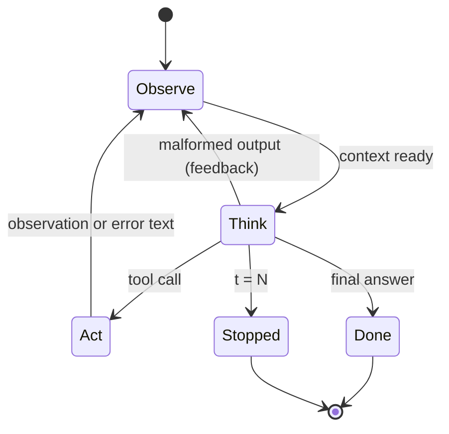

A loop that "keeps going until the model is done" sounds simple, and it is the source of most agent bugs. What happens if the tool throws? If the model replies with plain text instead of a call? If it never stops? The cure is the same one engineers use for network protocols and checkout flows: write the loop down as a **state machine**, a fixed set of states and the exact events that move between them.

Think of a vending machine. It is always in exactly one state (idle, has coins, dispensing), and each event (coin inserted, button pressed) has one defined outcome. Nothing is left to interpretation. An agent loop deserves the same treatment, because the model is an unpredictable component and everything around it should be predictable.

## Observe, think, act

The classic description of an agent is **observe → think → act**. Mapped onto code:

- **Observe**: assemble the context $c_t$ from the task, history and latest observation.
- **Think**: call the model on $c_t$. Its output is either a tool call, a final answer, or something malformed.
- **Act**: validate and execute the tool call, producing observation $o_t$.

Then go back to Observe. Two terminal states end the loop: **Done** (a final answer) and **Stopped** (a limit was hit or an unrecoverable error occurred).



## The transition function

Formally, a state machine is a set of states $S$, a set of events $E$ and a **transition function** $\delta : S \times E \to S$ that says where each event leads. For the loop, the state also carries a step counter $t$ and a limit $N$:

$$
\delta(\text{Think}, e) =
\begin{cases}
\text{Act} & e = \text{tool call and } t < N \\
\text{Done} & e = \text{final answer} \\
\text{Observe} & e = \text{malformed and } t < N \\
\text{Stopped} & t = N
\end{cases}
$$

Each pass through Think increments $t$ by one. The guard $t < N$ is what guarantees termination: whatever the model does, the machine reaches a terminal state after at most $N$ model calls. Every row of this function is a decision you make in code, not something you hope the model gets right.

```steps
Tracing the machine with N = 4
$t = 0$: Observe builds the context. Think: the model calls `search(q="refund policy")`. Act runs it and gets 3 results. Back to Observe.
---
$t = 1$: Think: the model calls `read_page(id=7)`. Act: the tool raises a timeout. The machine does not crash; it turns the error into an observation, "read_page timed out after 10 s", and goes to Observe.
---
$t = 2$: Think: the model retries with `read_page(id=7)` and Act succeeds. Observe appends the page text.
---
$t = 3$: Think: the model writes a final answer. The machine moves to Done after 4 model calls ($t$ went 0, 1, 2, 3), exactly at the limit. Had it asked for one more tool, the next transition would have been Stopped.
```

Notice the second step. A tool error is an **event with a defined transition**, not an exception that kills the run. Feeding the error back as an observation lets the model adapt (retry, choose another tool, or explain the failure). You will build on this in the failures lesson.

## See it

The simulation steps through a recorded agent trace one state at a time: each think, each tool call, each observation.

```sim
agent-loop
```

Try three things. Step through a full run and count model calls versus tool calls (there is always one more model call, because the last call produces the answer). Then lower the maximum steps until the run ends in Stopped instead of Done, and note which step it was on. Finally, inject a tool failure and watch whether the trace shows the error coming back as an observation and what the model does next.

## In practice

Production agent frameworks are, underneath, this state machine with logging attached. Writing it explicitly pays off in three ways. You can **log every transition** with the step number, which becomes the trace you debug from (lesson 7). You can **test each transition** with a fake model that returns scripted outputs, so loop logic is covered by fast deterministic tests. And you can **add states** cleanly later: an "Awaiting approval" state between Think and Act is how human sign-off works in the bounded-autonomy lesson.

A common mistake is handling the malformed case by raising an exception. Models occasionally emit a call to a tool that does not exist or arguments that fail validation. Treat it as an observation ("unknown tool `serch`; available tools are search, read_page") and let the step counter bound the retries.

```quiz
{"q": "An agent loop has a cap of N = 6 model calls. The model never produces a final answer. How many tool executions can happen at most?", "options": ["6", "5", "7", "Unbounded"], "answer": 0, "explain": "Each of the 6 model calls can produce a tool call, each followed by an execution, then the guard t = N moves the machine to Stopped instead of calling the model again. Answering 5 assumes the last call must be an answer, which is only true for runs that finish; 'unbounded' is exactly what the guard prevents."}
```

```quiz
{"q": "A tool raises a network error during Act. Which transition is usually best?", "options": ["Crash the run and return a 500 to the user", "Return to Observe with the error text as the observation, and let the step limit bound retries", "Silently retry forever until it works", "Jump straight to Done with an empty answer"], "answer": 1, "explain": "Turning the error into an observation keeps the machine in a defined state and gives the model a chance to recover or explain. Retrying forever removes the termination guarantee; crashing throws away the work already done."}
```
