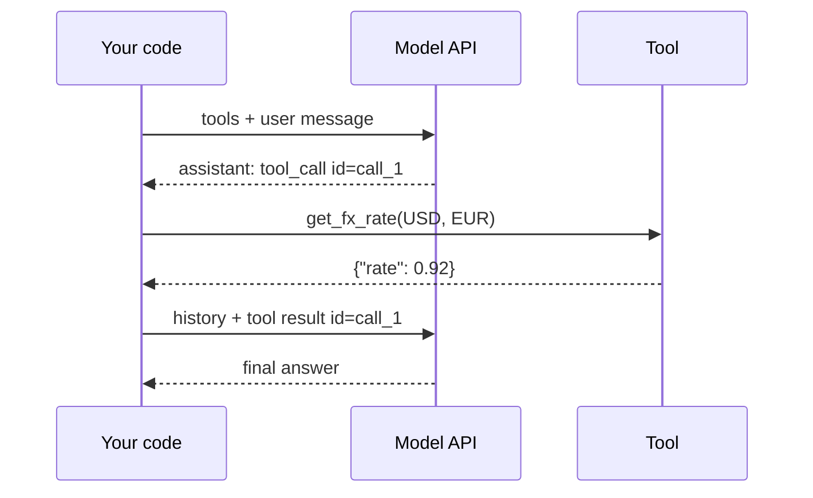

Under the friendly word "agent" there is nothing but a list of messages. Seeing that list exactly, with every field in place, removes most of the mystery and most of the bugs. If you can write the messages for a run by hand, you can debug any agent framework, because they all produce the same shape.

Think of it like a restaurant order pad. The waiter (the model) writes an order with a ticket number. The kitchen (your code) cooks it and sends the dish back with the same ticket number. Nobody mixes up two tables because the numbers match. Tool calls work the same way: each call carries an **id**, and each result names the id it answers.

## The four kinds of message

Provider APIs differ in field names, but every one of them has these pieces:

1. **Tool definitions**, sent with every request: a name, a description and a JSON Schema for the arguments.
2. A **user** message with the task.
3. An **assistant** message that contains one or more **tool calls**, each with an id, a tool name and arguments.
4. A **tool result** message for each call, carrying the call's id and the output (or an error).

Here is a complete two-turn exchange in a provider-neutral form:

```json
[
  {"role": "user", "content": "Convert 250 US dollars to euros."},
  {"role": "assistant", "tool_calls": [
    {"id": "call_1", "name": "get_fx_rate", "arguments": {"from": "USD", "to": "EUR"}}
  ]},
  {"role": "tool", "tool_call_id": "call_1", "content": "{\"rate\": 0.92}"},
  {"role": "assistant", "content": "250 USD is about 230 EUR at a rate of 0.92."}
]
```

The model emitted the arguments as structured data that matches the schema; your code parsed them, called the real service, and sent back a result tagged `call_1`. The model then did the arithmetic $250 \times 0.92 = 230$ in its answer. (For anything that matters, give it a calculator tool instead: models are not reliable at arithmetic.)



## Parallel calls

A model may return several tool calls in one assistant message, for example fetching the weather in three cities at once. Your code can run them concurrently, and must send back **one result per id**. Latency then depends on the slowest call rather than the sum:

$$
\text{latency}_\text{sequential} = \sum_{j=1}^{k} \ell_j, \qquad \text{latency}_\text{parallel} = \max_j \ell_j
$$

where $\ell_j$ is the latency of call $j$ and $k$ is the number of calls. Three lookups taking 400, 700 and 500 ms cost 1600 ms one after another, but 700 ms in parallel. Parallel calls also save model calls: one assistant turn instead of three.

## The hidden cost of tool definitions

Tool definitions are part of the prompt, so they are billed and re-read on **every** model call in the run. If you define $m$ tools averaging $s$ tokens each, and the run makes $K$ model calls, the definitions alone cost

$$
\text{definition tokens} = m \cdot s \cdot K
$$

With 12 tools at 180 tokens each and a 10-call run, that is $12 \times 180 \times 10 = 21{,}600$ input tokens before the task itself contributes anything. At \$3 per million input tokens that is about 6.5 cents per run, purely for describing tools, and it adds the same prefill latency to every step. Prompt caching (module 3) helps a lot here because the definitions are an identical prefix on every call.

| Field | Who writes it | Typical mistake |
|---|---|---|
| tool name and schema | you | vague names like `do_action` |
| call id | the model API | dropping it when sending results back |
| arguments | the model | not validating them before use |
| result content | your code | returning a 50 kB blob the model must read every later step |

## In practice

The most common integration bugs are mechanical. Sending results back without their ids, or in a different order from the calls, makes the API reject the request. Forgetting to include the assistant message that contained the tool calls (sending only the results) breaks the pairing. Returning a Python exception's full stack trace as the result wastes tokens and confuses the model: return a short, actionable error message instead (lesson 3 covers how).

Finally, the model's arguments are untrusted input. They usually match the schema, but your code must validate types, ranges and permissions before executing, exactly as you would for a request from a web form.

```quiz
{"q": "An assistant turn contains three tool calls whose tools take 300 ms, 900 ms and 600 ms. Your code runs them concurrently. Roughly how long does the tool phase take?", "options": ["1,800 ms", "900 ms", "600 ms", "300 ms"], "answer": 1, "explain": "Concurrent calls finish when the slowest one does: max(300, 900, 600) = 900 ms. 1,800 ms is the sequential sum, which is what you pay if you run them one after another."}
```

```quiz
{"q": "An agent defines 20 tools averaging 150 tokens each. A typical run makes 8 model calls. How many input tokens per run go to tool definitions alone?", "options": ["3,000", "24,000", "1,200", "160"], "answer": 1, "explain": "Definitions are resent on every call: 20 × 150 × 8 = 24,000 tokens. 3,000 is the size of the definitions once, which is only right for a single call."}
```
