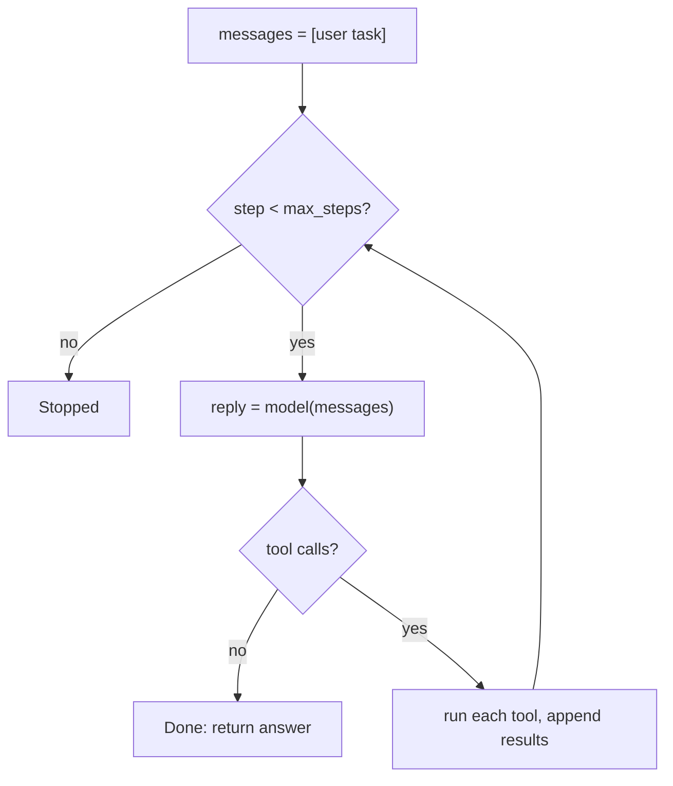

Frameworks make agents look complicated. Strip them back and the loop fits on one screen: a dictionary of tools, a function that calls the model, and a `for` loop with a cap. Writing it once yourself is the fastest way to understand what every framework is doing for you, and where it can go wrong.

To keep the code runnable anywhere, the "model" below is a scripted stand-in that returns the same replies a real model would for this task. Swap `fake_model` for a function that calls your provider's API and parses its reply into the same shape, and nothing else changes.

```python
import json

# Tools: plain functions plus a registry the loop can look up by name.
def get_order(order_id: int) -> dict:
    return {"order_id": order_id, "status": "shipped", "tracking": "JD0142"}

def get_eta(tracking: str) -> dict:
    return {"tracking": tracking, "eta": "Thursday"}

TOOLS = {"get_order": get_order, "get_eta": get_eta}

# A scripted stand-in for the model so the loop runs offline.
def fake_model(messages):
    n_results = sum(1 for m in messages if m["role"] == "tool")
    if n_results == 0:
        return {"tool_calls": [{"id": "c1", "name": "get_order", "arguments": {"order_id": 4417}}]}
    if n_results == 1:
        tracking = json.loads(messages[-1]["content"])["tracking"]
        return {"tool_calls": [{"id": "c2", "name": "get_eta", "arguments": {"tracking": tracking}}]}
    eta = json.loads(messages[-1]["content"])["eta"]
    return {"content": f"Your order should arrive on {eta}."}

def run_agent(task, model, max_steps=5):
    messages = [{"role": "user", "content": task}]
    for step in range(max_steps):                      # guard: at most max_steps model calls
        reply = model(messages)                        # Think
        if not reply.get("tool_calls"):                # final answer -> Done
            return reply["content"], step + 1
        messages.append({"role": "assistant", "tool_calls": reply["tool_calls"]})
        for call in reply["tool_calls"]:               # Act
            fn = TOOLS.get(call["name"])
            try:
                result = fn(**call["arguments"]) if fn else {"error": f"unknown tool {call['name']}"}
            except Exception as e:                     # errors become observations
                result = {"error": f"{type(e).__name__}: {e}"}
            messages.append({"role": "tool", "tool_call_id": call["id"], "content": json.dumps(result)})
    return "Stopped: step limit reached.", max_steps

print(run_agent("Will order 4417 arrive before Friday?", fake_model))
print(run_agent("Will order 4417 arrive before Friday?", fake_model, max_steps=2))
```

Running it prints `('Your order should arrive on Thursday.', 3)` and then `('Stopped: step limit reached.', 2)`. The second run shows the cap doing its job: the model wanted a third call to write its answer and was not allowed one.

## Where each idea from this lesson lives

| Idea | Line(s) in the code |
|---|---|
| Observe: the context $c_t$ | `messages`, which only ever grows |
| Think: $a_t = \pi(c_t)$ | `reply = model(messages)` |
| Act and observation $o_t$ | the inner `for call in ...` loop |
| Matching ids | `"tool_call_id": call["id"]` |
| Errors as observations | the `try` / `except` and the unknown-tool branch |
| Termination guarantee | `for step in range(max_steps)` |

## Counting what the loop does

Two simple identities let you sanity-check any trace. If a finished run made $R$ rounds of tool calls, it made exactly

$$
K = R + 1
$$

model calls, because every round is preceded by a model call and one more call writes the answer. And if round $r$ contained $m_r$ parallel calls, the run executed

$$
E = \sum_{r=1}^{R} m_r \le N \cdot m_\text{max}
$$

tools in total, where $m_\text{max}$ is the largest number of calls the model may issue in one turn. The right-hand side is your worst case: with $N = 5$ and up to 4 parallel calls per turn, a single run can execute at most $5 \times 4 = 20$ tools. If one of those tools sends email, that bound is worth knowing before launch, not after.

For the order example, $R = 2$ rounds with $m_1 = m_2 = 1$, so $K = 3$ model calls and $E = 2$ tool executions, which is exactly what the program reported.



## What production adds

This loop is correct but naive. Real systems add, in roughly this order: validation of arguments against each tool's schema before calling it; timeouts on every tool (a tool that hangs must not hang the run); a token and cost budget alongside the step cap; a log line per transition so you get a trace; and concurrency for parallel calls. Each is a few lines, and each is covered later in this module. Notice that none of them touches the model: reliability is mostly built in the code around it.

## Try it

Step through a full recorded run in the simulation and match each event to a line of the code above.

```sim
agent-loop
```

Inject a tool failure and check that the trace shows what the `except` branch would produce: an error observation followed by another model call, not a crash.

```quiz
{"q": "A finished run made 4 rounds of tool calls, with 1, 3, 2 and 1 calls per round. How many model calls and tool executions were there?", "options": ["4 model calls, 7 tool executions", "5 model calls, 7 tool executions", "5 model calls, 4 tool executions", "7 model calls, 7 tool executions"], "answer": 1, "explain": "K = R + 1 = 5 model calls (one before each round plus one for the answer), and E = 1 + 3 + 2 + 1 = 7 executions. Forgetting the final answering call gives 4."}
```

```quiz
{"q": "In the code above, what would happen if the line that appends the tool result were deleted?", "options": ["Nothing; the model remembers the result", "The model would never see the result, so it would likely call the same tool again until the step cap stops it", "The program would crash immediately", "The run would finish faster"], "answer": 1, "explain": "The model's only memory is the messages list. Without the result it sees an unanswered need and repeats the call; the step cap then ends the run with 'Stopped'. (Real APIs would also reject a tool call with no matching result.)"}
```
