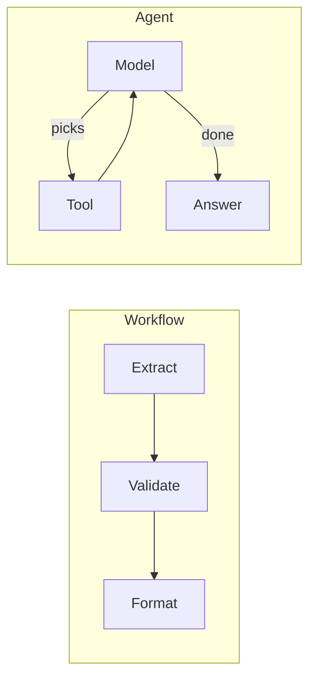

```callout-before
Before you start
You should be comfortable with the agent loop from the previous lesson: context in, tool call or answer out, repeat. This lesson asks a design question about that loop: should the model be in charge of it at all?
```

Two kitchens make the same dish. In the first, the head chef has written a recipe card: chop, sear, deglaze, plate. Any cook can follow it, and every plate looks the same. In the second, a talented chef tastes as they go and decides what to do next. The second kitchen copes with odd ingredients and unusual orders, and it also occasionally produces something nobody asked for.

LLM systems face the same choice. In a **workflow**, your code fixes the sequence of steps; models fill in each step (summarise this, classify that) but never choose what happens next. In an **agent**, the model chooses the next step at run time, including which tool to call and when to stop. The question "who decides the next step?" is the whole distinction.

## A spectrum, not a switch

Real systems sit somewhere between the two:

| Design | Who chooses the steps | Example |
|---|---|---|
| Single call | nobody: one step | classify a ticket |
| Fixed chain | code, always the same steps | extract fields, then validate, then format |
| Branching workflow | code, using a model's output as a branch condition | route a ticket to billing or tech flow |
| Agent with a fixed toolset | the model, within limits you set | support agent that can look up orders and issue refunds |
| Open-ended agent | the model, with broad tools | a coding agent that can run any shell command |

Moving down the table buys flexibility and costs predictability. A workflow is a **directed acyclic graph** (DAG): a fixed set of nodes and arrows with no cycles, so you can list every path it can take. An agent's path is decided as it runs.



## Counting the paths

The difference is starkest when you count how many distinct sequences of steps each design can produce. A three-step chain has exactly **one** path. A workflow with one two-way branch has two. An agent that may call any of $m$ tools at each of up to $N$ steps can follow

$$
\text{paths} = \sum_{k=1}^{N} m^k = \frac{m^{N+1} - m}{m - 1}
$$

distinct tool sequences (counting only which tool is called, ignoring arguments). With $m = 5$ tools and $N = 6$ steps:

$$
\frac{5^7 - 5}{4} = \frac{78{,}125 - 5}{4} = 19{,}530
$$

You cannot test 19,530 paths one by one, and arguments make the real number vastly larger. You can test every path of a workflow. That is the core trade: an agent's flexibility is exactly the size of the space you can no longer enumerate.

## When each one wins

Workflows win when the task decomposes into steps you can name in advance: document extraction, translation then review, classification then templated reply. They are cheaper (no planning calls), faster (steps can be parallelised by design), and easier to debug (a failure points to a node).

Agents win when the number and order of steps genuinely depend on what is discovered along the way: debugging a codebase, researching an open question, resolving a support case whose facts are unknown at the start. Writing a workflow for these would mean anticipating every branch, which is exactly the job you want the model to do.

## In practice

A good default is to start with the simplest design that could work, usually a single well-prompted call, then a workflow, and only then an agent. Many production "agents" are in fact workflows with one or two model-controlled steps embedded where flexibility pays. The rest of this lesson gives you the numbers to make that call, starting with the most important one: how reliability falls as steps add up.

```quiz
{"q": "An agent can call any of 3 tools at each step, for up to 4 steps. How many distinct tool sequences can it produce (ignoring arguments)?", "options": ["12", "81", "120", "64"], "answer": 2, "explain": "Sum over lengths 1 to 4: 3 + 9 + 27 + 81 = 120, or (3⁵ − 3)/2 = 120. 81 counts only sequences of exactly 4 steps; 12 multiplies tools by steps."}
```

```quiz
{"q": "Which task is the strongest case for an agent rather than a workflow?", "options": ["Translate a document, then have a second call check terminology", "Classify each email into one of 6 folders", "Find the cause of a failing test in an unfamiliar codebase", "Extract invoice fields into JSON"], "answer": 2, "explain": "Debugging needs steps that depend on what each previous step reveals, so they cannot be fixed in advance. The other three decompose into known steps, where a workflow is cheaper and more predictable."}
```
