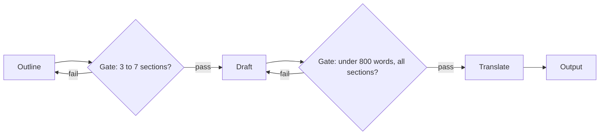

The simplest workflow is a **prompt chain**: break a task into a fixed sequence of model calls, where each call's output becomes the next call's input. Write an outline, then draft from the outline, then translate the draft. Each call does one thing, so each prompt can be short and specific, and each step can be tested on its own.

An assembly line is the right picture. Nobody builds a whole car at one station. Each station does one job well, and between stations there is an inspection: if a door is misaligned, it is caught before the paint goes on. In a prompt chain the inspections are called **gates**: cheap programmatic checks between steps that catch a bad output before the next step builds on it.

## Why splitting helps

A single prompt asked to do three things at once tends to do each of them a bit worse. Suppose one combined prompt gets everything right 75% of the time, while three focused prompts each succeed 95% of the time. The chain succeeds with probability

$$
0.95^3 = 0.857
$$

which beats the combined prompt despite having three chances to fail. Splitting only helps when the per-step gain outweighs the extra multiplication, so measure both. It also costs more latency (three calls in sequence) and more tokens (each call carries its own instructions).

## What a gate buys you

A gate is code, not a model: check the JSON parses, the outline has 3 to 7 sections, the summary is under 200 words, every cited ID exists. Say a step succeeds with probability $p$, the gate **detects** a bad output with probability $d$, and on detection the step is rerun once. The step now succeeds if it works first time, or if it fails, is caught, and the rerun works:

$$
p' = p + (1-p)\, d\, p
$$

The expected number of calls per step rises from 1 to $1 + (1-p)d$, because the rerun happens only after a caught failure.

```steps
Worked example: a 4-step chain with gates
Each step succeeds with $p = 0.90$. Without gates the chain succeeds with $0.9^4 = 0.656$.
---
Add a gate with detection rate $d = 0.8$ and one rerun. Per step: $p' = 0.90 + 0.10 \times 0.8 \times 0.90 = 0.90 + 0.072 = 0.972$.
---
The chain: $0.972^4 = 0.893$. Success rose from 66% to 89%.
---
Cost: each step makes $1 + 0.10 \times 0.8 = 1.08$ calls on average, so 4.32 calls instead of 4: **8% more calls for 23 points more success**.
```

Two details matter. First, the gate's detection rate caps the gain: a gate that catches nothing ($d = 0$) leaves $p' = p$. Second, a gate that **aborts** instead of rerunning does not raise success at all, but it still helps, because it stops a doomed run early and saves the cost of every later step. Failing fast is a cost optimisation; failing and retrying is a reliability one.



## A gate in code

```python
import json

def gate_outline(text: str) -> str | None:
    """Return None if the outline is acceptable, else a reason."""
    try:
        sections = json.loads(text)["sections"]
    except (ValueError, KeyError, TypeError):
        return "output was not JSON with a 'sections' list"
    if not 3 <= len(sections) <= 7:
        return f"expected 3 to 7 sections, got {len(sections)}"
    return None

print(gate_outline('{"sections": ["Intro", "Method", "Results"]}'))  # None
print(gate_outline('{"sections": ["Everything"]}'))                  # expected 3 to 7 sections, got 1
```

Returning a **reason** rather than a bare failure is deliberate: you can paste it into the rerun's prompt ("your previous outline had 1 section; produce 3 to 7"), which makes the rerun more likely to succeed than a blind retry.

## In practice

Gates are the cheapest reliability you can buy, because they cost microseconds and no tokens. Good ones check structure (parses, required fields present), constraints (lengths, ranges, allowed values) and references (IDs exist, quoted text appears in the source). Model-based checks ("is this summary faithful?") are possible gates too, but they cost a call and have their own error rate, which you then need to measure like any other step.

```quiz
{"q": "A step succeeds 80% of the time. A gate catches 90% of bad outputs and triggers one rerun. What is the step's new success rate?", "options": ["90%", "94.4%", "98%", "72%"], "answer": 1, "explain": "p' = 0.8 + 0.2 × 0.9 × 0.8 = 0.8 + 0.144 = 0.944. 98% would assume the rerun always succeeds; 72% multiplies p by d, which is not a meaningful quantity here."}
```

```quiz
{"q": "A gate detects bad outputs but, on detection, aborts the run instead of rerunning the step. What does it improve?", "options": ["End-to-end success rate", "Cost and latency of failed runs, by stopping them early", "Nothing at all", "The per-step success probability"], "answer": 1, "explain": "Without a rerun, a caught failure is still a failure, so success does not rise. But later steps are never run on bad input, which saves their tokens and time and avoids returning a confidently wrong result."}
```
