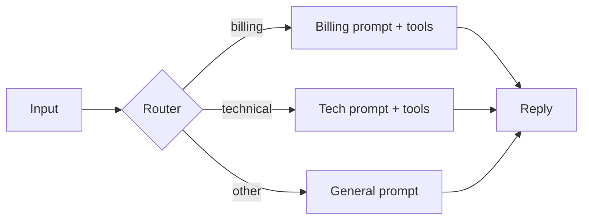

Chains run steps one after another. Two other workflow patterns change the shape of the graph. **Routing** sends each input down one of several branches, chosen by a classifier. **Parallelisation** runs several calls at once and combines the results, either by splitting the work into independent pieces (**sectioning**) or by asking the same question several times and taking a vote (**voting**).

A hospital triage desk is routing: a nurse spends thirty seconds deciding whether you need the fracture clinic or the cardiologist, so that each specialist sees only cases they are good at. A panel of three doctors reviewing the same X-ray independently is voting: any one of them may miss something, but they rarely all miss the same thing.

## Routing: one classifier, several specialists

A router is usually a cheap model call (or a small classifier) that labels the input, after which code picks the branch. Each branch has its own prompt, tools or even its own model. The overall success rate depends on how often the router is right:

$$
P(\text{success}) = a \cdot s_\text{right} + (1-a) \cdot s_\text{wrong}
$$

where $a$ is routing accuracy, $s_\text{right}$ is the success rate of a correctly routed input and $s_\text{wrong}$ that of a misrouted one. With $a = 0.95$, $s_\text{right} = 0.92$ and $s_\text{wrong} = 0.5$: $0.95 \times 0.92 + 0.05 \times 0.5 = 0.874 + 0.025 = 0.899$. The router costs about 2 points of success relative to a perfect router (0.92), which is the price of specialisation.

Routing also saves money. If a router costing $0.02$ units sends 70% of traffic to a small model costing $0.1$ units and 30% to a large one costing $1.0$, the average cost per request is

$$
0.02 + 0.7 \times 0.1 + 0.3 \times 1.0 = 0.39
$$

units, a 61% saving over sending everything to the large model. Module 8 treats this as model routing in depth.



## Parallelisation by sectioning

When a task splits into independent parts (review a contract's 4 sections, or check a draft for tone, facts and formatting), run the parts at the same time. Latency becomes the **slowest** part rather than the sum: four checks of 2, 3, 2 and 4 seconds take 4 seconds in parallel instead of 11. Tokens are not saved (every part still runs), but each call gets a short, focused prompt, which usually raises quality.

## Parallelisation by voting

Ask the same question $n$ times (with sampling, or with different prompts) and take the majority answer. If each attempt is right with probability $p$ independently, the majority of $n$ (odd) is right with probability

$$
P_\text{maj} = \sum_{k=\lceil n/2 \rceil}^{n} \binom{n}{k} p^k (1-p)^{n-k}
$$

```steps
Majority of three, p = 0.8
The majority is right when at least 2 of 3 are right. Exactly 3 right: $0.8^3 = 0.512$.
---
Exactly 2 right: there are $\binom{3}{2} = 3$ ways, each with probability $0.8^2 \times 0.2 = 0.128$, so $3 \times 0.128 = 0.384$.
---
Total: $0.512 + 0.384 = 0.896$. Voting lifts 80% to about 90%, for three times the tokens.
---
With $n = 5$ the same sum gives $0.942$. Gains shrink as you add voters, while cost grows linearly.
```

Voting has a sharp edge. If $p < 0.5$, the majority is **more** often wrong than a single attempt: with $p = 0.4$, the majority of three is right only $0.352$ of the time. And the formula assumes independent errors. Several samples from the same model often make the same mistake for the same reason, so real gains are smaller than the binomial predicts. Diverse voters (different prompts or different models) get closer to independence.

```sim
agent-reliability
```

In the simulation, set a per-step success rate of 0.8 and compare a single attempt with the verification or retry options. Notice that the shape of the improvement (big at first, then flattening) is the same one the majority-vote calculation shows.

## In practice

Routing is everywhere in production because it is cheap and it lets you tune each branch separately: a regression in billing prompts does not touch the tech branch. Always keep a fallback branch for inputs the router is unsure about, and log router decisions so you can measure $a$ against human labels. Voting is used more selectively, for high-stakes classifications or safety checks, where tripling the cost of one small call is worth a few points of accuracy.

```quiz
{"q": "Each of 3 independent judges is right with probability 0.6. How often is their majority vote right?", "options": ["0.600", "0.648", "0.784", "0.216"], "answer": 1, "explain": "P = 0.6³ + 3 × 0.6² × 0.4 = 0.216 + 0.432 = 0.648. Voting helps because p > 0.5. 0.216 counts only the case where all three are right."}
```

```quiz
{"q": "A router is 90% accurate. Correctly routed requests succeed 95% of the time; misrouted ones succeed 40%. What is the overall success rate?", "options": ["95.0%", "85.5%", "89.5%", "81.0%"], "answer": 2, "explain": "0.9 × 0.95 + 0.1 × 0.40 = 0.855 + 0.040 = 0.895. Answering 85.5% forgets that misrouted requests still sometimes succeed."}
```
