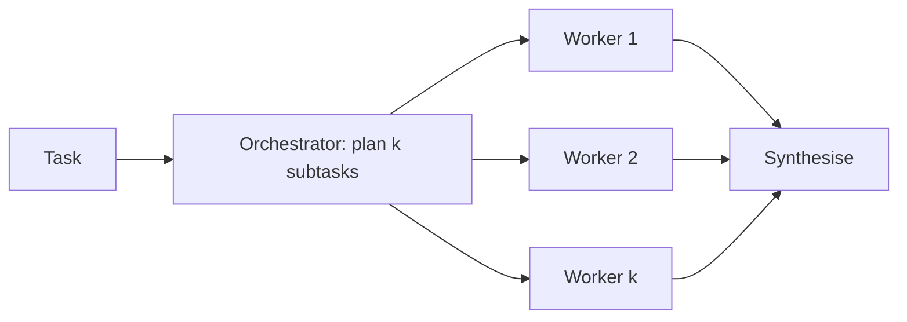

The last two workflow patterns are the most flexible, and they sit closest to the agent end of the spectrum. In **orchestrator-workers**, one model call looks at the task and decides how to split it into subtasks, then worker calls handle each subtask, and a final call combines the results. In **evaluator-optimiser**, one call produces a draft and another judges it against criteria; if the draft fails, the judge's feedback goes back to the first call for another try.

A newspaper desk works both ways. The editor reads the story brief and hands out assignments (one reporter takes the council meeting, another takes the budget figures): that is orchestrator-workers, and notice that the editor decides the split only after reading the brief, so the number of reporters varies. Later the copy chief reads a draft, marks problems and sends it back: that is evaluator-optimiser.

## Orchestrator-workers

The graph is still bounded: plan, fan out, combine. What differs from plain parallelisation is that the **number and content of subtasks is decided at run time** by the model. A coding task might need edits to 2 files or to 9; a research question might need 3 searches or 6.

Reliability multiplies, as always. If the plan is good with probability $q$, each of $k$ workers succeeds with probability $w$, and every subtask is needed, then

$$
P(\text{success}) = q \cdot w^{k}
$$

(ignoring the synthesis step, which you can multiply in as one more factor). With $q = 0.9$, $w = 0.95$ and $k = 4$ workers: $0.9 \times 0.95^4 = 0.9 \times 0.8145 = 0.733$. The plan is a single point of failure: a bad decomposition poisons all four workers, so it deserves a stronger model or a gate (for example, check that the subtasks cover every requirement in the brief).



Cost is $1 + k + 1$ model calls (plan, workers, synthesis), but latency is only three sequential stages because workers run in parallel. Each worker gets a fresh, small context rather than the orchestrator's growing one, which keeps the quadratic token growth from the previous lesson in check.

## Evaluator-optimiser

This is a loop with a model-based gate. Let a generated draft meet the bar with probability $g$. The evaluator **accepts a good draft** always but **catches a bad draft** only with probability $c$ (its recall on bad drafts); otherwise it wrongly accepts it. Each round has three outcomes:

- accept a good draft: $a = g$
- accept a bad draft by mistake: $b = (1-g)(1-c)$
- reject and try again: $r = (1-g)c$

With a cap of $R$ rounds, the probabilities of ending in each state are geometric sums:

$$
P(\text{good accepted}) = a\sum_{j=0}^{R-1} r^j, \qquad
P(\text{bad accepted}) = b\sum_{j=0}^{R-1} r^j, \qquad
P(\text{exhausted}) = r^R
$$

```steps
Worked example: g = 0.6, c = 0.8, R = 3
Per round: $a = 0.6$, $b = 0.4 \times 0.2 = 0.08$, $r = 0.4 \times 0.8 = 0.32$.
---
The common factor is $1 + r + r^2 = 1 + 0.32 + 0.1024 = 1.4224$.
---
$P(\text{good accepted}) = 0.6 \times 1.4224 = 0.853$. $P(\text{bad accepted}) = 0.08 \times 1.4224 = 0.114$.
---
$P(\text{exhausted}) = 0.32^3 = 0.033$. The three add to 1. A single attempt would have been good only 60% of the time.
```

Two lessons hide in this arithmetic. First, the loop lifts quality from 60% to 85%, but **the evaluator's recall caps the gain**: 11% of runs still return a bad draft that the judge waved through. Second, you must decide what happens on exhaustion (3.3% here): return the best draft with a warning, or escalate to a human. Silently returning the last draft hides the failure.

## In practice

Evaluator-optimiser works best when the criteria are clear and checkable (does the translation preserve all numbers, does the code pass these tests). With test-based evaluators, $c$ is close to 1 and the loop is very effective. With a vague judge ("is it good?"), models tend to approve their own work, so $c$ is low and the extra calls buy little. Measure $c$ against human labels before trusting the loop.

Both patterns are easy to over-use. If a single call with a good prompt already succeeds 95% of the time, a four-call orchestrator is mostly extra latency.

```quiz
{"q": "An orchestrator plans well with probability 0.9. It dispatches 3 workers, each succeeding with probability 0.9, and all 3 results are required. What is the success rate?", "options": ["0.729", "0.656", "0.810", "0.900"], "answer": 1, "explain": "0.9 × 0.9³ = 0.9 × 0.729 = 0.656. Answering 0.729 forgets that the plan itself can fail."}
```

```quiz
{"q": "In an evaluator-optimiser loop the evaluator rarely rejects drafts (low catch rate c). What is the most likely result?", "options": ["Quality barely improves over a single attempt, while cost rises", "Quality improves a lot, because more rounds always help", "The loop never terminates", "Every draft is rejected"], "answer": 0, "explain": "With low c almost every draft is accepted in round 1, so the loop behaves like a single call plus the evaluator's cost. More rounds only help if the evaluator can tell good from bad."}
```
