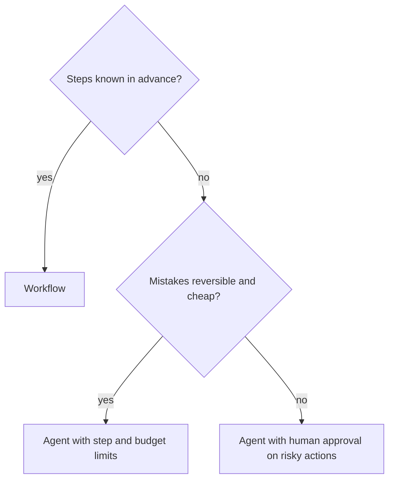

By now you have two sets of numbers. Workflows have bounded paths, a known number of calls and gates you control. Agents have flexible paths, a variable number of calls and reliability that decays with length. Choosing is a matter of comparing those numbers for your task, not of picking the more fashionable design.

A useful analogy is the difference between a train and a taxi. A train is cheap, fast and reliable, as long as your journey is on the line. A taxi goes anywhere and costs more, and the route depends on the driver. If 90% of your trips are on the line, ride the train and keep a taxi number for the rest.

## Four questions

1. **Can you list the steps in advance?** If yes, write them down as a workflow. The model's flexibility would be wasted and its variance would be a cost.
2. **How many steps does the typical run need?** Past about 10 to 15 model-chosen steps, compounding reliability bites hard (previous topics), so an agent needs verification and checkpoints.
3. **What does a wrong action cost?** Reversible, low-stakes actions suit an agent. Irreversible ones (payments, deletions) need either a workflow with fixed approval points or the limits from the last lesson of this module.
4. **What are the latency and cost budgets?** Agents cost several times more per task and take longer, as the next calculation shows.

## A cost comparison

Consider a task solved either by a 4-step workflow, where each call carries its own focused 2,000-token prompt, or by an agent that starts at $c_0 = 2000$ tokens, adds $\Delta = 600$ tokens per step and takes $K = 8$ calls on average.

Workflow input: $4 \times 2000 = 8{,}000$ tokens.

Agent input, using the series from lesson 1:

$$
I = K c_0 + \Delta \frac{K(K-1)}{2} = 8 \times 2000 + 600 \times 28 = 16{,}000 + 16{,}800 = 32{,}800
$$

That is $32{,}800 / 8{,}000 = 4.1$ times the input tokens. At \$3 per million input tokens, \$0.024 against \$0.098 per task. At 100,000 tasks a month, the gap is \$2,400 against \$9,840. If the agent's extra flexibility lifts success from 85% to 92% on a task worth a dollar, it may still be worth it; if success is the same, it is waste.

| Property | Workflow | Agent |
|---|---|---|
| Paths | few, enumerable | open-ended |
| Model calls | fixed | variable, often several times more |
| Failure analysis | "which node?" | "read the trace" |
| Testing | per node, then end to end | statistical, over many runs |
| Handles surprises | only those you coded | many, with some risk |

## See how the knobs interact

```sim
agent-reliability
{"p": 0.95, "n": 10, "retries": 1, "verify": false}
```

Start at the values above and read the task success. Raise the number of steps to 20 and note how much it falls. Then switch verification on and see how much of the loss it recovers, and at what cost in extra calls. This is the trade you make whenever you give a model more freedom: you must buy the reliability back somewhere.

## A decision sketch



## In practice

The pattern that works in most teams is incremental. Ship a single call. When it cannot do the job, add a gate or a chain. When the number of steps genuinely varies, introduce a model-controlled loop **inside** one node of an otherwise fixed workflow, with its own step cap. You end up with a workflow whose individual steps may be small agents, and you keep the predictability of the outer graph. Be suspicious of any design where the model chooses everything: ask which decisions you could have made in code.

```quiz
{"q": "A 4-call workflow uses 2,000 input tokens per call. An agent solves the same task in 6 calls with c₀ = 2,000 and Δ = 500. Roughly how many times more input tokens does the agent use?", "options": ["1.5", "2.4", "3.0", "0.75"], "answer": 1, "explain": "Agent: 6 × 2,000 + 500 × (6 × 5 / 2) = 12,000 + 7,500 = 19,500. Workflow: 4 × 2,000 = 8,000. The ratio is 2.44. A ratio of 1.5 would be the call-count ratio, which ignores re-reading the growing history."}
```

```quiz
{"q": "Which situation most favours an agent over a workflow?", "options": ["The steps are identical every time and the volume is 1M requests a day", "The steps depend on what earlier steps discover, and actions are reversible", "Actions are irreversible and need audit approval at fixed points", "Latency must be under 500 ms"], "answer": 1, "explain": "Variable, discovery-driven steps are what a workflow cannot encode, and reversibility makes model-chosen actions tolerable. The other options point to a workflow or to tight limits."}
```
