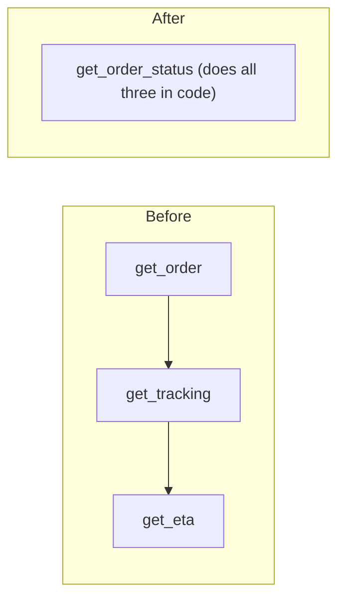

```callout-before
Before you start
You should know how a tool call travels as messages (previous lesson). Here we ask a design question: what makes a tool easy for a model to use correctly?
```

A good tool for a human developer is not automatically a good tool for a model. A human reads documentation once, remembers it, and notices when something looks off. A model sees the tool's name, description and schema on every call, has no memory of last time, and chooses by pattern-matching your text. The tool's description is effectively a tiny prompt, and it deserves the same care.

Think of labelling the buttons on a control panel for someone who has never seen it and cannot ask questions. `process(x)` tells them nothing. `refund_order(order_id, reason)` tells them what it does and what it needs. Most tool-use failures are label failures.

## Principles that hold up in practice

1. **Name by outcome, not mechanism.** `search_orders`, `cancel_subscription`. Not `query_db`, `run_action`.
2. **One clear job per tool.** A tool with a `mode` parameter that switches between five behaviours is five tools in a trench coat; the model must guess which mode you meant.
3. **Describe when to use it and when not to.** "Use for order lookups by ID. Do not use to search by customer name; use `find_customer` first."
4. **Return what the model needs, nothing else.** A 40-field JSON dump costs tokens every later step and buries the answer. Return the 5 relevant fields.
5. **Prefer identifiers the model has already seen.** If `search_orders` returns `order_id`, `get_order` should accept exactly that, not a different internal key.
6. **Make the safe thing the default.** A `dry_run` flag that defaults to true is better than a delete that defaults to real.

## Fewer, better tools

Each extra tool has a cost. Its definition occupies $s$ tokens on every call (earlier lesson: $m \cdot s \cdot K$ across a run), and it widens the choice the model must make at every step. Selection accuracy tends to fall as the toolset grows and as tools overlap in purpose. The numbers below are illustrative, not universal, but the shape is what you see in practice.

| Toolset | Illustrative selection accuracy per call | Over a 5-call run |
|---|---|---|
| 5 distinct tools | 0.99 | $0.99^5 = 0.951$ |
| 40 overlapping tools | 0.93 | $0.93^5 = 0.696$ |

Same model, same task, a 25-point drop in run success from tool sprawl alone. Cutting overlapping tools, or splitting them into groups and exposing only the relevant group (for example, by first routing the request, as in the previous lesson), reclaims it.

## Consolidating steps

The most valuable design move is usually to **merge tools that are always called together**. If answering "where is my order?" always takes `get_order`, then `get_tracking`, then `get_eta`, a single `get_order_status` that does all three in code replaces three model-chosen steps with one. By the product rule, with per-step reliability $p = 0.95$:

$$
p^3 = 0.95^3 = 0.857 \quad\text{versus}\quad p^1 = 0.95
$$

That is a 9-point gain, plus two fewer model calls and two fewer rounds of context re-reading. The model keeps the judgement (deciding the user wants order status); your code keeps the plumbing.



## Example: a good and a bad definition

```json
{"name": "do_action", "description": "Does an action", "parameters": {"type": "object", "properties": {"data": {"type": "string"}}}}
```

```json
{
  "name": "refund_order",
  "description": "Refund a delivered order. Use only after get_order shows status 'delivered' and the customer has stated a reason. Not for cancelling orders that have not shipped; use cancel_order for those.",
  "parameters": {
    "type": "object",
    "properties": {
      "order_id": {"type": "integer", "description": "The order_id returned by get_order"},
      "reason": {"type": "string", "enum": ["damaged", "wrong_item", "late", "other"]}
    },
    "required": ["order_id", "reason"]
  }
}
```

The second definition fixes the name, narrows the job, states preconditions, points at the neighbouring tool, and constrains `reason` to four values so the model cannot invent a fifth.

## In practice

Teams treat tool descriptions like prompts: they version them, test them on a set of realistic requests, and look at traces for the wrong-tool and wrong-argument cases. A cheap, high-value experiment is to take 30 recorded tasks and count how often the first tool the model picks is the one you would have picked. If it is under 90%, the problem is almost always the toolset or the descriptions, not the model.

```quiz
{"q": "An agent always calls get_user, then get_orders, then get_refund_status in that order for one common request. What is the best change?", "options": ["Add a fourth tool that summarises the other three", "Merge them into one tool that does the three lookups in code", "Raise the temperature so the model explores", "Remove the descriptions to save tokens"], "answer": 1, "explain": "A fixed sequence is plumbing, not judgement. One merged tool removes two model-chosen steps, and with p = 0.95 per step raises the chain from 0.857 to 0.95 while also cutting calls and tokens."}
```

```quiz
{"q": "Why is a tool with a 'mode' parameter that switches among five behaviours risky?", "options": ["JSON does not allow enums", "The model must infer which behaviour you mean from a single description, so wrong-mode calls rise", "It uses more output tokens", "Models cannot pass strings"], "answer": 1, "explain": "Five behaviours behind one name make the description vague and the arguments interdependent. Five narrowly named tools are easier for the model to pick between correctly."}
```
