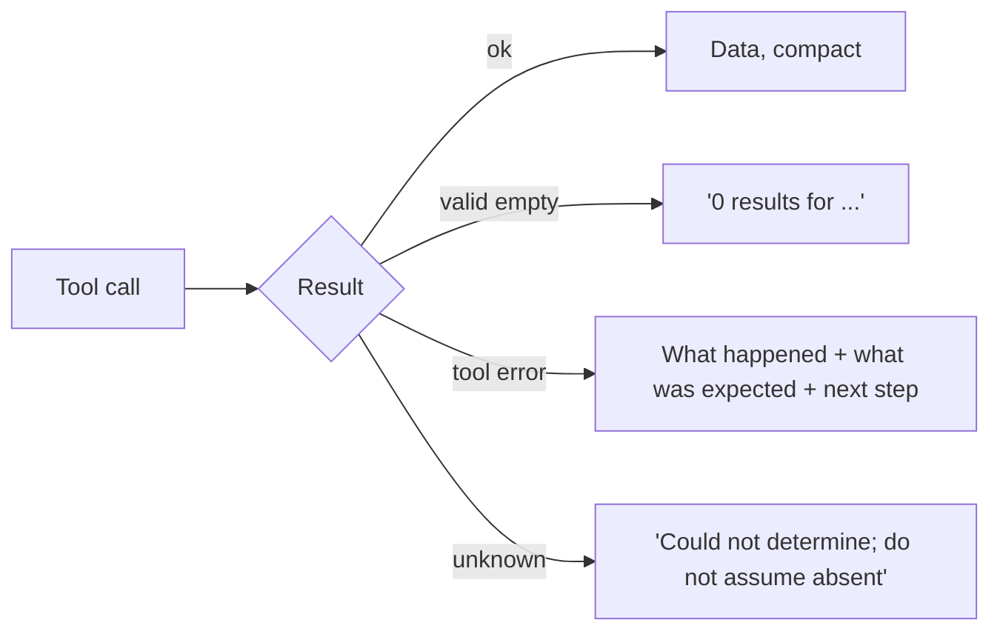

When a tool fails, the error message is the only thing the model learns about why. A message written for a human operator ("500 Internal Server Error", or a 40-line stack trace) tells the model almost nothing it can use. A message written for the model says what went wrong, what was expected, and what to try next. That difference decides whether the next step recovers or wanders.

Think of a satnav. "Error" is useless. "Road closed ahead, rerouting via the ring road" lets you carry on. The model is the driver, and the tool result is the satnav's voice.

## Three parts of a useful error

1. **What happened**, in plain words: "No order with id 4471."
2. **Why, or what was expected**: "Order ids are 4-digit integers between 1000 and 4999."
3. **What to do next**: "Call `search_orders` with the customer's email to find the id."

Compare:

| Vague | Actionable |
|---|---|
| `Error: invalid input` | `'days' must be between 1 and 7, got 10. Retry with days=7 for the longest forecast.` |
| `404` | `No customer with email 'ann@x.com'. Check spelling, or call find_customer with a name.` |
| `Traceback (most recent call last): ...` | `The service timed out after 10 s. It may be busy; retry once, then tell the user it is unavailable.` |
| `Permission denied` | `You may not refund orders above 100 USD. Ask the user to confirm and call request_approval instead.` |

Return errors **as normal tool results** that carry an error flag, not as crashes of your program. The model needs them in its context.

## How much it matters

Suppose each tool call fails with probability $f = 0.2$ in a 6-call run, so the run expects $6 \times 0.2 = 1.2$ failures. After a failure, each further attempt succeeds with probability $\rho$ (the chance the model fixes the problem on its next try), so the expected number of attempts needed to recover is $1/\rho$.

$$
\mathbb{E}[\text{extra calls}] = (n f)\cdot\frac{1}{\rho}
$$

Here $n$ is the number of tool calls and $f$ the failure rate, as above.

```steps
Worked example: vague versus actionable errors
Vague error: the model is mostly guessing, so $\rho = 0.3$. Expected attempts per failure: $1/0.3 = 3.33$.
---
Actionable error: the message names the fix, so $\rho = 0.8$. Expected attempts: $1/0.8 = 1.25$.
---
Per run: $1.2 \times 3.33 = 4.0$ extra calls with vague errors, against $1.2 \times 1.25 = 1.5$ with actionable ones.
---
Each extra call also re-reads the whole context (the quadratic growth from lesson 1), so the real cost gap is larger than the call count suggests. And the vague case is far more likely to hit the step cap before recovering.
```

The values of $\rho$ here are illustrative; measure yours by counting, in your traces, how often the call right after an error succeeds, for each error type.

## Errors that mislead

Some failures are worse than loud ones. A tool that returns an empty list for "nothing found" and also for "the service is down" teaches the model that the thing does not exist, and it will tell the user so. Make the distinction explicit:

- "0 results for 'blue widget'" (a valid empty answer) versus
- "search service unavailable (timeout); results unknown" (an error).

Likewise, truncation must be visible: "Showing 20 of 143 results; refine the query or pass `page=2`." A silently cut list is read as complete.



## In practice

Write the error text for the top five failures of each tool deliberately, rather than letting exceptions leak. Cap its length (a few hundred characters). Never include secrets, internal hostnames or stack traces in text the model will see: whatever is in the context can be repeated to the user or echoed into other tools. And log the full technical error separately for your own debugging.

```quiz
{"q": "A search tool returns an empty list both when nothing matches and when the backend is down. What is the likely consequence?", "options": ["The model will tell the user the item does not exist, even during an outage", "The model will retry forever", "Nothing, empty lists are always correct", "The tool becomes faster"], "answer": 0, "explain": "The model cannot distinguish the two cases, so it treats an outage as a valid empty answer. Return an explicit error for failures and reserve an empty list for a genuine zero-result search."}
```

```quiz
{"q": "A run makes 5 tool calls with failure rate 0.2 each. Errors are vague, so recovery succeeds with probability 0.25 per attempt. About how many extra calls does the run expect?", "options": ["1", "4", "5", "0.8"], "answer": 1, "explain": "Expected failures = 5 × 0.2 = 1. Each takes 1/0.25 = 4 attempts to recover, so 1 × 4 = 4 extra calls. Counting only the failure itself (1) ignores the retries."}
```
