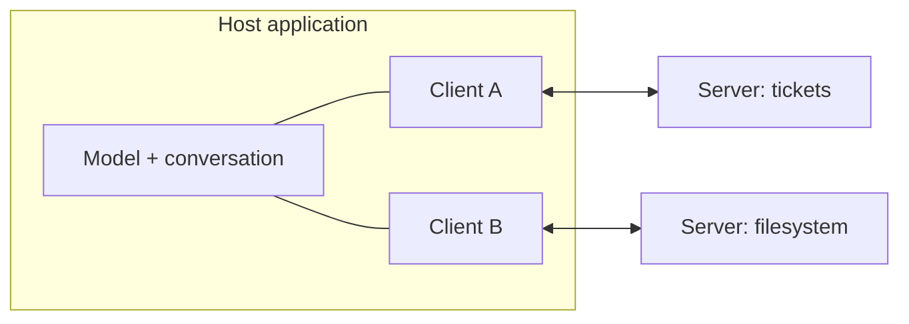

Suppose you build an assistant that can read your company's tickets, and another team builds one that can read the same tickets. Each of you writes a separate connector, in a different style, for a different model API. Add a documents system and a calendar and the number of connectors multiplies. This is the integration problem the **Model Context Protocol (MCP)** addresses: an open standard for how an AI application connects to tools and data, so a connector is written once and used by any compliant application.

The nearest everyday analogy is a USB port. Before USB, every device had its own plug. With one standard socket, any keyboard works with any computer. MCP aims to be that socket for models and the things they need to reach.

## The three roles

| Role | What it is | Example |
|---|---|---|
| **Host** | The AI application the user interacts with. It owns the model, the conversation and the user's permissions. | A desktop chat app, an IDE assistant, your own agent |
| **Client** | A connector inside the host that keeps a one-to-one connection to a single server. A host runs one client per server. | The code in the host that talks to the "tickets" server |
| **Server** | A program that exposes capabilities in the standard format. | A server wrapping your ticketing system, or a filesystem |



The model never talks to a server directly. The host decides what the model sees, which calls to allow, and what to show the user. That is where permissions and approvals belong.

## What servers offer

A server can expose three kinds of capability:

- **Tools**: functions the model can call, like `create_ticket`. The model decides when to call them (model-controlled).
- **Resources**: data the host can read and attach to context, like a file or a database record, identified by a URI. Typically the application or user chooses what to include (application-controlled).
- **Prompts**: reusable templates a user can invoke, such as "summarise this ticket thread" with arguments (user-controlled).

Most servers in practice are mainly tools, but the three-way split is useful: it separates what the model may trigger, what the app supplies as context, and what the user selects explicitly.

## Why a standard helps: the N times M problem

With $N$ host applications and $M$ services, bespoke integration needs one connector per pair:

$$
\text{connectors} = N \times M
$$

With a shared protocol, each host implements the client side once and each service implements the server side once:

$$
\text{implementations} = N + M
$$

```steps
Worked example: 5 hosts, 8 services
Without a standard: $5 \times 8 = 40$ connectors to build and maintain.
---
With a standard: $5 + 8 = 13$ implementations (5 client sides, 8 servers).
---
Add a ninth service: bespoke grows by 5 connectors; with the standard it grows by 1 server, immediately usable from all 5 hosts.
---
Break-even is small: for $N = M = 2$ the counts are 4 and 4. The standard pays off as soon as either side grows past 2.
```

The saving is real, but it moves the work rather than deleting it. Someone still has to write a good server, with the design care from the earlier topics, and the host must still decide which servers to trust.

## What MCP does not do

MCP standardises the plumbing, not the judgement. It does not make tools well designed, it does not stop a model from calling the wrong one, and it does not by itself make a server safe. A badly described tool is just as confusing over MCP as it was before. Treat MCP servers like any third-party dependency: read what they do, give them least privilege, and keep a human in the loop for consequential actions.

## In practice

Teams use MCP in two ways. As consumers, they plug existing servers (filesystem, databases, issue trackers, search) into a host and spend their effort on prompts and limits. As producers, they wrap an internal system as a server once and let several assistants use it. One caution: connecting many servers multiplies the tool definitions in context. Ten servers with ten tools each add 100 definitions to every call, which hits both cost and tool-selection accuracy (first topic of this lesson), so hosts often let users enable servers per task.

```quiz
{"q": "A company has 6 internal assistants and 10 internal services. How many implementations are needed with a shared protocol, compared with bespoke connectors?", "options": ["16 versus 60", "60 versus 16", "16 versus 16", "6 versus 10"], "answer": 0, "explain": "Shared protocol: N + M = 6 + 10 = 16. Bespoke: N × M = 60 connectors. The standard turns a product into a sum."}
```

```quiz
{"q": "In MCP, which component decides what the model is allowed to see and call, and shows approval prompts to the user?", "options": ["The server", "The host", "The model itself", "The transport"], "answer": 1, "explain": "The host owns the conversation, the model and the user's permissions; clients and servers sit behind it. Servers only expose capabilities and cannot be relied on to police themselves."}
```
