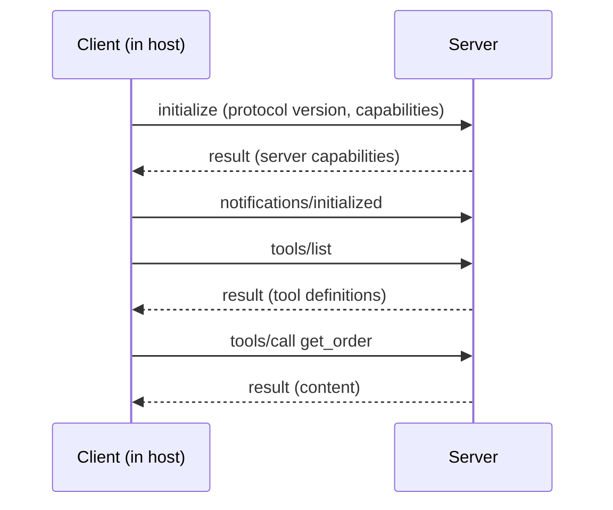

MCP is built on **JSON-RPC 2.0**, a very small standard for calling remote methods with JSON. Once you can read JSON-RPC you can read any MCP conversation, and the mystery goes out of it. There are only three kinds of message.

Think of a postal system with numbered letters. A **request** is a letter that expects a reply and carries a number. A **response** is the reply, stamped with the same number so the sender knows which letter it answers. A **notification** is a letter that needs no reply, so it carries no number.

## The three message shapes

A request has `jsonrpc`, an `id`, a `method` and optional `params`:

```json
{"jsonrpc": "2.0", "id": 7, "method": "tools/call", "params": {"name": "get_order", "arguments": {"order_id": 4417}}}
```

A response echoes the `id` and carries either a `result` or an `error` object (never both):

```json
{"jsonrpc": "2.0", "id": 7, "result": {"content": [{"type": "text", "text": "{\"status\": \"shipped\"}"}], "isError": false}}
```

A notification has a `method` but no `id`, and no response is sent:

```json
{"jsonrpc": "2.0", "method": "notifications/initialized"}
```

The `id` lets either side have many requests in flight at once and still match each answer to its question, which is exactly the ticket-number idea from the earlier tool-calling messages.

## A full session



1. **`initialize`**: the client states which protocol version it speaks and what it supports; the server replies with its own capabilities (for example, that it offers tools and resources). This is a handshake so both sides know what the other can do.
2. **`notifications/initialized`**: the client confirms it is ready.
3. **`tools/list`**: the client asks what tools exist and receives each tool's name, description and input schema. The host turns these into the tool definitions it gives the model.
4. **`tools/call`**: when the model chooses a tool, the host sends the name and arguments. The result carries a `content` list and an `isError` flag, so a tool failure is a normal result the model can read.

Resources and prompts follow the same pattern with their own methods: `resources/list`, `resources/read`, `prompts/list` and `prompts/get`.

## Two kinds of failure

JSON-RPC has a protocol-level `error` object (with a numeric `code` and a `message`) for problems like an unknown method or malformed parameters. A tool that ran but failed on its own terms ("no such order") should instead return a normal `result` with `isError: true` and an explanation, so the text reaches the model as an observation (previous topic). Mixing these up means the model either never sees the error or sees a cryptic protocol code.

## Latency arithmetic

Every request is a network round trip. If a round trip costs $\text{RTT}$ and the server takes $s$ to do the work, then a session start plus one call costs

$$
T = \underbrace{2\,\text{RTT}}_{\text{initialize + tools/list}} + \text{RTT} + s
$$

(the `initialized` notification needs no reply, so it adds no wait). With $\text{RTT} = 40$ ms and $s = 150$ ms, the first call takes $3 \times 40 + 150 = 270$ ms, and every later call only $\text{RTT} + s = 190$ ms. The handshake is paid once per connection, so hosts keep connections open instead of reconnecting per call. For a local server over a pipe, RTT is near zero and the work time $s$ dominates.

Tool listing also has a **token** cost, because every listed tool becomes part of the model's prompt. A server with 25 tools at 150 tokens each contributes $25 \times 150 = 3{,}750$ tokens to every model call while connected.

## Try it by hand

```python
import json

def handle(request: dict) -> dict | None:
    """A toy MCP-style server loop for one tool."""
    method, rid = request.get("method"), request.get("id")
    if rid is None:                      # notification: no reply
        return None
    if method == "tools/list":
        tool = {"name": "add", "description": "Add two numbers.",
                "inputSchema": {"type": "object", "properties": {"a": {"type": "number"}, "b": {"type": "number"}}, "required": ["a", "b"]}}
        return {"jsonrpc": "2.0", "id": rid, "result": {"tools": [tool]}}
    if method == "tools/call":
        args = request["params"]["arguments"]
        text = str(args["a"] + args["b"])
        return {"jsonrpc": "2.0", "id": rid, "result": {"content": [{"type": "text", "text": text}], "isError": False}}
    return {"jsonrpc": "2.0", "id": rid, "error": {"code": -32601, "message": f"Method not found: {method}"}}

call = {"jsonrpc": "2.0", "id": 1, "method": "tools/call", "params": {"name": "add", "arguments": {"a": 2, "b": 3}}}
print(json.dumps(handle(call)))
```

It prints a response with `"id": 1` and the text `5`. The code `-32601` is the standard JSON-RPC code for "method not found". (A real server also implements `initialize` and checks the tool name; this sketch only shows the message shapes.)

## In practice

When an MCP integration misbehaves, log the raw JSON-RPC messages first. Most problems are visible there: a tool list that never arrived, an `id` mismatch, arguments that do not match the schema, or an `isError` result the host did not pass on to the model.

```quiz
{"q": "Which JSON-RPC message has no id and receives no response?", "options": ["Request", "Response", "Notification", "Error"], "answer": 2, "explain": "A notification is fire-and-forget: it names a method but carries no id, so there is nothing for a reply to refer to. Requests carry ids because they expect a response that echoes the id."}
```

```quiz
{"q": "A tool ran but found no such order. How should an MCP server report it?", "options": ["A JSON-RPC protocol error with a numeric code only", "A normal result with isError set to true and an explanatory message", "Close the connection", "Return an empty string"], "answer": 1, "explain": "Tool-level failures belong in the result so the model reads them as observations and can recover. Protocol errors are for malformed requests or unknown methods."}
```
