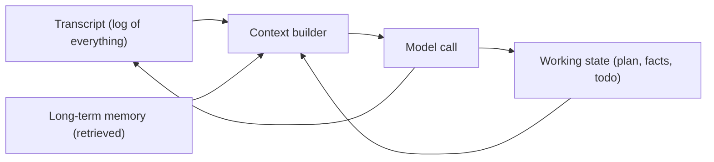

```callout-before
Before you start
Recall from lesson 1 that the model's weights never change during a run. Everything an agent "knows" about what it has done is whatever text you put back into its context.
```

Imagine a detective who has total amnesia every morning and must work from the notes left on the desk. If the notes are a complete, rambling log of everything that happened, she wades through pages before doing anything. If the notes are a tidy case file (suspects, evidence, next steps), she works fast. If the notes are missing a key fact, it is as if that fact never existed.

An agent is that detective. Designing its memory is deciding what goes on the desk. It helps to separate three things people casually call "memory", because they have different lifetimes and different homes.

| Kind | What it holds | Lifetime | Where it lives |
|---|---|---|---|
| **Transcript** | Every message, tool call and result so far | One run | The context window (and your logs) |
| **Working state** | The current plan, facts established, what is done and what is left | One run, but must survive compaction | A structured object you control, rendered into the context |
| **Long-term memory** | Facts and preferences that outlive the run: "this user prefers metric units" | Across runs, days or months | An external store, retrieved when relevant |

## The transcript is a poor database

The default design is to keep appending everything to the transcript and hope. That works for 5 steps and fails for 50, for three reasons:

1. **Cost.** Every call re-reads the whole thing, so input tokens grow quadratically (lesson 1).
2. **Capacity.** The window is finite, and a run can fill it.
3. **Attention.** Facts buried in the middle of a long context are used less reliably (the next topic shows this).

The cure is to treat the transcript as a log and keep the information the agent actually needs in a smaller, curated form.

## How many steps fit

Let the window be $W$ tokens, the starting context $c_0$, each step add $\Delta$ tokens, and reserve $R$ tokens for the model's own output. The largest number of steps $k$ before the context overflows satisfies

$$
c_0 + k\,\Delta \le W - R \quad\Longrightarrow\quad k_{\max} = \left\lfloor \frac{W - R - c_0}{\Delta} \right\rfloor
$$

```steps
Worked example: a 128,000-token window
Take $W = 128{,}000$, $R = 4{,}000$, $c_0 = 6{,}000$ (system prompt plus tool definitions) and $\Delta = 2{,}500$ per step.
---
Usable room for history: $128{,}000 - 4{,}000 - 6{,}000 = 118{,}000$ tokens.
---
$k_{\max} = \lfloor 118{,}000 / 2{,}500 \rfloor = \lfloor 47.2 \rfloor = 47$ steps. After 47 steps the context is $6{,}000 + 47 \times 2{,}500 = 123{,}500$ tokens.
---
Halve the observation size so $\Delta = 1{,}250$: $k_{\max} = \lfloor 118{,}000 / 1{,}250 \rfloor = 94$. Shrinking observations is the strongest lever on how long an agent can run.
```

In practice you rarely want to run to the limit. Long contexts cost more, respond more slowly, and degrade in quality well before they overflow, so teams set a compaction threshold at a fraction of $W$ (often somewhere between half and three quarters) and act before reaching it.



The context builder is the key piece. Each call, it assembles a fresh context from the sources above: system prompt, the state object, a few retrieved memories, and the most recent part of the transcript. The model's output updates the state and the log. Nothing forces the context to equal the transcript.

## In practice

The first design decision for any long-running agent is where each fact lives. Facts the agent must never lose (the user's goal, constraints, decisions made, IDs already created) belong in working state. Raw observations belong in the transcript and logs, where they can be dropped from the context. Facts that should survive to the next session belong in long-term memory. The next topics make each of these concrete.

```quiz
{"q": "W = 100,000, R = 2,000, c₀ = 8,000 and Δ = 3,000 per step. How many steps fit before overflow?", "options": ["30", "31", "33", "27"], "answer": 0, "explain": "k_max = ⌊(100,000 − 2,000 − 8,000) / 3,000⌋ = ⌊90,000 / 3,000⌋ = 30. A 31st step would push the context past the limit. Answering 33 divides the whole window by Δ and forgets both the reserve and the starting context."}
```

```quiz
{"q": "Which fact should live in working state rather than only in the transcript?", "options": ["The raw HTML of a page fetched 30 steps ago", "The user's stated constraint: budget under 500 dollars", "A timeout error from step 4 that was retried successfully", "The model's intermediate wording"], "answer": 1, "explain": "A constraint must never be lost, and the transcript can be compacted or pruned. Raw pages, resolved errors and wording are exactly what compaction is meant to discard."}
```
