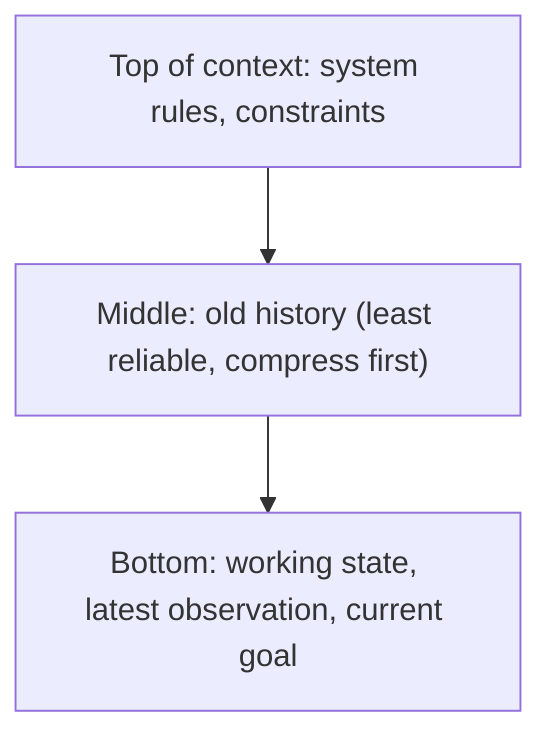

A context window is a budget, like a monthly salary. You can spend it on rent (fixed costs), groceries (things you need each week) and savings (headroom), but if you spend it all on rent you cannot eat. The first step to spending well is to write down the categories and put a number next to each.

An agent's context has six consumers. Fixed ones are paid on every call; variable ones grow as the run proceeds.

| Slice | Typical share | Grows over the run? |
|---|---|---|
| System prompt and rules | small, fixed | no |
| Tool definitions | fixed per toolset | no |
| Working state and plan | small | slowly |
| Retrieved memories or documents | bounded | no, if you cap $k$ |
| Transcript (calls and results) | the big one | yes, every step |
| Output reserve | fixed | no |

The sum has to fit:

$$
W \;\ge\; \underbrace{s + d + w + m}_{\text{fixed per call}} \;+\; \underbrace{h_t}_{\text{history at step } t} \;+\; R
$$

Here $s$ is the system prompt, $d$ the tool definitions, $w$ working state, $m$ retrieved memory, $h_t$ the history after $t$ steps, and $R$ the output reserve.

## A worked budget

```steps
Budget for a 32,000-token window
Fixed per call: system prompt $s = 1{,}200$, tool definitions $d = 2{,}400$, working state $w = 800$, retrieved memory $m = 1{,}000$. Sum: $5{,}400$ tokens.
---
Output reserve: $R = 2{,}000$ (room for a long answer or a big tool call).
---
Left for history: $32{,}000 - 5{,}400 - 2{,}000 = 24{,}600$ tokens.
---
If each step appends $\Delta = 1{,}800$ tokens, the history fills after $\lfloor 24{,}600 / 1{,}800 \rfloor = 13$ steps. To run 40 steps you must cut what the history holds, which is what summarising and pruning do in the next topics.
---
Fixed overhead is $5{,}400 / 32{,}000 = 16.9\%$ of the window, paid on every call whether or not it is useful. Trim a tool you never use and you win it back on every step.
```

Notice what a tight window punishes: the **fixed** portion is re-read on every single call, so a bloated system prompt or too many tool definitions taxes the whole run (this is the $m \cdot s \cdot K$ cost from lesson 1) and shrinks the room for history at the same time.

## Where in the window matters too

Capacity is not the only constraint. Models use information unevenly across a long context: facts near the start and the end are used more reliably than facts in the middle, and the effect grows with context length. The simulation below shows an illustrative curve.

```sim
context-position
{"contextTokens": 32768, "position": 50, "model": "older"}
```

Try this. With the fact at 50% of the context, read the recall. Move the position to 0 and then 100 and compare. Then raise the context length and watch the dip in the middle deepen. Finally switch the model to the long-context one and note how much the effect shrinks, though it does not vanish.

The design consequence is simple. Put the things that must not be missed at the **edges**: standing instructions and constraints at the top, the current goal and the latest instruction at the bottom, near where the model starts generating. Old tool results in the middle are the safest thing to compress or drop, which happens to be the biggest consumer anyway.

## In practice

Teams compute this budget once for each agent, as a table like the one above, and put alarms on it: log the context size at every call and alert when a run passes, say, 70% of the window. Two further habits help. Measure the **fixed overhead** per call and treat additions to the system prompt or toolset as having a recurring cost, not a one-off one. And test the agent at several context lengths: an agent that scores well on a 5-step demo can fail at step 30 simply because early constraints have slid into the poorly attended middle.



```quiz
{"q": "A 16,000-token window has fixed overhead of 3,000 tokens and an output reserve of 1,000. Each step adds 1,200 tokens. How many steps fit?", "options": ["8", "10", "13", "12"], "answer": 1, "explain": "History room = 16,000 − 3,000 − 1,000 = 12,000 tokens; 12,000 / 1,200 = 10 steps. Answering 13 ignores the fixed overhead and the reserve (16,000 / 1,200 ≈ 13)."}
```

```quiz
{"q": "Where should a standing constraint such as 'never email customers directly' sit in a long context?", "options": ["In the middle, between tool results", "At the start (and restated near the end), where recall is strongest", "Only in the first message, never repeated", "It does not matter where"], "answer": 1, "explain": "Recall dips in the middle of long contexts, so critical instructions belong at the edges. Restating a key rule near the current goal costs few tokens and guards against it being lost."}
```
