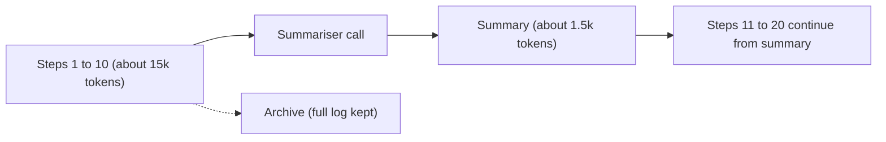

When the history grows too large, the standard fix is **compaction**: replace the older part of the transcript with a short summary, and carry on with the summary plus the most recent steps. It is how you take a 40-step run that would need a million tokens and make it fit in a few tens of thousands.

Think of meeting minutes. Nobody replays the whole recording at the next meeting. Someone writes half a page: decisions, open questions, next actions. The recording still exists in the archive, but the working memory of the team is the minutes. A compaction step writes the minutes of the run so far.

## The shape of the saving

Without compaction, the context at call $k$ is $c_0 + k\Delta$, and the total input over $K$ calls is the quadratic series from lesson 1. Now compact every $m$ steps: after each block of $m$ steps, the history is replaced by a summary of $s$ tokens. When a block is full and about to be summarised, the context never exceeds

$$
c_{\max} = c_0 + s + m\,\Delta
$$

no matter how long the run is. Inside a block, call $j$ (for $j = 0, \dots, m-1$) reads $c_0 + s + j\Delta$ tokens, so one block costs

$$
B = m\,(c_0 + s) + \Delta\,\frac{m(m-1)}{2}
$$

(The first block has no summary yet, so it costs the same expression with $s = 0$.)

```steps
Worked example: 40 steps, compaction every 10
Take $c_0 = 4{,}000$, $\Delta = 1{,}500$, $K = 40$, $m = 10$, and summaries of $s = 1{,}500$ tokens.
---
No compaction: $I = 40 \times 4{,}000 + 1{,}500 \times \frac{40 \times 39}{2} = 160{,}000 + 1{,}170{,}000 = 1{,}330{,}000$ input tokens. The final context is $4{,}000 + 39 \times 1{,}500 = 62{,}500$.
---
First block (no summary): $10 \times 4{,}000 + 1{,}500 \times 45 = 40{,}000 + 67{,}500 = 107{,}500$. Each later block: $10 \times 5{,}500 + 67{,}500 = 122{,}500$, and there are three of them: $367{,}500$. Total: $475{,}000$.
---
Add the three summarisation calls, which read about 19,000, 20,500 and 20,500 tokens: $60{,}000$. Grand total: $535{,}000$ input tokens, a **60% saving**. The context never exceeds $4{,}000 + 1{,}500 + 15{,}000 = 20{,}500$ tokens, against 62,500 without compaction.
```

Compaction therefore does three jobs at once: it cuts cost, it keeps the context under the window, and it keeps the context short enough that recall stays high.

## The risk: lossy memory

A summary is lossy by design. If it drops a detail the agent later needs, that detail is gone from the model's view. Common failures: a constraint stated early ("under 500 dollars") disappears; an ID created in step 6 is not mentioned; the summary records a failed attempt as a success. Several habits reduce this:

- **Summarise with a template**, not free prose: goal, constraints, decisions made, facts established, IDs and file paths created, open questions, next step. A template forces the slots to be filled.
- **Keep critical facts outside the summary**, in the working state object (next topic), so compaction cannot touch them.
- **Keep the last few steps verbatim**, because the freshest observations are the most likely to be needed exactly.
- **Archive the full transcript**, so a human (or a retrieval tool) can recover details later.



## When to compact

Two triggers are common. A **size trigger** fires when the context passes a threshold (for example 60 to 70% of the window). A **step trigger** fires every $m$ steps, as in the worked example. The size trigger adapts to bulky observations; the step trigger is predictable and easy to test. Many systems use both.

## In practice

Compaction is where agents quietly lose their way. Teams test it directly: take a long recorded run, compact it, and check that the questions the agent should still be able to answer (what was the budget, which file did we create, what did the user reject) are answerable from the compacted context alone. If you cannot write a handful of such questions for your agent, you probably do not yet know which facts are critical.

```quiz
{"q": "With c₀ = 2,000, s = 1,000, Δ = 1,000 and compaction every m = 8 steps, what is the largest context ever sent to a model (including the summariser call that ends each block)?", "options": ["11,000", "8,000", "3,000", "It grows without bound"], "answer": 0, "explain": "c_max = c₀ + s + mΔ = 2,000 + 1,000 + 8,000 = 11,000, the size when a block is full and is handed to the summariser. Without compaction the context would grow without bound; 3,000 is only the fixed part."}
```

```quiz
{"q": "Which summarisation approach best protects against losing a key constraint?", "options": ["Free-form prose summary of the whole conversation", "A template with an explicit 'constraints' slot, plus keeping constraints in working state", "Summarise more often", "Summarise with a smaller model"], "answer": 1, "explain": "A template forces the constraints slot to be filled, and the state object means compaction cannot remove them at all. More frequent or cheaper summarisation does nothing to guarantee a specific fact survives."}
```
