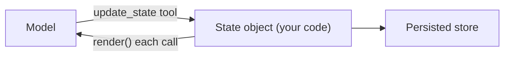

Keeping facts in the transcript means trusting compaction and attention to preserve them. A safer approach is to keep the facts that matter in a small, explicit, structured object that your code owns, and to render it into the context on every call. The model reads it and updates it through a tool; your code stores it. Compaction can rewrite the transcript as aggressively as it likes, because the state sits outside it.

A pilot's checklist is the right picture. It is short, structured, always in the same place, and ticked off as the flight proceeds. The pilot does not rely on remembering what happened ten minutes ago; the checklist says what is done and what is next.

## What goes in the state

A good state object has a handful of fixed fields:

| Field | Example | Why it matters |
|---|---|---|
| `goal` | "Book a hotel in Oslo for 2 nights" | Never lost, even after compaction |
| `constraints` | "under 150 EUR a night; near the station" | The facts compaction most often drops |
| `plan` | list of steps with status | Shows progress, prevents repeating work |
| `facts` | `{"city": "Oslo", "dates": "12-14 May"}` | Established results, in compact form |
| `ids` | `{"search_id": "s_91"}` | Handles needed by later tools |
| `notes` | "Hotel B has no free cancellation" | The model's own scratchpad |

A **scratchpad** is the free-form part: a place where the model may write notes to itself, via a tool such as `save_note(text)`. It is the simplest form of working memory, and it is the model deciding what is worth keeping.

## Token cost of state

State is paid for on every call, so it must stay small. If the state holds $w$ tokens and the run makes $K$ calls, the recurring cost is $w K$ input tokens. Compare it with keeping the same information in the transcript, where it would be re-read and also dragged along with everything around it:

$$
\text{state cost} = w\,K
$$

With a 400-token state and $K = 30$ calls, the state costs $400 \times 30 = 12{,}000$ input tokens, about 1% of the 1.33 million tokens that a 40-step uncompacted run from the last topic reads. For that, the agent gets a guaranteed copy of its goal, constraints and progress at the top of every call. It is one of the best-value pieces of context you can spend on.

```steps
Worked example: the state across a compaction
Before compaction the transcript holds 18 steps of searches and results. The state holds: goal, constraint "under 150 EUR", plan with steps 1 to 3 done, and fact `candidate = Hotel B`.
---
Compaction replaces the 18 steps with a 1,500-token summary. The summary happens to omit the budget.
---
The next call is built as: system prompt, tools, **state (goal, constraint, plan, facts)**, summary, last two steps. The 150 EUR limit is still there, because it was never in the part that was compacted.
---
The model reads the plan, sees step 4 is next, and continues. Without the state, it might have recommended a 200 EUR hotel.
```

## A small implementation

```python
from dataclasses import dataclass, field
import json

@dataclass
class AgentState:
    goal: str
    constraints: list[str] = field(default_factory=list)
    plan: list[dict] = field(default_factory=list)   # {"step": str, "done": bool}
    facts: dict = field(default_factory=dict)

    def render(self) -> str:
        """Compact text block placed near the top of every model call."""
        lines = [f"GOAL: {self.goal}", "CONSTRAINTS: " + "; ".join(self.constraints)]
        for i, p in enumerate(self.plan, 1):
            lines.append(f"{i}. [{'x' if p['done'] else ' '}] {p['step']}")
        lines.append("FACTS: " + json.dumps(self.facts, separators=(",", ":")))
        return "\n".join(lines)

s = AgentState("Book a hotel in Oslo, 2 nights", ["under 150 EUR a night"],
               [{"step": "search", "done": True}, {"step": "compare", "done": False}],
               {"candidate": "Hotel B"})
print(s.render())
```

It prints a five-line block you can paste straight into a prompt. Notice that it is compact: a few dozen tokens for goal, constraints, progress and facts.



## In practice

Two design rules keep state useful. **Let the model propose changes, but validate them in code**: if the model tries to delete a constraint the user set, reject it. And **persist the state outside the process** (a database row, a file), because a state that survives a crash gives you resumable runs, which the failures lesson builds on. A common mistake is letting the state grow into a second transcript: every note appended, none removed. Cap it, and have the agent rewrite it rather than only add to it.

```quiz
{"q": "A 500-token state is rendered into every one of 20 model calls. How many input tokens does the state cost in total?", "options": ["500", "10,000", "20,000", "100"], "answer": 1, "explain": "State cost = w × K = 500 × 20 = 10,000 tokens. Counting it once (500) forgets that the whole context is re-read on every call."}
```

```quiz
{"q": "After compaction the agent recommends an option that breaks a user constraint. What design would have prevented it?", "options": ["A bigger context window", "Keeping constraints in a state object rendered into every call, outside the compacted transcript", "A higher temperature", "Summarising more often"], "answer": 1, "explain": "A summary may drop any fact, but a state object is never compacted. A larger window only delays compaction, and summarising more often loses more detail, not less."}
```
