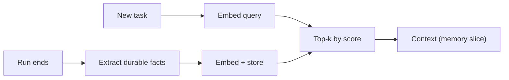

Everything so far lives and dies with a single run. A support agent that forgets a customer's preferences the moment the chat ends will ask the same questions every time. **Long-term memory** stores facts across runs and brings back the few that matter for the current task.

The mechanism is the one you met in the RAG module, pointed at the agent's own experience. A person's memory works similarly: you do not replay your whole life when someone says "Lisbon"; a few relevant memories surface, recent and vivid ones first. An agent does the same by **writing** memories to a store and **retrieving** a handful by relevance.

## The loop: write, embed, retrieve

1. **Write.** At the end of a run (or when something notable happens), the agent or a separate step extracts durable facts: "User prefers aisle seats", "Project Atlas deploys on Fridays". Store each as a short text with a timestamp.
2. **Embed.** Convert each memory to a vector with an embedding model (embeddings module). Store text, vector and metadata.
3. **Retrieve.** At the start of a new task, embed the task description, find the top-$k$ nearest memories by cosine similarity, and place them in the context (the $m$ slice of the budget).



## Scoring: relevance and recency

Pure similarity retrieves the most on-topic memory, even if it is two years stale. A common refinement multiplies similarity by a **recency decay**. With cosine similarity $\cos\theta$ between the query and the memory, age $a$ in days, and half-life $h$ days:

$$
\text{score} = \cos\theta \cdot 2^{-a/h}
$$

The factor $2^{-a/h}$ halves every $h$ days. Some systems add a third term for **importance** (how much the fact matters), but the idea is the same: combine several signals into one ranking number.

```steps
Worked example: half-life h = 30 days
Memory A: cosine similarity $0.82$, written 2 days ago. Decay: $2^{-2/30} = 0.955$. Score: $0.82 \times 0.955 = 0.783$.
---
Memory B: cosine similarity $0.88$, written 60 days ago. Decay: $2^{-60/30} = 2^{-2} = 0.25$. Score: $0.88 \times 0.25 = 0.22$.
---
B is more similar but A ranks far higher: $0.783 > 0.22$. A recent, slightly less relevant memory beats an old, slightly more relevant one.
---
Is that always right? For a fact that does not expire ("the user's name") it is wrong: such memories need a long half-life or no decay. Tune $h$ per memory type.
```

## Costs and risks

Retrieval costs tokens on every call: $k$ memories of $\bar{t}$ tokens each add $k\bar{t}$ to the fixed context. With $k = 5$ and $\bar{t} = 120$, that is $600$ tokens per call, over a 30-call run $18{,}000$ input tokens. Retrieving at the start of the task and refreshing only when the topic changes costs far less than retrieving at every step.

The main risks are all about quality:

- **Stale memories** that are no longer true. Store timestamps, allow updates and deletions, and prefer overwriting a fact to piling up contradictions.
- **Wrong memories**: something the model misunderstood gets stored and then repeated forever. Be selective about what is written, and let users see and edit what is remembered.
- **Irrelevant retrieval**: top-$k$ always returns $k$ items, even when none is relevant. Add a minimum score threshold so that "nothing relevant" is an allowed answer.
- **Privacy**: memory about a person is personal data. Scope it per user, give a way to delete it, and never retrieve one user's memories into another's context.

## In practice

Long-term memory is the part of an agent most likely to be overbuilt. Start with something much simpler than a vector store: a short per-user profile of a dozen facts rendered into the system prompt, like the state object. Move to vector retrieval only when the memory is too large to include wholesale. When you do, evaluate it like any retrieval system: write test queries with known right memories and measure recall@$k$.

```quiz
{"q": "Half-life h = 14 days. A memory is 28 days old with cosine similarity 0.9. What is its score?", "options": ["0.900", "0.450", "0.225", "0.600"], "answer": 2, "explain": "Decay = 2^(−28/14) = 2^(−2) = 0.25, so score = 0.9 × 0.25 = 0.225. A single half-life would give 0.45; two half-lives have passed."}
```

```quiz
{"q": "A memory retriever always returns its top 5 results. A user asks something unrelated to anything stored. What is the likely problem?", "options": ["It returns 5 irrelevant memories that distract the model", "It returns nothing", "It crashes", "It improves accuracy"], "answer": 0, "explain": "Top-k returns k items however poor the match. Add a minimum similarity threshold so that no memories are injected when none are relevant."}
```
