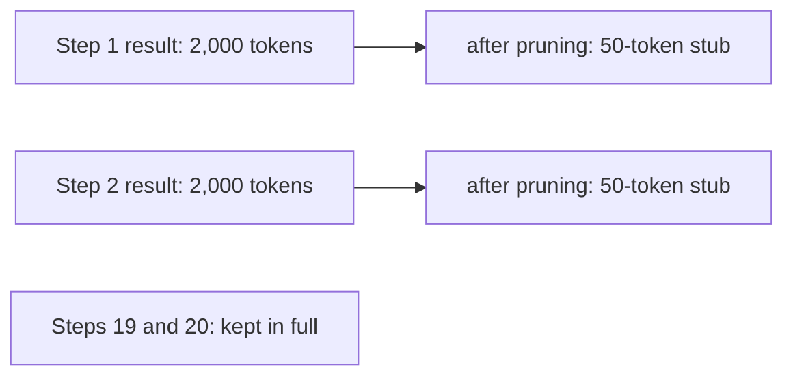

Of everything in an agent's transcript, **tool results** are usually the heaviest. A page fetch, a file read or a database dump can run to thousands of tokens, while the model's own call is a few dozen. They are also the cheapest thing to throw away once their information has been used. After the agent has read a search result and decided what to do, it rarely needs the full result again.

Think of a desk covered in printouts. Once you have pulled the number you need into your notes, the printout can go in the bin. If you ever need it again, you can print it again. **Observation pruning** applies the same idea: replace old tool results with a short stub, such as "[result of search('refund policy'): 4,200 tokens, discarded; re-run to see it]".

## How much it saves

Let the starting context be $c_0$, each step add a model call of $a$ tokens and an observation of $o$ tokens, and let old observations shrink to a stub of $u$ tokens. Keep the latest $r$ steps in full. The context at call $k$ is

$$
c_k = c_0 + \min(k, r)\,(a + o) + \max(0,\, k - r)\,(a + u)
$$

With no pruning it is $c_0 + k(a+o)$.

```steps
Worked example: 20 calls, keep the last r = 2 results in full
Take $c_0 = 3{,}000$, $a = 200$, $o = 2{,}000$, $u = 50$. A full step is $a + o = 2{,}200$ tokens; a pruned step is $a + u = 250$.
---
Without pruning, call 19 reads $3{,}000 + 19 \times 2{,}200 = 44{,}800$ tokens. Summing all 20 calls gives $478{,}000$ input tokens.
---
With pruning, call 19 reads $3{,}000 + 2 \times 2{,}200 + 17 \times 250 = 3{,}000 + 4{,}400 + 4{,}250 = 11{,}650$ tokens. Summing all 20 calls gives $179{,}650$.
---
Saving: $1 - 179{,}650 / 478{,}000 = 62\%$ of input tokens, and the last call's context is 26% of its unpruned size. Growth per step has dropped from 2,200 to 250 tokens, so the quadratic term is much smaller.
```

Pruning and summarising are cousins. Pruning is mechanical and cheap, with no model call, and leaves a placeholder. Summarising costs a call but keeps the **gist**. A common stack uses both: prune old tool results first, and summarise only when the pruned transcript is still too long.

## What to keep

Pruning is safe only for results whose useful content has been **extracted**. The standard tactic is to make extraction explicit: after a bulky result, the agent records the facts it needs into state ("refund window = 30 days, source: policy page 2"), after which the raw result may go. If it never records anything, pruning deletes information the agent hasn't yet used.

| Observation | Prune? | Why |
|---|---|---|
| Search results already acted on | Yes, after the choice is made | Gist is in the next call |
| Large file contents already read and noted | Yes, keep path and a note | Can be re-read if needed |
| Error from a step that then succeeded | Yes | Resolved, no longer informative |
| The user's own messages | No | Instructions and constraints |
| IDs or handles needed later | No, or move to state | Cannot be re-derived cheaply |
| The latest result | No | Not yet used |

## See it in the budget



The agent still knows it ran those searches (the stub says so), so it does not repeat them blindly, and it knows how to get the content back.

## In practice

Prune on the **way into** the context builder, not on the stored transcript: keep the full log for debugging and replay, and build a pruned view for the model. Log both sizes so you can see what the model actually read. And watch for a subtle bug: if a stub looks like a result, the model may treat the placeholder as the answer. Make stubs unmistakable ("[discarded; re-run tool to see]") and keep them short.

```quiz
{"q": "Without pruning each step adds 2,200 tokens. With pruning, steps older than the latest 2 add only 250. At call 10 (counting from 0) with c₀ = 3,000, what is the pruned context size?", "options": ["3,000 + 10 × 250", "3,000 + 2 × 2,200 + 8 × 250", "3,000 + 10 × 2,200", "3,000 + 2 × 250 + 8 × 2,200"], "answer": 1, "explain": "The latest 2 steps stay full (2 × 2,200 = 4,400) and the older 8 are stubs (8 × 250 = 2,000), giving 9,400 tokens. Without pruning it would be 25,000."}
```

```quiz
{"q": "Why is it risky to prune a tool result the agent has not yet extracted facts from?", "options": ["Pruning is slow", "The information is lost from the model's view before it has been used or recorded", "Stubs cost more tokens than results", "It breaks the JSON format"], "answer": 1, "explain": "Pruning removes the raw content. If the agent has not noted what it needs in state or in its next call, that information is gone, and it may repeat the tool call or answer from a guess."}
```
