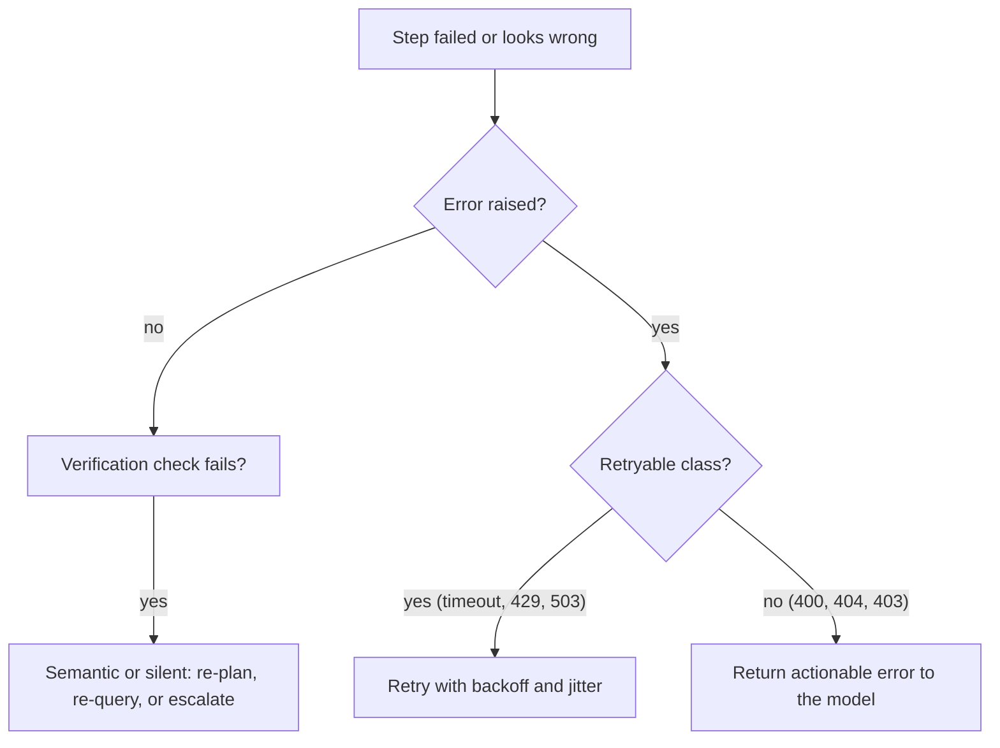

```callout-before
Before you start
This lesson assumes the product rule from the previous one: a run of $n$ steps succeeds only if every step does. Here we look at what actually goes wrong inside a step, because the right response depends on the kind of failure.
```

When a step fails, the instinct is to retry. Sometimes that is exactly right and sometimes it is harmful. Retrying a network blip fixes it; retrying a request for a record that does not exist wastes time; retrying a payment that actually went through charges the customer twice. Before choosing a response, name the failure.

A doctor does the same. A cough might be nothing, an infection, an allergy or something serious, and treatment depends on diagnosis. Four categories cover most agent failures.

| Kind | Example | Right response |
|---|---|---|
| **Transient** | Timeout, rate limit (HTTP 429), brief 503, network reset | Retry with backoff; it will likely pass |
| **Permanent** | Invalid argument, record not found, no permission, tool does not exist | Do not retry unchanged; return an actionable error to the model |
| **Semantic** | The tool worked but returned something wrong for the task: wrong file, irrelevant results, misread value | Verify, re-plan or change tool, as retrying the same call repeats the error |
| **Silent** | A tool returns success with empty or stale data; the model misreads a number and carries on | Only detected by verification: checks on outputs, assertions, cross-checks |

The first two are the loud ones, the kind your code can see. The last two are the dangerous ones, because nothing raises an exception. Silent and semantic failures are why agents can fail while every log line says "ok".

## How often something fails during a run

If each tool call fails (in any of the four ways) with probability $f$, independently, a run of $n$ calls has at least one failure with probability

$$
P(\ge 1 \text{ failure}) = 1 - (1-f)^n
$$

and expects $n f$ failures. With $f = 0.02$ and $n = 15$: $1 - 0.98^{15} = 1 - 0.739 = 0.261$, and $15 \times 0.02 = 0.3$ expected failures. A 2% failure rate sounds negligible, yet more than a quarter of runs hit at least one failure. Recovery is not a corner case: for long runs it is the normal case.

```steps
Classifying a failure, step by step
The tool call raises `ConnectionResetError`. Is it transient? Yes: the network dropped. Action: retry with backoff, same arguments.
---
The tool returns `404: order 99999 not found`. Permanent for this input. Action: do not retry. Return "No order 99999. Order ids are 4 digits; check the id with search_orders" to the model.
---
The search tool returns 10 results, none about the right product. Semantic: the call succeeded but the content is wrong. Action: let the model reformulate; retrying the identical query returns the same results.
---
The stock tool returns `{"stock": 0}` because its cache was stale; true stock is 14. Silent: nothing signals the problem. Only a check, such as comparing against a second source or asserting freshness, finds it.
```

## A decision flow



## Where the effort goes

Most engineering effort should follow the cost of each class. Transient failures are common and cheap to handle (a retry wrapper, written once). Permanent failures need good error messages (previous lesson). Semantic and silent failures are rare per step but expensive and invisible, so they call for **verification**: assertions in code, checks by a second model or tool, sampling of outputs for human review. The rest of this lesson builds those pieces in order.

## In practice

Log the class of every failure explicitly, with a label like `transient`, `permanent`, `semantic_suspected`. After a week of traffic, the proportions tell you where to invest. Teams are often surprised that retries (the thing everybody built first) address only a minority of the failures that actually lose user trust, which tend to be the silent ones.

```quiz
{"q": "A tool call returns HTTP 429 (rate limited). What is the right first response?", "options": ["Retry immediately, in a tight loop", "Wait with exponential backoff and jitter, then retry", "Treat it as permanent and stop", "Ask the model to guess the answer"], "answer": 1, "explain": "429 is transient: the service is saying 'too fast, try again soon'. Immediate retries make the overload worse; backoff with jitter gives it room to recover."}
```

```quiz
{"q": "Each of 25 tool calls fails with probability 0.01 independently. What is the probability a run has at least one failure?", "options": ["About 1%", "About 22%", "About 25%", "About 78%"], "answer": 1, "explain": "1 − 0.99²⁵ = 1 − 0.778 = 0.222. The naive sum 25 × 1% = 25% slightly overestimates because it double-counts runs with two failures; 1% forgets the 25 chances."}
```
