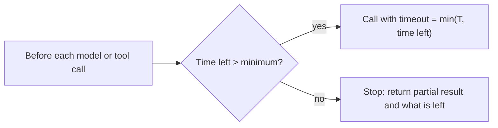

A call that never returns is worse than one that fails. It holds a connection, blocks the loop, and leaves the user watching a spinner. Every external call an agent makes needs a **timeout**: an upper limit on how long to wait. Beyond that, the whole run needs a **deadline**: a point in time by which something must be returned, even if only an honest "I could not finish".

Think of a restaurant order. The kitchen should not be allowed to take unlimited time on a dish, and the table should not be allowed to wait unlimited time for dinner. The first is a timeout for one step; the second is the deadline for the meal.

## Choosing a timeout

A timeout too short kills calls that would have succeeded; too long, and a hung call eats your latency budget. A practical rule is to set it just beyond a high percentile of normal latency. If a tool's p99 latency is 4 seconds, a 6-second timeout cuts off almost only calls that are truly stuck. The fraction of healthy calls wrongly cut off is the tail beyond the timeout: roughly 1% at the p99, and far less at 1.5 times the p99.

A timeout tells you nothing about whether the work happened. The server may have completed the action and simply been slow to respond. This is the crux of the idempotency topic below: **a timeout means "unknown", not "failed"**.

## Worst-case time with retries

With a per-attempt timeout $T$, up to $r$ attempts, and a delay $d_j$ before attempt $j+1$, the worst case is that every attempt times out:

$$
t_\text{worst} = r\,T + \sum_{j=1}^{r-1} d_j
$$

```steps
Worked example: does the retry policy fit the budget?
A tool call allows $r = 3$ attempts, timeout $T = 5$ s, and backoff delays $d_1 = 1$ s, $d_2 = 2$ s.
---
Worst case: $3 \times 5 + (1 + 2) = 18$ s for one tool call.
---
The user-facing deadline is 30 s and the run has 6 tool calls, each of which might in principle do this. Six worst cases would take $6 \times 18 = 108$ s, far over the deadline.
---
So the retry policy alone does not guarantee the deadline. The deadline must be enforced **globally**: track remaining time, shrink or skip retries as it runs out, and stop with a partial result when time is up.
```

That last point is the design rule: a per-call policy bounds one call, but only a **run-level deadline** bounds the whole run. Implement it by passing a remaining-time budget to each call: the timeout for an attempt is $\min(T, \text{remaining})$, and if remaining time is below the minimum useful time, skip further retries.

## The deadline as a state-machine guard

In the state machine from lesson 1, the deadline is one more guard on the Think and Act transitions, next to the step cap and the budget cap. A run that crosses the deadline moves to Stopped with a message built from the state object: what was done, what remains, and why it stopped.



## Timeouts for model calls too

Model calls hang and slow down like any other. A streaming response that has stopped producing tokens for, say, 30 seconds is stuck even if the connection is open, so use a **stall timeout** (no token for $x$ seconds) as well as a total timeout. For long generations, time to first token and total time are separate budgets.

## In practice

Teams commonly set three layers: a per-attempt timeout on each tool and model call, a retry policy with a small maximum number of attempts, and a run-level deadline that is checked before every step. The deadline is derived from the product requirement (a chat answer in 30 seconds, a background job in 10 minutes), and each lower layer is derived from it. A frequent mistake is to put a retry loop inside a tool, another inside the framework, and a third in the agent, which multiplies attempts: $3 \times 3 \times 3 = 27$ calls against a failing service.

```quiz
{"q": "Per-attempt timeout T = 4 s, up to 4 attempts, with backoff delays of 1, 2 and 4 s between attempts. What is the worst-case time for one call?", "options": ["16 s", "23 s", "7 s", "12 s"], "answer": 1, "explain": "Four timeouts: 4 × 4 = 16 s, plus delays 1 + 2 + 4 = 7 s, total 23 s. 16 s forgets the waiting between attempts."}
```

```quiz
{"q": "A call times out. What do you know about whether the operation happened on the server?", "options": ["It definitely did not happen", "It definitely happened", "Nothing: it may have completed, partly completed, or not started", "It happened exactly once"], "answer": 2, "explain": "A timeout means no response arrived in time, not that the work did not occur. That uncertainty is why retrying side-effecting calls needs idempotency keys."}
```
