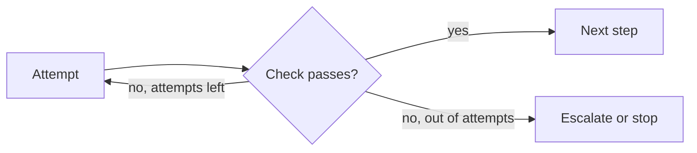

The compounding-reliability topic showed that a 20-step run at 95% per step succeeds about 36% of the time. This topic measures how much of that loss retries and verification win back, and what they cost. The headline: a modest retry policy can lift that run above 95%, but only when failures can be **detected**.

Think of a quality inspector on an assembly line. If the inspector catches every defect and the worker redoes the part, defects almost vanish. If the inspector catches only half of them, half still reach the customer. Retries are the redo, and verification is the inspector.

## The formula with perfect detection

Say a step succeeds with probability $p$ and can be attempted up to $r$ times. If every failure is detected (an error, a failed check) and each attempt is independent, the step ends in failure only if all $r$ attempts fail:

$$
p_\text{step} = 1 - (1-p)^{r}
$$

```steps
Worked example: p = 0.95, n = 20 steps
No retries ($r = 1$): $p_\text{step} = 0.95$, run success $0.95^{20} = 0.358$.
---
Two attempts ($r = 2$): $p_\text{step} = 1 - 0.05^2 = 0.9975$, run success $0.9975^{20} = 0.951$.
---
Three attempts ($r = 3$): $p_\text{step} = 1 - 0.05^3 = 0.999875$, run success $0.999875^{20} = 0.9975$.
---
One extra attempt on failure lifts the run from 36% to 95%. The cost is small: a retry happens only after a failure, which is 5% of steps.
```

## The formula with imperfect detection

Real checks miss some failures. Let $d$ be the probability that a failure is **detected** (and so retried). A step now has this structure: it passes first time with probability $p$; with probability $x = (1-p)d$ it fails visibly and is retried; the remaining failures slip through undetected and end the step as errors. Summing over up to $r$ attempts:

$$
p_\text{step} = p\,\big(1 + x + x^2 + \dots + x^{r-1}\big) = p\,\frac{1 - x^{r}}{1 - x}, \qquad x = (1-p)\,d
$$

and the expected number of calls per step is the geometric sum $\dfrac{1 - x^{r}}{1 - x}$, since a further attempt happens only after a detected failure. If $d = 1$, then $x = 1 - p$ and the formula reduces to $1 - (1-p)^r$, matching the one above.

| Detection $d$ | Attempts $r$ | $p_\text{step}$ | Run success ($n=20$) | Calls per step |
|---|---|---|---|---|
| (no retries) | 1 | 0.9500 | 35.8% | 1.000 |
| 1.0 | 3 | 0.99988 | 99.7% | 1.053 |
| 0.8 | 2 | 0.9880 | 78.5% | 1.040 |
| 0.5 | 2 | 0.9738 | 58.7% | 1.025 |

Read the last three rows together. With a check that catches 80% of failures and one retry, the run goes from 36% to 79%; with a weak check that catches half, it reaches only 59%. **Detection quality is as important as the number of retries.** The costs are tiny in every row (4% extra calls or less), so the main lever is making failures visible.

## Where detection comes from

- **Hard signals**: exceptions, HTTP status codes, schema validation failures. Cheap and near-perfect.
- **Programmatic checks**: asserts on outputs (sum of line items equals total, file compiles, tests pass).
- **Model-based checks**: a second call that critiques the result. Flexible, but costs tokens and has its own error rate.
- **Human checkpoints** at the riskiest steps, a form of detection with $d$ near 1 and high cost.

## See it

```sim
agent-reliability
{"p": 0.95, "n": 20, "retries": 2, "verify": true, "catchRate": 0.9}
```

Note that the simulation's retries slider counts **extra** attempts, so retries = 2 means $r = 3$ attempts in the formulas above, and it treats some failures as loud (always detected) and the rest as silent (caught only by the verifier), which is a slightly richer detection model than a single $d$. Read the task success with these settings, then set retries to 0 and compare. Turn verification off and note the loss. Lower the catch rate to 0.5 and see how much of the gain disappears. Finally push the number of steps to 50 and see which combination of retries and verification still holds up.

## Cost and expected calls

A run of $n$ steps makes about $n\,\dfrac{1-x^r}{1-x}$ calls. For $n = 20$, $d = 0.8$, $r = 2$: $20 \times 1.04 = 20.8$ calls against 20. Cheap. But a verification call on every step doubles the call count, so verification is usually applied selectively, to the steps that are risky or whose errors are expensive, not uniformly.



## In practice

Two cautions keep the arithmetic honest. First, the model assumes independent attempts; a retry of the same call against the same broken input fails again, so retries work best after something changes (a transient error clears, or an error message guides a correction). Second, retries must not repeat side effects. If a step sent an email, a blind retry sends it twice. That is the subject of the next topic.

```quiz
{"q": "A step succeeds with p = 0.9 and every failure is detected. With up to 3 attempts, what is the per-step success probability?", "options": ["0.900", "0.990", "0.999", "0.729"], "answer": 2, "explain": "1 − 0.1³ = 0.999. 0.99 is the two-attempt figure; 0.729 is 0.9³, the probability that all three attempts succeed, which is not the question."}
```

```quiz
{"q": "Why can a weak verifier (catching only half of failures) limit how much retries help?", "options": ["Retries only run after a detected failure, so undetected failures are never retried", "Weak verifiers make every call slower", "Retries need a strong model", "Retries multiply the failure rate"], "answer": 0, "explain": "x = (1−p)·d: a retry is triggered only when the failure is detected. A step that fails silently is simply wrong, however many retries are allowed."}
```

```lab
make-the-agent-reliable
```
