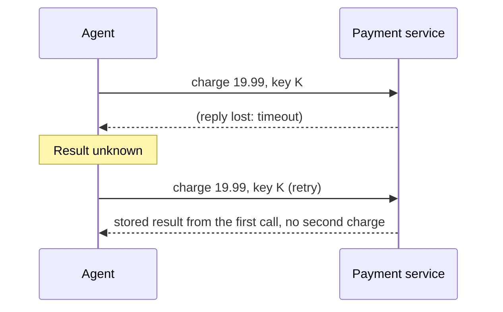

Retries are safe for reading and dangerous for writing. If an agent retries a search, the worst outcome is a second identical search. If it retries "charge the customer 19.99" after a timeout, the worst outcome is a customer charged twice, because the first request may have succeeded and only the reply was lost.

Think of pressing a lift button. Pressing it five times does not summon five lifts, because the button is **idempotent**: repeating the action has the same effect as doing it once. A doorbell is not: five presses ring five times. The goal of this topic is to make every side-effecting tool behave like the lift button.

## Idempotent by design

An operation is **idempotent** if applying it several times leaves the system in the same state as applying it once. Some operations are naturally so: "set the status to shipped", "put file X at path P". Others are not: "add 1 to the balance", "send an email", "create an order". For the second kind, the standard fix is an **idempotency key**: a unique string that the caller sends with the request. The server remembers the keys it has processed, and if it sees the same key again it returns the stored result instead of repeating the action.



## How big is the problem?

Suppose a service handles $N$ charges per day and a fraction $\lambda$ of responses are lost after the server has committed the action (the client sees a timeout). If the client retries on timeout, each lost response produces one duplicate:

$$
\text{duplicates per day} = N\,\lambda
$$

```steps
Worked example: N = 10,000 charges a day, λ = 0.5%
Duplicate charges without idempotency keys: $10{,}000 \times 0.005 = 50$ a day.
---
At an average charge of 20 dollars that is 1,000 dollars of wrongly taken money per day, plus 50 support tickets, plus refunds.
---
Alternative: never retry after a timeout. Duplicates drop to zero, but every lost response is now a charge the agent believes failed, when in fact it succeeded: 50 customers are charged and told nothing. That is also wrong.
---
With idempotency keys, you retry freely: the retry returns the stored result. Duplicates: 0, lost confirmations: 0.
```

The lesson: when a result is unknown, you cannot safely retry or safely give up; the key is what makes retry safe.

## Choosing the key

A key must be **stable across retries** of the same logical action and **different** for different actions. A random UUID generated inside the retry loop is wrong, because each retry would get a new key and the server would see a new request. Generate the key once, before the first attempt, and reuse it. For agents, a good recipe derives the key from the identity of the action: the run id, the step number, the tool name and a hash of the arguments.

```python
import hashlib, json

CHARGES = {}          # idempotency_key -> stored response (stands in for a database)
LEDGER = []           # every charge actually made

def make_key(run_id: str, step: int, tool: str, args: dict) -> str:
    raw = json.dumps([run_id, step, tool, args], sort_keys=True)
    return hashlib.sha256(raw.encode()).hexdigest()[:16]

def charge(customer: str, cents: int, idempotency_key: str) -> dict:
    if idempotency_key in CHARGES:                 # replay: return the stored result, do nothing
        return CHARGES[idempotency_key]
    LEDGER.append((customer, cents))               # the side effect happens once
    result = {"status": "charged", "cents": cents, "charge_id": f"ch_{len(LEDGER)}"}
    CHARGES[idempotency_key] = result
    return result

key = make_key("run-42", 3, "charge", {"customer": "ann", "cents": 1999})
first = charge("ann", 1999, key)
retry = charge("ann", 1999, key)                   # the client timed out and retried
print(first == retry, len(LEDGER))                 # True 1
```

The retry returns the identical stored result and the ledger holds exactly one charge. In a real system the key store lives in a database with a unique constraint, and the check-and-insert is atomic, so two concurrent retries cannot both pass.

## Where agents need it

Keys protect the **tool layer**. Two other places benefit from the same thinking:

- **Resuming a run**: if the process crashes after a tool call but before the result is saved, a resumed run will re-issue the call. With a key derived from run and step, the replay is harmless (next topic).
- **Model-level repeats**: models sometimes call the same tool twice in a row. A key derived from the arguments makes the second call a no-op rather than a second email.

## In practice

For every tool, record whether it is **read-only**, **idempotent write**, or **non-idempotent write**. Read-only tools may be retried freely. Idempotent writes may be retried. Non-idempotent writes must either accept an idempotency key or be wrapped so that they check for an existing result first ("is there already an order with this client reference?"). If a downstream service offers no way to make an action safe to repeat, treat it as unretryable and put a human approval in front of it.

```quiz
{"q": "Which operation is idempotent?", "options": ["Append a line to a log file", "Set an order's status to 'shipped'", "Increment a counter by 1", "Send an email"], "answer": 1, "explain": "Setting a value to a fixed state yields the same result however many times it runs. The others change the outcome each time: another log line, another increment, another email."}
```

```quiz
{"q": "A service processes 50,000 charges a day and 0.2% of responses are lost after the charge is committed. The client retries without idempotency keys. How many duplicate charges per day?", "options": ["10", "100", "1,000", "0"], "answer": 1, "explain": "50,000 × 0.002 = 100 duplicates a day. With idempotency keys the retry would return the stored result and the count would be 0."}
```
