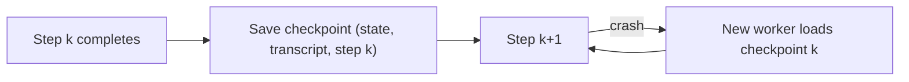

Two last problems finish this lesson. What happens to a 30-step run that crashes at step 28? And what happens when an agent is not failing but simply going round in circles? The first is solved by **checkpoints**, the second by **loop detection**.

A video game gives the right picture for the first. Without save points, dying at the final boss sends you back to the start. With a save point after each level, you lose only the current level. A checkpoint is a save point after each step of the run.

## Checkpoints and resume

After every completed step, persist the run's state: the state object, the transcript (or its compacted form), the step number, and the results of side-effecting calls. If the process crashes or the machine is replaced, a new worker loads the latest checkpoint and continues from the next step. Combined with idempotency keys, a step that was in flight at the crash can be re-issued safely: if it had already happened, the key returns the stored result.



## What checkpoints save

Let each step cost one unit and crash (or fail unrecoverably) with probability $f$. Without checkpoints, any failure restarts the whole run from scratch. A single attempt of $n$ steps succeeds with probability $S = (1-f)^n$, and the expected number of steps executed in one attempt (the run stops at the first failure) is

$$
E_\text{attempt} = \sum_{k=1}^{n} (1-f)^{k-1} = \frac{1 - (1-f)^n}{f}
$$

Attempts repeat until one succeeds, which takes $1/S$ attempts on average, so

$$
E_\text{no checkpoint} = \frac{E_\text{attempt}}{S}, \qquad E_\text{checkpoint} = \frac{n}{1-f}
$$

(with checkpoints, each step is executed $1/(1-f)$ times on average until it succeeds).

```steps
Worked example: f = 2% per step
For $n = 20$: $S = 0.98^{20} = 0.668$. $E_\text{attempt} = (1 - 0.668)/0.02 = 16.6$ steps, so $E_\text{no checkpoint} = 16.6 / 0.668 = 24.9$ steps. With checkpoints: $20 / 0.98 = 20.4$ steps.
---
For $n = 100$: $S = 0.98^{100} = 0.133$. $E_\text{attempt} = (1 - 0.133)/0.02 = 43.4$, so $E_\text{no checkpoint} = 43.4 / 0.133 = 327$ steps. With checkpoints: $100 / 0.98 = 102$ steps.
---
At 20 steps checkpoints save about 18% of the work. At 100 steps they save 69%, and the run without them is only 13% likely to complete in any one attempt. The longer the run, the more checkpoints matter.
```

Checkpoints also give you what money cannot buy back: **time**. A human user whose 20-minute task crashed at minute 19 is far more forgiving if it resumes in seconds.

## Loop detection

The other failure produces no error at all. The agent calls `search("refund policy")`, reads the result, calls `search("refund policy")` again, and so on, burning tokens and time until the step cap stops it. Models fall into such loops when a tool result is unhelpful and they cannot think of an alternative.

Detection is simple. Keep a **signature** of each action, such as `(tool, normalised arguments)`, and count repeats over a recent window:

```python
from collections import Counter, deque
import json

class LoopDetector:
    def __init__(self, window=8, max_repeats=3):
        self.recent = deque(maxlen=window)
        self.max_repeats = max_repeats

    def check(self, tool: str, args: dict) -> bool:
        """Record an action; return True if it has now been repeated too often."""
        sig = (tool, json.dumps(args, sort_keys=True))
        self.recent.append(sig)
        return Counter(self.recent)[sig] >= self.max_repeats

d = LoopDetector()
hits = [d.check("search", {"q": "refund policy"}) for _ in range(3)]
print(hits)   # [False, False, True]
```

On detection, do not simply stop. Useful responses, from gentlest to strongest: add a note to the next prompt ("you have run this exact search 3 times with the same result; try a different approach"), force a re-plan, switch to a different tool or a stronger model, or stop and escalate to a human.

Exact repeats are only the simplest case. Agents also loop in longer cycles (A, B, A, B) or make **no progress** with slightly varied actions. Complement signature counting with a progress check: has the state object changed, or has any new fact been recorded, in the last $w$ steps? If not, treat the run as stalled.

## In practice

Resumable runs need two disciplines. Make the checkpoint **small** (the state object plus the compacted transcript, not every raw result) and **atomic** (written fully before the next step starts). And test resume as a feature: kill the process at a random step in your test suite and confirm that the resumed run produces the same result without repeating a side effect. Teams that have never tested it generally find it does not work.

```quiz
{"q": "f = 1% per step, n = 50 steps. With checkpoints, roughly how many step executions does a completed run need on average?", "options": ["50", "About 50.5", "About 100", "About 25"], "answer": 1, "explain": "With checkpoints each step is executed 1/(1−f) = 1/0.99 = 1.0101 times on average, so 50 × 1.0101 ≈ 50.5. Without checkpoints the expected work is much higher because every failure restarts from scratch."}
```

```quiz
{"q": "An agent calls the same search with identical arguments 4 times in a row and gets the same useless result. Which response is most useful?", "options": ["Do nothing; the model will eventually stop", "Detect the repeat and tell the model, or force a different approach or an escalation", "Increase the temperature to 2", "Delete the search tool"], "answer": 1, "explain": "A signature counter catches exact repeats cheaply. The agent is stuck, not failing, so waiting just burns budget; feeding the repeat back, re-planning or escalating gives it a way out."}
```
