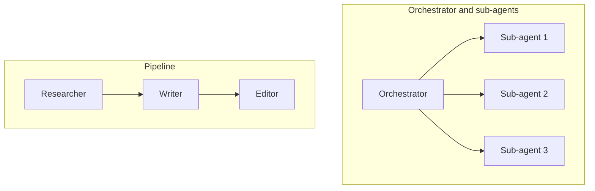

```callout-before
Before you start
A "multi-agent system" is not a different technology. Each agent is the same loop from lesson 1: a model, some tools and a context. What changes is that several loops run, each with its own context, and pass messages to one another.
```

A single agent is one person doing a whole job. A multi-agent system is a team: an editor handing stories to reporters, a pipeline of departments, or two colleagues reviewing each other's work. The reasons for building a team are the same as with people: some jobs are too big for one head, can be done in parallel, or benefit from a second pair of eyes. The costs are also the same: meetings, handoffs and misunderstandings.

## Four common shapes



| Shape | How it works | Good for | Watch out for |
|---|---|---|---|
| **Orchestrator with sub-agents** | A lead agent plans, delegates pieces to sub-agents (often in parallel), then combines the results | Broad tasks with independent parts: research on several topics, edits across files | The orchestrator is a bottleneck and single point of failure |
| **Pipeline** | Each agent hands its output to the next: research, then write, then review | Tasks with clear stages and different skills | Errors flow downstream; handoffs lose detail |
| **Peer review** | One agent produces, another critiques, perhaps in rounds | Quality-sensitive output; code review, fact-checking | The reviewer inherits the producer's blind spots if it is the same model with the same prompt |
| **Debate or ensemble** | Several agents propose answers independently, then reconcile or vote | Hard reasoning, ambiguous questions | Cost scales with the number of agents; agreement may not mean correctness |

You have already met two of these as workflows: orchestrator-workers and evaluator-optimiser. The difference when it is "multi-agent" is that each participant is itself a loop with its own tools and its own decisions, rather than a single call.

## Three real reasons to split

1. **Parallelism.** Independent subtasks run at the same time, so wall-clock time falls (next topic).
2. **Context isolation.** A sub-agent works with a small, clean context containing only its subtask, and returns a short result. The orchestrator never sees the 40,000 tokens of raw material the sub-agent read. This keeps contexts short, which saves tokens and keeps recall high.
3. **Specialisation.** A sub-agent with a focused prompt, a small toolset and perhaps a different model can do one job better than a generalist with every tool. (Remember from the tools topic that selection accuracy falls as the toolset grows.)

And one bad reason: it feels sophisticated. A single agent with good tools beats a badly designed team on cost, latency and debuggability.

## A first look at the cost

Every agent loop pays its own fixed overhead: system prompt, tool definitions, state. If a task needs $A$ agents each with fixed overhead $c_0$ tokens and $K_i$ calls, the fixed part alone is $\sum_i K_i c_0$, which is the same as one agent's if the total number of calls is the same. The real differences come from how the contexts **grow** (quadratically within each agent) and how many extra calls the coordination itself needs. The next topics put numbers on both.

Here is a rough sketch of one orchestrated run:

```steps
A research task with an orchestrator
The user asks for a comparison of 4 vendors. The orchestrator reads the request (about 1,500 tokens) and plans: one sub-agent per vendor.
---
Four sub-agents start in parallel. Each searches, reads pages and extracts a structured summary of about 300 tokens, using perhaps 6 steps and a context that peaks near 15,000 tokens. None of that raw material goes back to the orchestrator.
---
The orchestrator receives four 300-token summaries (1,200 tokens), writes the comparison, and may ask one sub-agent to double-check a number.
---
Total wall-clock time is about one sub-agent's time plus planning and synthesis, instead of four sub-agents' time added up.
```

## In practice

Start with one agent. Move to several only when you can name which of the three reasons applies, and measure it: latency, tokens and success rate against the single-agent baseline. Many teams that built elaborate multi-agent systems found a single agent with better tools matched them at a fraction of the cost. Use the shapes above as a menu, not a goal.

```quiz
{"q": "Which is the strongest reason to use sub-agents for a research task over a single agent?", "options": ["It sounds more advanced", "Independent subtopics can run in parallel and each sub-agent's raw reading stays out of the lead's context", "It always reduces cost", "It removes the need for tools"], "answer": 1, "explain": "Parallelism and context isolation are real, measurable benefits. Multi-agent designs do not always reduce cost (coordination adds calls), and sub-agents still need tools."}
```

```quiz
{"q": "In a two-stage design, a writer agent's output is critiqued by a reviewer agent that is the same model with a similar prompt. What is the main weakness?", "options": ["The reviewer is too slow", "The reviewer tends to share the writer's blind spots, so some errors pass both", "Two agents cannot communicate", "Reviewers always reject everything"], "answer": 1, "explain": "Errors are correlated when both agents are the same model with similar context. A reviewer with different tools, different information or independent checks (tests, sources) catches more."}
```
