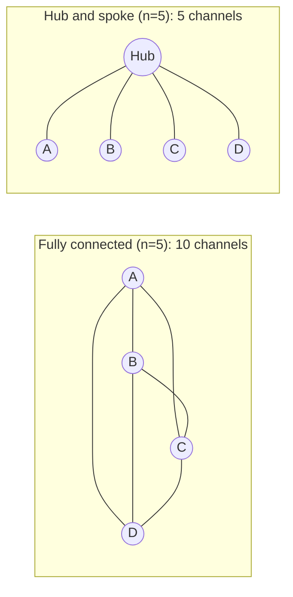

Add people to a late software project, Fred Brooks observed long ago, and it gets later. The reason is not laziness: every new person has to be briefed, and every pair of people may need to talk. Agents are no different. Each extra agent adds messages to write, read and get wrong, and the number of possible conversations grows faster than the number of agents.

A meeting room shows it clearly. Three people share three possible pairs of conversations. Six people have fifteen. Ten have forty-five. Nobody got ten times better; the potential chatter got fifteen times bigger.

## Counting channels

If every agent can message every other agent directly (a **fully connected** design), the number of two-way channels among $n$ agents is

$$
\binom{n}{2} = \frac{n(n-1)}{2}
$$

In a **hub-and-spoke** design, where all communication goes through one orchestrator, there are only $n$ channels (one per worker, with $n$ workers plus the hub, or $n-1$ with the hub counted among the agents). The two differ enormously as $n$ grows:

| Agents $n$ | Fully connected $n(n-1)/2$ | Hub and spoke $n$ |
|---|---|---|
| 3 | 3 | 3 |
| 6 | 15 | 6 |
| 10 | 45 | 10 |
| 12 | 66 | 12 |

(Here the hub design counts one channel per agent, a simple convention for comparing growth.)

```steps
Worked example: token cost of communication
Say each channel carries 3 messages of about 800 tokens each during a task, which is $2{,}400$ tokens of conversation per channel. Each message is generated by one agent and read by another, so it costs tokens twice, but we count the 2,400 as one unit here.
---
Six agents, fully connected: $15 \times 2{,}400 = 36{,}000$ tokens of inter-agent conversation.
---
Six agents, hub and spoke: $6 \times 2{,}400 = 14{,}400$ tokens, 60% less.
---
Ten agents, fully connected: $45 \times 2{,}400 = 108{,}000$ tokens, and every one of those messages is another chance to misread or invent something. Hub and spoke: $24{,}000$.
```

The practical rule is to prefer a hub: workers report to an orchestrator and never talk to one another. That limits channels to $n$ and keeps one place where plans and results are combined.

## Debate and ensembles cost more than they look

In a debate, $A$ agents answer, then see each other's answers and revise, for $R$ rounds. Each agent reads the other $A-1$ answers of about $s$ tokens in each round, so the reading cost is

$$
\text{extra input} \approx A\,(A-1)\,R\,s
$$

```steps
Worked example: 3 agents, 2 rounds of debate
Each answer is about $s = 500$ tokens.
---
Round 1: each of 3 agents reads the other 2 answers: $3 \times 2 \times 500 = 3{,}000$ tokens. Round 2 does the same: another 3,000.
---
Total extra input: $A(A-1)Rs = 3 \times 2 \times 2 \times 500 = 6{,}000$ tokens, on top of generating the original answers (about $3 \times 500 = 1{,}500$ output tokens plus the revisions).
---
Raise to 5 agents and 3 rounds: $5 \times 4 \times 3 \times 500 = 30{,}000$ extra tokens, five times more, from only 1.7 times the agents and 1.5 times the rounds, because the cost is quadratic in $A$.
```

## The fixed costs per agent

Beyond conversation, each agent pays a setup cost:

1. **Briefing**: writing the task so a cold-start agent can do it. A sloppy brief wastes the whole sub-agent run.
2. **Fixed context** $c_0$, re-read on every call of that agent.
3. **Result handling**: the orchestrator must read, check and merge outputs, and they may disagree.
4. **Failure handling**: each added agent is another thing that can time out, loop or return junk, which the orchestrator must tolerate.



## In practice

Keep agent counts small. Two to five well-defined roles cover most designs, and every added role should be justified by a measured gain. Use structured messages (JSON with a schema, as in the tools lesson) rather than free-form chat between agents: structure is shorter, cheaper to validate and harder to misread. Cap the number of rounds in any back-and-forth, as you would cap steps in a single loop. And watch for agents that "agree" because the second simply echoes the first: that adds cost and no information.

```quiz
{"q": "Eight agents can all message each other directly. How many two-way channels exist?", "options": ["8", "16", "28", "56"], "answer": 2, "explain": "8 × 7 / 2 = 28. 56 counts each pair twice (once per direction); 8 is the hub-and-spoke count."}
```

```quiz
{"q": "A debate has 4 agents, 3 rounds and answers of about 400 tokens. Each agent reads the other agents' answers each round. About how many extra input tokens does the debate use?", "options": ["4,800", "14,400", "1,600", "19,200"], "answer": 1, "explain": "A(A−1)Rs = 4 × 3 × 3 × 400 = 14,400. Reading 4 × 400 = 1,600 only counts one round of all answers; the cost is quadratic in agents and linear in rounds."}
```
