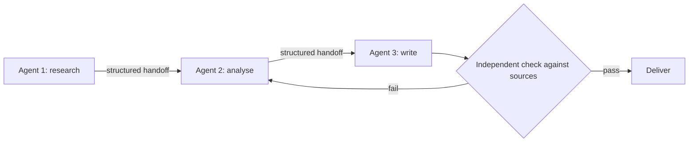

In a team, one person's mistake rarely stays put. A wrong number in the first analyst's spreadsheet is copied into the second analyst's model and appears, confidently formatted, in the executive summary. By the end, nobody remembers where it started, and the final document looks authoritative.

Multi-agent systems have this problem in a sharper form. An agent that receives another agent's output usually treats it as true. If the upstream agent hallucinated, misread a source or dropped a constraint, the downstream agent builds on the error and may add its own. Two properties make this worse than a single agent: **handoffs lose information**, and **downstream agents rarely re-check upstream work**.

## Two sources of compounding

First, each stage can be wrong. For a pipeline of $k$ stages, each correct with probability $p$, the product rule from lesson 2 applies:

$$
P(\text{correct}) = p^k
$$

Second, each **handoff** can lose detail. Say a fraction $h$ of the needed information survives each handoff (the brief omits a constraint, the summary drops a caveat). With $k$ stages there are $k-1$ handoffs:

$$
P(\text{correct}) = p^k\,h^{\,k-1}
$$

```steps
Worked example: a 3-stage pipeline, p = 0.9, h = 0.95
Stage reliability alone: $0.9^3 = 0.729$.
---
Two handoffs at 95% fidelity: $0.95^2 = 0.9025$.
---
Combined: $0.729 \times 0.9025 = 0.658$. The final output is right only about two times in three, though each stage individually is 90% reliable.
---
If instead one agent did all three stages in a single context, there would be no handoffs and the stage factor alone applies. Splitting gains specialisation, but it costs the handoff factor, which has to be won back.
```

## Breaking the chain: independent verification

Errors stop spreading when something **independent** checks the work. Suppose an independent reviewer catches a wrong output with probability $c$ (and, to keep it simple, a flagged output gets fixed or escalated, so it is not delivered wrong). The probability that a wrong result is **delivered** falls from $1 - p^k$ to

$$
P(\text{wrong delivered}) = (1 - p^k)(1 - c)
$$

With the same three stages at $p = 0.9$, ignoring handoff loss: the chance of at least one error is $1 - 0.729 = 0.271$. A reviewer with $c = 0.7$ leaves $0.271 \times 0.3 = 0.081$, so a wrong answer is delivered about 8% of the time instead of 27%. That is a large gain for one extra agent, **provided the reviewer is independent**.

Independence is the whole game. A reviewer that is the same model, reading the same context and the same upstream summary, tends to repeat the same mistakes, so its $c$ is far lower than for a reviewer with different evidence. Strong reviewers:

- run **tests or code** rather than opinion (a compiler, a unit test, a calculator),
- check against the **original source** (re-open the document and verify the quote), not against the upstream summary,
- have a **different task framing** ("find what is wrong") and perhaps a different model.



## Reducing handoff loss

Handoff fidelity $h$ is something you can design. Practical measures:

1. **Pass structured data, not prose.** A schema with named fields (`constraints`, `sources`, `confidence`) cannot silently drop a field the way a paragraph can.
2. **Pass references, not copies.** Send a pointer to the original document and the exact span relied on, so the next agent can re-read it.
3. **Carry the goal and constraints in every brief**, copied from the shared state, not paraphrased.
4. **Return uncertainty.** A sub-agent that says "confidence: low, because the page was a forum post" lets the receiver weigh it; one that only says the answer hides what it did not know.

## See it

```sim
agent-reliability
{"p": 0.9, "n": 6, "retries": 1, "verify": true, "catchRate": 0.7}
```

Treat each step as one agent's hand-off in a six-stage chain. Read the task success, then turn verification off and compare. Then set the catch rate to 0.3 to see what a weak, non-independent reviewer buys you, and raise it to 0.95 to see what a test-based check does. The simulation treats verification as a catch on silent failures, which matches the reviewer idea above.

## In practice

When a multi-agent system gives a wrong answer, trace **where the error entered**, not where it surfaced. The traces in the next lesson make that possible: you read each agent's input and output in order and find the first place where the content became wrong. Teams often discover the root was a thin brief or a lossy summary, not a bad model. Fix the handoff first.

```quiz
{"q": "A 4-stage pipeline has each stage 95% reliable, with 3 handoffs at 97% fidelity. What is the approximate probability the final output is correct?", "options": ["0.815", "0.743", "0.905", "0.950"], "answer": 1, "explain": "Stages: 0.95⁴ = 0.8145. Handoffs: 0.97³ = 0.9127. Combined 0.8145 × 0.9127 = 0.743. Ignoring handoffs gives 0.815."}
```

```quiz
{"q": "Which reviewer is most likely to catch an error introduced upstream?", "options": ["The same model reading the same upstream summary and asked 'is this right?'", "A check that re-reads the original source and runs the calculation with code", "A second copy of the upstream agent", "A reviewer that only reads the final sentence"], "answer": 1, "explain": "Independence matters. A check using original evidence and executable verification does not share the upstream agent's blind spots, whereas copies of the same model reading the same summary make correlated mistakes."}
```
