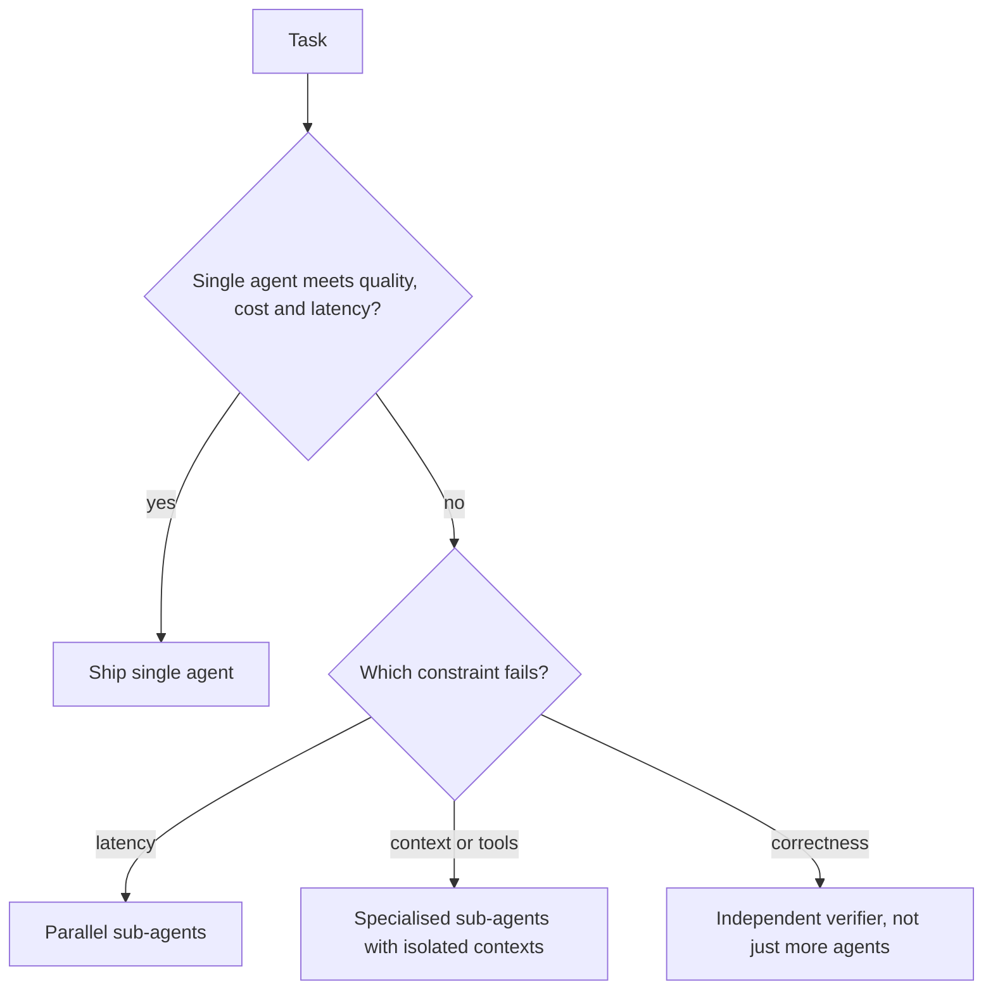

You now have the pieces for a rational decision. Parallel specialists can cut latency and keep contexts small. Coordination adds calls and channels. Handoffs lose information and spread errors. Whether a multi-agent design wins depends on the numbers for your task, and the numbers are easy to write down before you build anything.

A builder weighing a second crew works the same way. Two crews finish sooner, but need a site manager, daily briefings and extra tools, and the work they hand over at the boundary must fit together. The answer depends on the job. A ten-house estate: yes. A bathroom: no.

## An expected-value comparison

For a task worth $V$ when completed correctly, a design with success probability $s$ and cost $c$ per attempt has expected net value

$$
E = s\,V - c
$$

Compare designs by $E$, then check latency separately against your requirement.

```steps
Worked example: is the team worth it?
A task is worth $V = 2.00$ dollars when done right. A single agent succeeds with $s = 0.80$ at a cost of $c = 0.30$ dollars: $E = 0.80 \times 2.00 - 0.30 = 1.30$.
---
A multi-agent design succeeds with $s = 0.90$ but costs $c = 0.55$: $E = 0.90 \times 2.00 - 0.55 = 1.25$.
---
The multi-agent design is **better on quality** (90% against 80%) and **worse on value** ($1.25 < 1.30$). At this task value, the extra 10 points of success do not pay for the extra 25 cents.
---
Raise the task value to $V = 10$: single $= 8.00 - 0.30 = 7.70$; multi $= 9.00 - 0.55 = 8.45$. Now the team wins. The decision flipped because errors became more expensive, not because the system changed.
```

The break-even task value $V^\star$ follows from setting the two equal: $s_1 V - c_1 = s_2 V - c_2$, so

$$
V^\star = \frac{c_2 - c_1}{s_2 - s_1} = \frac{0.55 - 0.30}{0.90 - 0.80} = 2.50
$$

Above \$2.50 per task, the multi-agent design is worth it on these numbers; below, it is not. Latency can change the verdict: if the single agent takes 160 s and users abandon after 60 s, the parallel design is the only one that works at all, whatever the expected value says.

## A checklist

| Question | If yes | If no |
|---|---|---|
| Can the work be split into independent parts? | Parallel specialists may help | A pipeline adds handoff loss for little gain |
| Does one agent's context overflow or degrade on this task? | Isolation helps | A single agent with compaction may do |
| Are the tools so many that selection accuracy suffers? | Specialised toolsets help | Keep one toolset |
| Is a wrong answer expensive, and can an independent check be built? | Add a reviewer with real independence | A same-model reviewer adds cost without safety |
| Is latency the binding constraint? | Parallelism is the main lever | Cost and simplicity dominate |

If all answers are "no", build a single agent.



## Designing the handoffs

If you do split, spend your design time on the interfaces:

- **A contract per agent**: what it receives (a schema), what it returns (a schema), its tools, its step and time budget.
- **One owner of the final answer**: typically the orchestrator, who is accountable for merging and checking.
- **Shared state, not shared transcript**: a state object (previous lesson) that agents read from and write to under rules, rather than everyone seeing everyone's raw chatter.
- **Failure policy**: what the orchestrator does when a worker times out, returns malformed output, or disagrees with another worker.

## In practice

Run the comparison honestly: build the single-agent baseline first, record its success, cost and latency on 50 or so real tasks, then build the multi-agent version and measure the same things. If the gain is within the run-to-run noise, keep the simpler system. When the multi-agent version does win, the win usually comes from one specific mechanism (parallel speed, isolated context, an independent check), and naming that mechanism tells you which part to keep if you later simplify.

```quiz
{"q": "Design X succeeds 70% of the time and costs 0.20 dollars; design Y succeeds 85% and costs 0.50. At what task value do they have equal expected value?", "options": ["1.00 dollars", "2.00 dollars", "3.00 dollars", "0.30 dollars"], "answer": 1, "explain": "V* = (0.50 − 0.20) / (0.85 − 0.70) = 0.30 / 0.15 = 2.00. Above that value the more accurate, costlier design wins."}
```

```quiz
{"q": "A single agent already meets quality and cost targets but takes 150 s, and users need an answer within 45 s. The task splits into 6 independent parts. What is the most sensible move?", "options": ["Add a reviewer agent", "Run the independent parts as parallel sub-agents", "Switch to a larger model", "Add more tools"], "answer": 1, "explain": "The binding constraint is latency, and the work is independent, which is exactly where parallel sub-agents help. A reviewer improves correctness (not the problem), and a larger model usually makes latency worse."}
```
