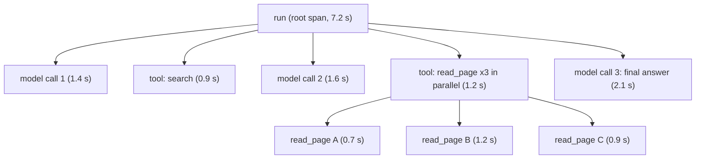

```callout-before
Before you start
You should be comfortable with the agent loop and the idea of a step: one model call, or one tool call. A trace is simply a recording of those steps, in order, with timings.
```

When an agent gives a wrong answer, the answer itself rarely tells you why. Was the retrieval poor, did a tool time out, did the model misread an observation at step 7, or did it run out of steps? To find out you need the whole journey. Think of a flight data recorder: nobody inspects a crash site to guess what happened when the recorder has already logged every control input and sensor reading in order.

A **trace** is that recording for one agent run. It is made of **spans**, each span describing one unit of work: its name, start time, duration, what went in, what came out and whether it succeeded. Spans nest, so a trace is a tree.

## Anatomy



Each span carries a handful of **attributes**:

| Span type | Useful attributes |
|---|---|
| run (root) | run id, user or tenant, task type, total tokens, total cost, outcome (done, stopped, error) |
| model call | model name, input tokens, output tokens, latency, stop reason, the prompt and response (or references to them) |
| tool call | tool name, arguments, result size, latency, error class, retry count, idempotency key |
| verification | what was checked, pass or fail |

A short JSON record for a tool span might be:

```json
{"trace_id": "t_81f2", "span_id": "s_07", "parent_id": "s_00", "name": "tool.search",
 "start_ms": 1400, "duration_ms": 900, "status": "ok",
 "attrs": {"args": {"q": "refund policy"}, "result_tokens": 640, "retries": 0}}
```

The `parent_id` links spans into the tree; `trace_id` ties together everything from one run, including spans written by different services or sub-agents. Passing the trace id from an orchestrator to its sub-agents (so that their spans appear under the same trace) is called **context propagation**, and it is what makes a multi-agent run readable as one story.

## Reading time from a trace

Spans give you attribution. Add up the model-call spans and tool-call spans and you see where the time went.

```steps
Worked example: where did the 7.2 seconds go?
The root span lasted 7.2 s. Its children run one after another: model 1.4 s, search 0.9 s, model 1.6 s, read_page 1.2 s, model 2.1 s.
---
Check the arithmetic: $1.4 + 0.9 + 1.6 + 1.2 + 2.1 = 7.2$ s. The children account for the whole run.
---
The three `read_page` calls ran in parallel with durations 0.7, 1.2 and 0.9 s. Their parent span lasts $\max(0.7, 1.2, 0.9) = 1.2$ s, not the sum (2.8 s). The slowest sibling is the **critical path**; speeding up the 0.7 s call changes nothing.
---
Model calls total $1.4 + 1.6 + 2.1 = 5.1$ s, or $71\%$ of the run; tools total $2.1$ s, or $29\%$. To make this run faster, look at the model calls first (shorter context, smaller model, fewer steps), not the tools.
```

The general rule: for sequential children the parent duration is the **sum**; for parallel children it is the **maximum**. Optimise the critical path.

## What a trace storage bill looks like

Traces that include full prompts and responses are large. If an average run produces $s$ KB of trace data and you run $N$ runs a day, daily volume is $N s$. For $N = 100{,}000$ and $s = 30$ KB, that is $3$ GB a day, or $90$ GB over 30 days. That is manageable, but it grows quickly with longer runs (remember the quadratic growth of context: recording each full prompt per call is where it gets large). Common remedies are to store prompts by reference or hash, to **sample** (keep all failed and slow traces, but only a percentage of successful ones), and to set a retention period.

## In practice

Instrument first, analyse later. Adding spans to an agent takes an afternoon; the first real failure that you can diagnose in two minutes from a trace instead of two days from guesswork pays for it. Use an established format (OpenTelemetry's concepts of traces and spans are widely supported) so that your agent's spans sit alongside the rest of your service's. And treat traces as **sensitive data**: they contain user inputs and tool outputs, so they need the same access controls and retention rules as the data they came from.

```quiz
{"q": "A parent span has three child tool spans that ran in parallel, lasting 0.5 s, 1.5 s and 1.0 s. How long does the parent span last (ignoring overhead)?", "options": ["3.0 s", "1.5 s", "1.0 s", "0.5 s"], "answer": 1, "explain": "Parallel children finish when the slowest does: max(0.5, 1.5, 1.0) = 1.5 s. 3.0 s is what you would get if they ran one after another."}
```

```quiz
{"q": "An agent platform runs 200,000 runs a day, each producing 25 KB of trace data. How much is stored per day?", "options": ["500 MB", "5 GB", "50 GB", "25 GB"], "answer": 1, "explain": "200,000 × 25 KB = 5,000,000 KB = 5 GB. Over a 30-day retention that would be 150 GB, which is why teams sample successful traces and store prompts by reference."}
```
