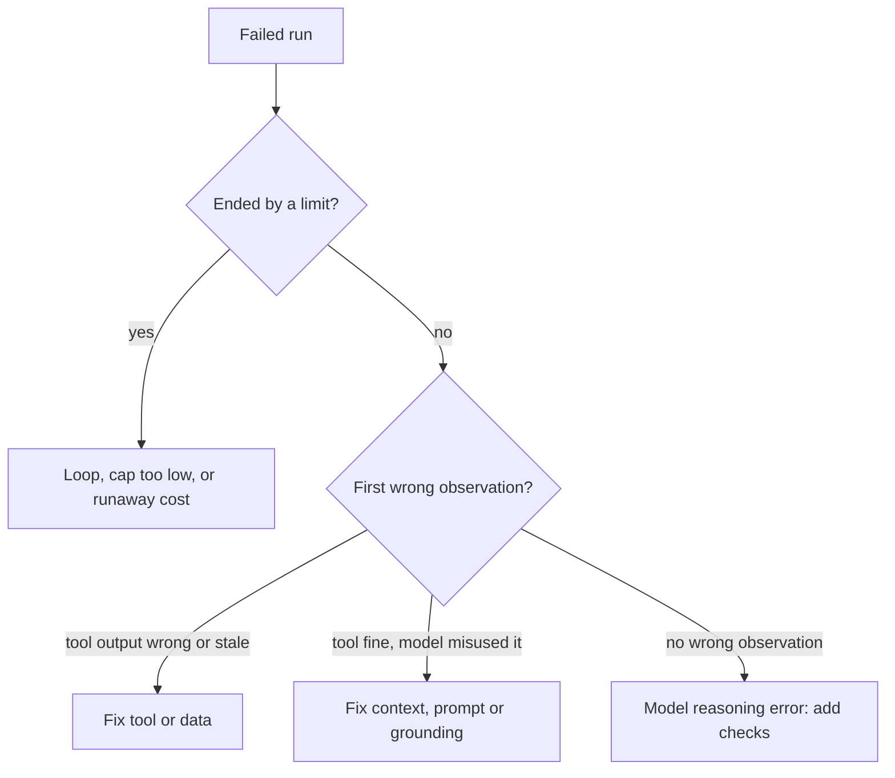

Having a trace is not the same as understanding it. A run with 25 steps has 25 model spans and as many tool spans, thousands of tokens each. Reading it top to bottom is slow and unreliable. A skilled reader instead asks a small sequence of questions that narrows down where the run went wrong, the way a mechanic works from symptom to subsystem.

Think of finding a leak in a pipe network. You do not inspect every metre. You check the pressure at a few points, find the segment where it drops, and look closely only there. Reading traces works the same way: find the first span whose output is wrong, then examine only the span before it.

## Five questions in order

1. **How did the run end?** Done, stopped by a limit (steps, budget, deadline), or errored? A step-cap ending points to loops or a too-hard task, not to a wrong final answer.
2. **Where did the time or tokens go?** Sort spans by duration and by tokens. One outlier span often explains a slow or expensive run.
3. **What is the first span with a wrong output?** Walk forward from the start and check each observation against ground truth. Everything before it is fine; everything after it may be a consequence.
4. **What did the model see when it made the bad decision?** Open the model span just after the first bad observation. Was the needed fact in the context? Was it in the middle of a long context? Did a truncated tool result hide it?
5. **Which category of failure is this?** Use the classes from the failures lesson: transient, permanent, semantic or silent. The category determines the fix.

## A worked diagnosis

```steps
A support agent told a customer the refund window is 14 days. The policy says 30.
The run ended normally (done, 6 steps, 7.2 s), so it is not a limit or an error. Question 1 rules out the loop and timeout stories.
---
Step 2 was `search("refund policy")`. It returned 3 results with 640 tokens in total; the first result is the page for the **old** policy (14 days), the second is the **current** policy (30 days), and the third is unrelated. First wrong-looking observation: the ranking put the stale page first.
---
Step 3 was a model call. In its context the old policy appears at the top and the current one directly below. The model chose the first. The context was short, so this is not an attention problem; the model had both and picked the one listed first with no way to tell which was newer.
---
Category: a **semantic** failure (the tool call worked, the content was misleading), caused by missing metadata. The fix is in the tool, not the prompt: include the `last_updated` date in each result and sort newest first.
---
Add this trace to the regression set with the expected answer "30 days", so the fix is tested and cannot silently return.
```

## Common patterns and what they usually mean

| What the trace shows | Usual cause |
|---|---|
| Same tool called with same arguments 3+ times | Loop: unhelpful result, no alternative; add loop detection and better error text |
| Run ends at the step cap with steady, varied progress | Cap too low for this task type; check the step distribution |
| One tool span far longer than the rest | Slow dependency; add a timeout, cache, or a cheaper alternative |
| Model ignores a fact present in the context | Fact in a long, noisy middle; compact or reorder, or move the fact to the state object |
| Arguments rejected by validation, then fixed on retry | Schema or description unclear; tighten the tool definition |
| Final answer contradicts a tool result | Model not grounded; require citing the result, add a check |
| Large result in an early step, then slow later steps | Context bloat from one big observation; prune or summarise it |

## Aggregating beyond a single trace

Reading one trace answers "what happened here". Aggregating many answers "what usually goes wrong". Tag each failed run with the first-bad-span category and count them. A tally of 200 failures like

| Category | Count | Share |
|---|---|---|
| Wrong or stale retrieval | 62 | 31% |
| Loop or no progress | 44 | 22% |
| Tool argument errors not recovered | 36 | 18% |
| Final answer ungrounded | 30 | 15% |
| Timeouts | 16 | 8% |
| Other | 12 | 6% |

tells you where effort pays. The two largest categories account for $62 + 44 = 106$ of $200$ failures, so $53\%$ of the problem; fixing retrieval ranking and adding loop detection removes more than half the failures before you touch anything else. This ranking by frequency is the same idea as the error analysis in the evaluation module.



## In practice

Build a small viewer or use your tracing vendor's: it should show the span tree, the prompt and response of any span, and token and time per span, with a filter for failed runs. Make it routine to read five failed traces a week as a team. Nothing else teaches what real failures look like as fast, and the patterns you find become the tests you should have had.

```quiz
{"q": "A trace shows the answer was wrong, and every tool observation in the trace matches the ground truth. Where is the fault most likely to be?", "options": ["The tools", "The model's use of correct information, such as misreading or ignoring it", "The network", "The tracing system"], "answer": 1, "explain": "If all observations are right, the information reached the model correctly. The fault is in how it was used: reasoning, attention to the relevant part, or grounding. That points to context, prompt and checks rather than tools."}
```

```quiz
{"q": "Of 150 failed runs, 45 had stale retrieval and 30 had loops. What fraction of failures do those two categories explain?", "options": ["30%", "50%", "20%", "75%"], "answer": 1, "explain": "(45 + 30) / 150 = 0.5. Prioritising the largest categories gives the most failures removed per unit of effort."}
```
