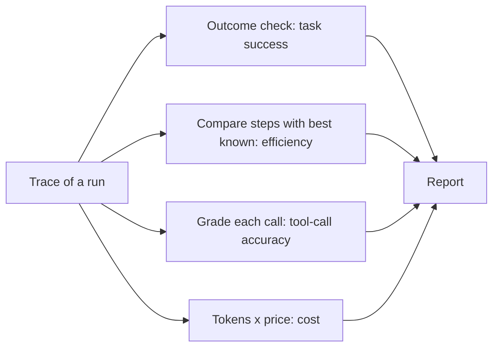

Evaluating a chatbot means judging one answer. Evaluating an agent means judging a **trajectory**: the whole sequence of thoughts, tool calls and observations that led to the answer. Two agents can both get the right result, one in 4 clean steps and one in 14 messy ones with three wrong tool calls. They are not equally good, and an evaluation that only checks the final answer cannot tell them apart.

A driving test works the same way. Reaching the destination matters most, but the examiner also notes whether you took a sensible route and obeyed the signs. An agent evaluation has three layers of scoring in the same spirit.

## The three core metrics

**Task success** is the headline: did the run achieve the goal? For $N$ tasks of which $S$ were completed correctly,

$$
\text{task success} = \frac{S}{N}
$$

Deciding what "correctly" means for each task is the hard part. Prefer checks on the **final state of the world** (the refund exists in the database, the file passes its tests, the booking has the right dates) over comparing text. Where only text exists, use a rubric, exact checks for key facts, or a model-based judge (evaluation module).

**Step efficiency** measures waste. If the best known solution uses $s^\star_i$ steps and the agent used $s_i$, then on run $i$

$$
\text{efficiency}_i = \frac{s^\star_i}{s_i} \in (0, 1]
$$

computed over successful runs only (a failed run has no meaningful efficiency). An efficiency of 0.5 means the agent used twice the steps it needed, which usually means twice or more the cost and latency.

**Tool-call accuracy** measures whether individual calls were sensible: the right tool, valid arguments, and arguments that match what the task needed. Over all calls in all runs,

$$
\text{tool-call accuracy} = \frac{\text{correct calls}}{\text{total calls}}
$$

A call counts as correct if it was the right tool with right arguments given what the agent knew at the time. Calls that were rejected by validation, repeated needlessly, or aimed at the wrong tool count against it.

```steps
Worked example: five recorded runs
Run 1: success, 6 steps (best known 4), 5 of 6 calls correct. Run 2: success, 4 steps (best 4), 4 of 4 correct. Run 3: failed, 12 steps (best 5), 6 of 12 correct. Run 4: success, 8 steps (best 5), 7 of 8 correct. Run 5: failed, 3 steps (best 4), 2 of 3 correct.
---
Task success: 3 of 5 runs succeeded, so $3/5 = 60\%$.
---
Step efficiency over the three successes: $4/6 = 0.667$, $4/4 = 1.0$, $5/8 = 0.625$. Mean: $(0.667 + 1.0 + 0.625)/3 = 0.764$.
---
Tool-call accuracy: correct calls $5 + 4 + 6 + 7 + 2 = 24$, total calls $6 + 4 + 12 + 8 + 3 = 33$, so $24/33 = 72.7\%$.
---
Reading together: success is only 60%; among successes the agent wastes about a quarter of its steps; and a quarter of all calls are wrong. The failed run 3 has 12 steps and only half its calls correct: the clearest target for inspection.
```

## Cost-aware metrics

Success alone ignores money. Combine it with cost:

$$
\text{cost per success} = \frac{\text{total cost over all runs}}{\text{number of successes}}
$$

An agent that costs 0.22 dollars per run with 72% success costs $0.22 / 0.72 = 0.31$ dollars per **successful** task. A cheaper agent at 0.10 per run with 40% success costs $0.10 / 0.40 = 0.25$, which is less per success but fails far more often. Which is better depends on what a failure costs you (a human fix, an angry customer). Report cost per success alongside the success rate, never alone.

## Other metrics worth tracking

| Metric | Why |
|---|---|
| Steps and tokens: median and 95th percentile | The tail finds loops and runaway runs |
| Stop reasons (done, step cap, budget, error) | Fraction ending at limits is a health signal |
| Recovery rate | Of runs that hit a tool error, the share that still succeeded |
| Unsafe-action rate | Attempted actions that violated policy, even if blocked (last lesson) |
| Latency end to end, p50 and p95 | User-visible speed |



## In practice

Start with task success and cost per success, which cannot be gamed by clever logging. Add step efficiency when you have a reference solution for each task; if you do not, use the median number of steps among successful runs as the benchmark. Grade tool calls by rules wherever possible (valid schema, expected tool for this task type) and use a judge only for the fuzzy cases. Always keep per-task results, not just the averages: the interesting part is which tasks fail.

```quiz
{"q": "An agent succeeded on 4 tasks using 5, 8, 6 and 12 steps, where the best known solutions need 5, 4, 6 and 6 steps. What is the mean step efficiency?", "options": ["0.50", "0.75", "0.88", "0.60"], "answer": 1, "explain": "Efficiencies: 5/5 = 1.0, 4/8 = 0.5, 6/6 = 1.0, 6/12 = 0.5. Mean = 3.0/4 = 0.75. Dividing total best steps by total actual steps gives a different, weighted figure (21/31 = 0.68); either is fine if you state which."}
```

```quiz
{"q": "Agent A: 0.30 dollars per run, 60% success. Agent B: 0.12 dollars per run, 20% success. Which has the lower cost per success?", "options": ["Agent A at 0.50", "Agent B at 0.60", "Agent A at 0.18", "They are equal"], "answer": 0, "explain": "A: 0.30 / 0.60 = 0.50 per success. B: 0.12 / 0.20 = 0.60 per success. A is cheaper per success and fails far less often."}
```
